# Claude Code Game Kit

Make games with Claude Code that hold together. Every project gets the same commands, tests and habits on any of nine
engines (eight tested against their real toolchains; RPG Maker MZ is an untested proof of concept), so Claude builds,
tests and checks your game instead of guessing. Free and open source (MIT).

**New to this?** Read **[START_HERE.md](START_HERE.md)**: install Claude Code and Python, open this folder in VS Code (or the Claude desktop app), open Claude Code and type **Start**. Claude interviews you about your game, writes a one-page game plan with you, then sets everything up. The steps below are the same thing done by hand.

## Made with the kit
One small game for every engine but LÖVE, plus a local-AI pair. Six were built using only what is in the kit, with bots that test their
main idea; every one comes with a step-by-step HOW_IT_WAS_MADE, including what went wrong. Click one.

<table>
<tr>
<td width="50%"><a href="examples/ghost-lantern/">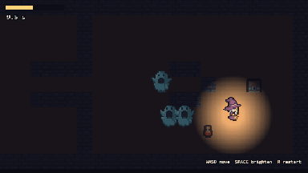</a><br><b><a href="examples/ghost-lantern/">Ghost Lantern</a></b>, Web 2D (Phaser)<br>Slip out of a crypt past ghosts that fear your lantern.</td>
<td width="50%"><a href="examples/courier-dash/">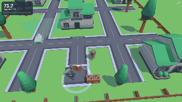</a><br><b><a href="examples/courier-dash/">Courier Dash</a></b>, Web 3D (Three.js)<br>Deliver parcels past a patrol robot you can read.</td>
</tr>
<tr>
<td width="50%"><a href="examples/scrap-tanks/">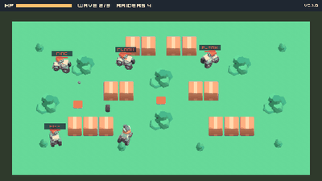</a><br><b><a href="examples/scrap-tanks/">Scrap Tanks</a></b>, C++ and SDL2<br>Tank brawl against raiders on a behavior tree.</td>
<td width="50%"><a href="examples/graveyard-shift/">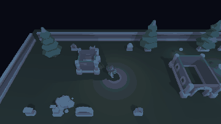</a><br><b><a href="examples/graveyard-shift/">Graveyard Shift</a></b>, Unity 6<br>Light the lantern or creep in the dark past NavMesh ghosts.</td>
</tr>
<tr>
<td width="50%"><a href="examples/rune-delve/">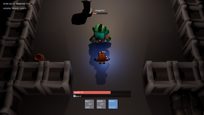</a><br><b><a href="examples/rune-delve/">Rune Delve</a></b>, Unreal Engine 5<br>Time your ward to the orc's swing: GAS spells, all C++.</td>
<td width="50%"><a href="examples/coyote-hop/">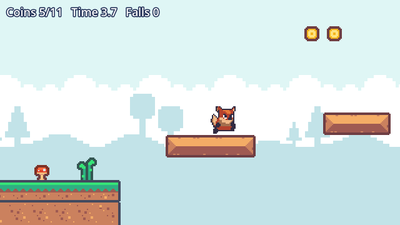</a><br><b><a href="examples/coyote-hop/">Coyote Hop</a></b>, Godot 4<br>A one-level platformer with a reachability-tested level.</td>
</tr>
<tr>
<td width="50%"><a href="examples/gatekeeper-godot/">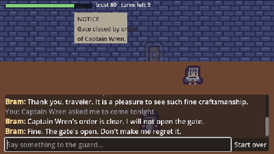</a><br><b><a href="examples/gatekeeper-godot/">Gatekeeper</a></b>, Godot 4 and Web<br>Talk past a guard run by a small AI model on your own machine.</td>
<td width="50%"><b><a href="examples/lockpick-mz/">Lockpick MZ</a></b>, RPG Maker MZ<br>A lockpicking minigame plugin: timing beats mashing.<br><i>Untested proof of concept: built without MZ, tested in Node and a browser, never run in the engine.</i></td>
</tr>
<tr>
<td width="50%"><a href="examples/crimson-nebula/">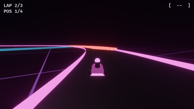</a><br><b><a href="examples/crimson-nebula/">Crimson Nebula</a></b>, Bevy (Rust)<br>Neon kart racing on a track that rewrites itself every lap.</td>
<td width="50%" align="center"><b>Your game next</b><br><br>Open this folder in VS Code, open Claude Code and type <b>Start</b>. <a href="START_HERE.md">START_HERE.md</a> walks you through it.</td>
</tr>
</table>

## Quick start

**1. Install the basics**
| Need | Get it | Check |
|---|---|---|
| Claude Code | [docs.claude.com/claude-code](https://docs.claude.com/en/docs/claude-code/overview) | `claude --version` |
| Python 3.8 or newer | [python.org](https://www.python.org/downloads/) (Windows: tick "Add to PATH") | `python --version` (`python3` on macOS/Linux) |
| Git | [git-scm.com](https://git-scm.com/downloads) (Windows: Git for Windows, Claude Code uses its Git Bash) | `git --version` |
| A game engine | First game and no strong preference? Use the **web** overlay (2D) or **web-3d** (3D): it needs only [Node.js](https://nodejs.org) 22.12+, the game runs in the browser, and `dev.py setup` installs the rest. Want a real engine with an editor? **Godot 4** is free, small and the easiest engine for Claude to read (its setup takes a few more steps). Not sure? Read `CHOOSING_AN_ENGINE.md` | Open it once (web: `node --version`) |

**2. Get the kit:** download this repo (Code > Download ZIP, then unzip) or `git clone` it.

**3. Make your game project** (run from the kit folder):
```
python scripts/new_game.py --name "My Game" --engine godot --dest ../my-game --git-init
```
Engines: `godot`, `web` (2D browser games: Phaser + TypeScript), `web-3d` (3D browser games: Three.js + TypeScript), `cpp-sdl2`, `unreal`, `unity`, `bevy` (Rust, Bevy 0.20; the first build compiles Bevy, 5 to 15 minutes), `love2d` (Lua, LÖVE 11.5: small 2D games as plain code, the lightest install), `rpgmaker-mz` (RPG Maker MZ plugins; an untested proof of concept, never run against MZ) (`--list-engines` shows them). Web projects: run `python tools/dev.py setup` once after scaffolding, from inside the new game folder. On macOS and Linux, type `python3` wherever these steps say `python` if `python` is not found. Engines without an overlay yet, and what one would take: `CHOOSING_AN_ENGINE.md`. Unity and Unreal: create the project in the engine first, then add `--adopt` (see "Already have a project?" below). RPG Maker MZ: scaffold, then, inside the game folder, `python tools/dev.py setup --from <a new MZ project>`.

**4. Check your setup:**
```
cd ../my-game
python tools/dev.py doctor
```
It tells you exactly what is missing (engine path, test framework, ...) and where the fix is described (`docs/ENGINE.md`).

**5. Start Claude Code in the project:**
```
claude
/start-session
```
Then open `docs/FIRST_HOUR.md` and follow it: pitch, pillars, a tiny vertical slice, and your first playable build.

Want to see results first? See **Made with the kit** above; every example has its own README and HOW_IT_WAS_MADE, and `examples/README.md` has the details.

## What you get in every project
- **One command contract**, the same on every engine: `python tools/dev.py check | test | smoke | build | run | clean | doctor`. Claude runs these instead of guessing flags, and a change is not done until `check` and `test` pass.
- **A lean `CLAUDE.md`** (project memory) plus docs Claude keeps up to date: game design doc, roadmap, handoff notes between sessions, architecture, asset log.
- **21 skills (slash commands):** `/start-session` `/end-session` `/new-feature` `/bug-hunt` `/stuck` `/playtest-report` `/asset-intake` `/gen-brief` `/dotwork` `/model-pipeline` `/adr` `/gdd-sync` `/next-tier` `/perf-pass` `/release-check` `/publish-repo` `/triage-issues` `/game-ai` `/procgen` `/game-feel` `/game-shell`.
- **5 subagents:** `code-reviewer` `build-doctor` `design-critic` `playtest-analyst` `researcher`.
- **23 short SOPs:** features, bugs, playtests, assets and licenses, git, releases, Claude Code hygiene, scope control, testing, performance, 3D, job plans and budgets, publishing to GitHub, game AI (enemies and NPCs), language models in games (cloud vs local small models, with a reality check on training your own), the 2D art pipeline, procedural generation (levels made at runtime that are proven fair), game feel, the shell (menus, settings, saves, rebinding, localization), accessibility, shipping on Steam and itch, balancing and economy, and marketing.
- **Guardrails:** permission rules that block reading secrets and ask before destructive commands; a session hook that loads the handoff notes.
- **Resource lists** for music, SFX, art, fonts and AI tools, each with license caveats, and an **evidence ledger** that grades every sourced claim by how well it is backed (`docs/EVIDENCE.md`).
- **Tools:** health check, doc link checker, publish pre-flight (secrets, personal data, license), asset intake with license logging, a read-only second opinion from another AI model (`second_opinion.py`, Kimi Code CLI), a read-only GitHub Issues reader that fences player reports off as untrusted text (`issues.py`, with Bug and Feel issue forms), YouTube transcript grabber, chroma-key for AI sprites, GIF maker, a retro sound-effect synth and a chiptune renderer (text patterns to a seamlessly looping WAV), an opt-in ElevenLabs client (sound effects and music with your key, logged with your plan's license), a Fish Audio text-to-speech client (balance, voice search, lines), a WAV helper that normalizes and makes any download loop seamlessly, GIMP batch processing, Inkscape SVG export, and Blender scripts that validate models, prepare them for export (pivot, transforms, LODs) and render them into sprite sheets.

## Make it yours: profiles
By default projects get neutral wording and no file footer. To add your name, a footer line on new source files, and your own working-style rules for Claude, copy `profiles/default.json`, fill it in, and pass it:
```
python scripts/new_game.py --name "My Game" --engine godot --dest ../my-game --profile profiles/mine.json
```
`profiles/example.json` shows a filled-in one. Details: `profiles/README.md`.

## Already have a project?
Add `--adopt`. It never overwrites anything: a file that differs gets a `<file>.gold` copy next to yours (engines ignore it) so you can merge by hand. Preview with `--dry-run`.
- **Godot:** your `project.godot` stays; copy the `[autoload] Log=...` line from `project.godot.gold`, print `BOOT_OK` from your main scene, install GUT. Full steps: the "Adopting an existing project" section of the Godot flow guide.
- **C++/SDL2:** you get `CMakeLists.txt.gold` and `CMakePresets.json.gold`. `dev.py` needs presets named `debug` and `release` (binaryDir `build/<preset>`), the exe in `build/<preset>/bin/`, and a `--smoke N` flag that prints `BOOT_OK`. Easiest path: merge the presets, keep your CMakeLists.
- **Unreal:** adopt writes docs, `dev.py` and `.gitattributes` (check LFS before the next commit). Set `UE_ROOT`.
- **Unity:** adopt writes docs, `dev.py`, test assemblies and a build script. Set `UNITY_EDITOR`.
- **RPG Maker MZ:** a plain scaffold into a new folder (no `--adopt`), then move your MZ project into its `game/` folder
  (the editor's Deployment then exports the game, not the kit **(verify)**). Name your own plugins in `OWN_PLUGINS` at the top of the game's dev.py.
- Always: merge your old `CLAUDE.md` with `CLAUDE.md.gold`. The kit's one imports `docs/HANDOFF.md` and `docs/ENGINE.md`.

**Kit updated since you scaffolded?** Run `python scripts/new_game.py --dest <your game folder> --upgrade`: it takes the name, slug and engine from the game's `.game-kit.json` (a different `--engine` is refused, a different `--name` or `--slug` too unless you add `--rename`), replaces kit files you never edited (tracked by content hashes in `.game-kit.json`), writes `.gold` copies only where you changed something, and leaves out kit files you deleted.

## Putting your game on GitHub
Run `/publish-repo` in the project. It follows `docs/sop/SOP-13-publish-to-github.md`: pick a license (code and assets can differ), check that every asset may be redistributed, scan for secrets and personal data (`tools/publish_check.py`), create the repo private, lock it down (branch ruleset, secret scanning, two-factor), and only then make it public.

## How the kit is laid out
```
core/                     copied into every game
  CLAUDE.md               lean project memory (imports docs/HANDOFF.md and docs/ENGINE.md)
  .claude/                settings.json, skills/, agents/, SessionStart hook config
  docs/                   FIRST_HOUR, GDD, ARCHITECTURE, ROADMAP, HANDOFF, STYLE, BRIEFS, CONCEPTS, VERTICAL_SLICE, ASSET_LOG
                          RESOURCES (index) + resources/, EVIDENCE (ledger) + evidence/ (raw notes), sop/, adr/
  tools/                  doctor.py, check_links.py, publish_check.py, yt_transcript.py, art/chroma_key.py,
                          blender/validate_asset.py, bozzetto/ (3D models on your GPU), hooks/session_context.py
                          (each with its exam where testable)
engines/<id>/             engine.json, ENGINE.md, FLOW.md, gitignore.append, settings.patch.json, skeleton/
engines/_template/        copy this to add GameMaker, Roblox, Defold, etc.
profiles/                 author, footer and working-style presets for new_game.py --profile
scripts/new_game.py       the scaffolder (new, --adopt, --upgrade, --dry-run)
scripts/codename.py       a random placeholder name for a new game (Project_Cobalt_Wyvern)
examples/                 games made with the kit, each with HOW_IT_WAS_MADE.md (all rights reserved, free to reference)
media/gallery/            the README's example thumbnails (one frame of each example's GIF)
workflows/                experiments and showcases outside the scaffold (local-pixel-art, wavesmith-showcase,
                          bozzetto-showcase, picture-to-game)
CHOOSING_AN_ENGINE.md     which overlay to pick
CHANGELOG.md              what changed and why
DISTILL_PROMPT.md, DISTILL_GOAL.txt, DISTILL_REPORT.md   how the kit's evidence was cleaned up (the report: rules, open claims, experiments)
PROCGEN_PROMPT.md, PROCGEN_GOAL.txt                      the brief and /goal line that built /procgen and SOP-17
```

## What was tested and what was not
Being straight about it, because it matters for trust. Everything below was run on Windows 11 unless noted.

| Piece | Status |
|---|---|
| Scaffolder: all 9 engines, dry-run, `--adopt`, `--upgrade` (hash-based), idempotent re-run, profiles, error paths, placeholder resolution | Tested (Windows, and Linux for the earlier version) |
| `tools/doctor.py`, session hook, settings JSON merge | Tested |
| Godot `dev.py` (`import`, `check`, `test`, `smoke`, `clean`, `doctor`) | Real Godot 4.7.2 with GUT 9.7.1, including planted failures. `build` exports Windows, Linux and Web from the shipped `export_presets.cfg` (the exported exe boots); `run` opens the game (`BOOT_OK` in Godot's log); `smoke --screenshot` and `--record` capture from a real window (a moving test node: 30 frames, the box advanced about 64 px per 6 frames, GIF made) |
| C++/SDL2 overlay (CMake presets, vcpkg, doctest, `dev.py`) | VS 2022 Build Tools (MSVC 14.44), bundled CMake and vcpkg, SDL2 2.32.10: `check`, `test`, `smoke` (including `--until`, `--fail-on`, `--screenshot`, `--record` and game options after `--`), release `build`, `clean`, with planted failures. Example game `examples/scrap-tanks` (SDL2_image, SDL2_ttf, SDL2_mixer via vcpkg). `run` (Scrap Tanks booted in a window). Linux/macOS **not** tested |
| Unity overlay (`dev.py`, `GameKitBuild.cs`, asmdefs, EditMode tests, PlayMode boot smoke) | Unity 6000.6.6f1: `doctor`, `check`, `test`, `smoke` (including `--until`, `--fail-on`, `--screenshot`, `--record`), `build`, `exec`, `clean`, with planted failures. Example game `examples/graveyard-shift` (AI Navigation 2.0.16; its built player replays a test night exactly). `run` launches the editor; on the test machine the GUI editor waited at Unity licensing (Hub sign-in), so a loaded editor is **not** confirmed. Batchmode commands are unaffected |
| Web overlay (Phaser 4.2, TypeScript 7, Vite 8, Vitest 5, Playwright 1.64) | Node 26 on Windows: `setup`, `check`, `test`, `build`, `smoke` in headless Chromium, `clean`, `doctor`, with planted failures (type error, failing test, no tests, boot exception, `Log.error`, missing asset as HTTP 404). `run` (the dev server serves a game that logs `BOOT_OK`) |
| Web 3D overlay (Three.js r186, same tooling as web) | Node 26 on Windows: `setup`, `check`, `test`, `build`, `smoke` (renders real frames in headless software WebGL), `doctor`, with planted failures (frame-loop exception, renderer failure); re-adopt and upgrade clean. Example game `examples/courier-dash`: its scenario pair passes in headless Chromium and in Vitest. `run` (dev server; the game renders and logs `BOOT_OK`) |
| Unreal `dev.py` | UE 5.8: `check`, `test`, `smoke` (including `--until`, `--fail-on`), `package`, `exec` (editor Python), `clean` on a C++ project with planted failures; example game `examples/rune-delve` (GAS, AI Perception, content from a headless script); `check` and `test` on a Blueprint-only project. `run` (opens the editor) and `genproj` on Rune Delve; Blueprint-only `package` **not** verified |
| Bevy overlay (Bevy 0.20, Rust 1.99.1, cargo, `dev.py`) | Windows 11 with VS 2022 Build Tools (MSVC): `doctor`, `check` (rustfmt, clippy), `test` (12 unit and 4 headless App tests), `smoke` (headless, `--until`, `--fail-on`, game options after `--`, `--screenshot` and `--record` in a window), release `build` (the exe ran from a clean folder), `run` (window on Vulkan), `clean`, with planted failures (compile error, failing test, unformatted code, `error!` at boot, panic, bad game option). Example game `examples/crimson-nebula` (a full headless race to `RACE_OVER`, `--record-from` for its GIF, `run` in a window). Linux/macOS **not** tested; web (WASM) builds not wired |
| LÖVE overlay (LÖVE 11.5, `dev.py`, `tests/runner.lua`, `tools/lovecheck`) | LÖVE 11.5 (the official Windows zip): `doctor`, `check` (compiles every .lua with LÖVE's LuaJIT), `test` (the bundled runner; a planted failing test exits 1, no tests exits 2), `smoke` (an off-screen window and `--headless`), `--screenshot`, `--record`, `build` (a .love and a fused Windows exe with LÖVE's DLLs, which boots), `clean --yes`, options before and after the subcommand; planted syntax errors in main.lua, conf.lua and a required module and a runtime error each exit 1 within about a second. macOS and Linux packaging not run |
| `tools/golden_vectors.py`, `data/golden/*.json` | The reference for the juice and shell logic; exam 19/19 on Python 3.8 and 3.14, which write byte-identical vector files; every engine port's tests check these files |
| Juice and shell logic ports (`SOP-18`, `SOP-19`) | Each port's tests load `data/golden/juice.json` and `shell.json` and check every case (41 cases): Bevy 55 tests (cargo), C++/SDL2 26 CTest tests with 598 assertions (Debug and Release, MSVC), Unity 95 EditMode tests (6000.6.6f1), Unreal 55 automation tests in the GameKitShell plugin (UE 5.8, a C++ project; 70 in a Blueprint-only project in 0.8.3, where `check` builds the plugin; enabling it from the editor's Plugins window not tested), Godot 48 GUT tests (771 asserts, Godot 4.7.2 and GUT 9.7.1), LÖVE 94, web 86 and web-3d 89 (Vitest); the Godot, LÖVE and web shells also passed their scripted runs (headless Chromium for web) (`--drive menus` changed the settings file, `--drive crash` wrote a crash file, the pseudo-locale run checked 258 labels (web, the same on every run) and a planted clipped label failed, `--compare`, no telemetry file without consent); each also passes `check` and `smoke`, and the Bevy, C++ and Unity agents planted vector changes that their tests caught |
| Audio, music and access logic ports (`data/golden/audio.json`, `music.json`, `access.json`, owned by Wavesmith) | Each engine's tests check every case of the three files: web 106 and web-3d 109 tests (Vitest), Godot 60 GUT tests, LÖVE 122, Unity 214 EditMode tests (in `examples/graveyard-shift`'s project), Bevy 27 golden and 6 headless tests, C++/SDL2 29 CTest tests, Unreal 68 GameKit automation tests (plugin on), RPG Maker MZ 25 Node tests (verify in MZ); Godot and LÖVE also play music and draw caption arrows in their shells; Unity's AudioEventPlayer runs in 3 PlayMode tests (takes, ducking, sliders), its MusicPlayer is compiled and tested but not run in Play mode |
| `tools/image_diff.py` (visual regression), `tools/credits.py` | Exams 8/8 and 8/8 on Python 3.8 and 3.14; credits.py built CREDITS.md and THIRD_PARTY_LICENSES.md in a scaffolded game |
| `.github/workflows/ci.yml` | Parsed as YAML and its engine dispatch reviewed; **not yet run on GitHub** (verify on the first push) |
| `.github/workflows/audio.yml` (Wavesmith on Linux, Windows, macOS; one copy in every game, one for the kit itself with `core/` paths) | Both parsed as YAML. Its commands pass on Windows 11 (Python 3.8, 3.9, 3.12, 3.13) and inside a web game scaffolded on Linux (Ubuntu 26.04 in WSL, Python 3.14): every Wavesmith exam, the three golden checks, zero broken references. macOS **not** tested here; the workflow **not yet run on GitHub** |
| RPG Maker MZ overlay (`dev.py`, `smoke.mjs`, `serve.mjs`, the plugin pair, `mzFake.js`) | **Not run against RPG Maker MZ** (not installed when it was built, 2026-10-23). Node 26 on Windows: `check` (five planted faults caught), `test`, `doctor`, `clean`, adopt; `setup --from`, `smoke` (headless Chromium) and `build` against a fake MZ project made of stand-in core scripts. The editor's side (annotations as the Plugin Manager reads them, `js/plugins.js` format, Deployment, `run --editor`) is marked (verify) |
| `examples/lockpick-mz` | 37 Node tests (rules, the bot pair over 40 seeds with sloppy copies, the glue against MZ stand-ins); `smoke --query autoplay --until LOCK_OPEN` and the masher's `LOCK_JAMMED` against the fake MZ. Untested proof of concept: never run in real MZ |
| `tools/check_links.py`, `tools/publish_check.py` | Exams 11/11 and 16/16 (gitleaks 8.30.1 clean on a fresh game with the shipped `.gitleaks.toml`), and zero broken references in all 9 scaffolded engines |
| `tools/art/chroma_key.py` | Exam 14/14 on synthetic images, not yet on real AI sprites |
| `tools/art/pixel_sprite.py` (first art drawn in code) | Exam 13/13 (standard library only): the reference hero's atlas, malformed PNGs refused cleanly, mirrored rows, the JSON layout, the PNG round trip; the first-art floor passes the hero and fails a dot, a flat circle and a one-color box. The ported hero matches the original Pillow script pixel for pixel (32 frames, 0 differences). Not yet run inside a game build by an engine |
| `tools/second_opinion.py` | Exam 26/26 offline (canned CLI results, plus real processes for the timeout); live with Kimi Code 2.3.0 on K3: a read-only review of the kit's Godot export change found a real stale claim, and a request to write a file failed for lack of a tool. Other vendors' CLIs not supported yet |
| `tools/issues.py` and `/triage-issues` (GitHub Issues) | Exam 17/17 offline (canned gh output): hidden-character cleaning (ANSI, bidi, zero-width, tag and variation-selector smuggling), a forged end marker stays inside the fence, spam-hidden comments skipped, links listed and never opened, gh failures mapped to exit codes, only read-only gh commands ever run. Live, read-only, against a public repo (cli/cli, gh 2.102.0): `check`, `list`, `show`. The issue forms parse as YAML; not yet seen rendered on GitHub, and the skill has not yet triaged a real game's issues |
| `tools/audio/wavesmith/sfx_synth.py`, `tools/audio/wavesmith/chiptune.py` | Exams 11/11 and 12/12 (pitch, timing, loop points, recipes, bad song numbers); every sound and the music in `examples/coyote-hop` made with them, the theme's loop picked up by Godot 4.7.2's default WAV import, notes checked by FFT against the song file. Sound quality is a human call: listen |
| `tools/art/pixellab.py` (PixelLab pixel art) | Exam 48/48 offline (a redirect test runs two local servers) against canned responses built from PixelLab's OpenAPI spec (v2, read 2026-10-24): job and resource polling, PNG/GIF/TTF/zip checks, download links never get the token, the token never written. Live (2026-10-24): `check`, one 16 px `character --legacy`. Live (2026-10-26): `prop`, `vfx`, `iso-tile`, `tileset --kind sidescroller`, `edit`, `fix reduce-colors`. Live (2026-11-04): `image`, a 32 px v3 `character`, `animate`, `animate-character --mode skeleton-v3`, top-down `tileset`, `ui`, `font`, a 1-direction `object` (16 candidates), `pixelate`, every `fix` op (lite normal map), `fetch`. Not yet live: `tiles-pro`, `outfit` |
| `tools/art/comfy_local.py` (local ComfyUI) | Exam 39/39 offline against a stand-in ComfyUI server on 127.0.0.1: local-only rule, API vs UI workflow format, `--set`/`--seed`/`--image`, missing nodes, rejected and failed jobs (out-of-memory hint), embedded-workflow stripping, no overwrite, hostile file names, ASSET_LOG rows with a non-ASCII prompt, 3D outputs (`.glb` saved with the glTF extras removed). Live: `check` and `check --workflow` on ComfyUI 0.43.0 with five SpriteKiln workflows; `run` of a FLUX.2 klein picture (10 s) and of Bozzetto's TRELLIS.2 workflow (a textured `.glb`, 506 s cold) |
| `tools/audio/wavesmith/` (Wavesmith: the audio tool; `wavesmith.py list` names every subcommand) | 20 exams, 334 tests, all standard library only and offline except the REAPER live exam, which skips without `REAPER_BIN` (`wavesmith.py test`, about 4 minutes; Python 3.8, 3.9, 3.12 and 3.14, and on Linux in WSL); WAV, FLAC and OGG Vorbis read with nothing installed, MP3, Opus and AAC through ffmpeg when it is installed. Live on one machine (RTX 5060 Ti 16 GB): loudness against pyloudnorm and ffmpeg on 815 files; sound events, the typewriter and subtitle timing, bus sliders, mono downmix and sample-exact music transitions in headless Chromium; the events, music and access vectors in all nine engines (below); sound sets rendered with Stable Audio 3 and checked clean; one designed voice in five languages scored with Whisper. Each proof is in `docs/resources/audio.md`. Sound quality is a human call: listen |
| `tools/art/dotwork/` (local pixel-art pipeline on ComfyUI, Godot first) | Exam 198 tests offline, the lane exams included (about a minute, a stand-in ComfyUI server; Python 3.8, 3.9, 3.12 and 3.14, Pillow + numpy). In a freshly made Godot 4.7.2 game: the code-drawn `ui` example packs 76 files with `--engine none` and 102 with Godot (`verify` loads its 30 resources and passes the game's smoke), and the `screen` (transitions, weather) and `status` examples verify too (79 resources in all). The model lanes ran live on one machine (RTX 5060 Ti 16 GB) while Dotwork was built, and in a test project `verify` loaded 48 resources including animated characters and spells. The 0.8.1 lanes (UI kit, store art, screens, capture, CJK and Latin fonts, 2.5D diorama, VFX, animation polish, lighting, `qa pack`) each verified in a fresh Godot game; the Aseprite (1.3.18) and Pixelorama (1.2.3) round trips change no file without an edit and carry an edit back with its provenance. Reviewed before the port (correctness, security, kit readiness, art QA); open art flaws in `KNOWN_ISSUES.md`. Other GPUs, Linux/macOS and engines other than Godot (beyond `--engine none` PNGs, issues #55 to #62) untested |
| `tools/bozzetto/` (Bozzetto: local 3D models, TRELLIS.2 on ComfyUI, Blender cleanup) | Exam 32/32 offline (a stand-in ComfyUI and a canned mesh; Python 3.8 and 3.14, the Blender part on Blender 5.2.3 and on the `bpy` module under Python 3.13). Live on one machine (RTX 5060 Ti 16 GB): a prop from a prompt (465 s, 13.9 GB VRAM peak, 2,697 triangles, budget passed) and a character (see the showcase); both loaded in a scaffolded Godot 4.7.2 game (import, `check`, `smoke`, a GUT test measuring height and pivot) and by Three.js's GLTFLoader in the web-3d smoke. Unity, Unreal and Bevy imports **not** tested (their ENGINE.md notes say verify); no rigging; other GPUs, Linux and macOS untested |
| `tools/audio/wavesmith/eleven_audio.py`, `tools/audio/wavesmith/wavfile.py` | Exams 21/21 offline (canned API, the key never written) and 7/7 (also reads the 32-bit WAV Godot's movie writer records); live: `check`, MP3 and WAV effects, a looping ambience, all of `examples/graveyard-shift`'s sound. Music returned HTTP 402 ("not available", a service limit), so the music path is tested offline only. Three bugs found live and fixed (stereo PCM, the 402 message, header names) |
| `tools/audio/wavesmith/daw.py`, `tools/audio/wavesmith/midifile.py` (the DAW round trip) | Exams 39/39 (4 of them live) and 5/5 on Python 3.8 and 3.14; live with REAPER 7.84 (evaluation) on Windows 11: a sound set, a folder of UI sounds and chiptune stems written as `.rpp` projects and rendered back headless (about 15 s a render, a throwaway settings folder, the user's REAPER settings untouched); an untouched round trip changes 0 bytes, an edited sound comes back at its bus level with an ASSET_LOG row "Modified? yes". The stems route ran with stand-in renders, not a real FL Studio, Ableton or Audacity session; REAPER on macOS and Linux **not** tested |
| `tools/audio/wavesmith/fish_tts.py` | Exam 13/13 offline; live: `check`, `voices --licensed`, a free-model line (4.8 s of clean mono speech). The runtime voice in `examples/gatekeeper-godot` spoke 5 lines live (about 2 s each), then from cache; bad key and no key both leave the game playable |
| `tools/art/gimp_batch.py`, `tools/art/svg_export.py` | Exams 13/13 against GIMP 3.2.6 and 12/12 against Inkscape 1.4 on Windows; macOS and Linux binary names unverified |
| `tools/blender/render_sprites.py`, `prep_export.py` | Exams 24/24 and 23/23 with the `bpy` 5.2.2 module; a Kenney CC0 character rendered into an 8-direction walk sheet, and every sprite of `examples/scrap-tanks` (32-direction hulls and turrets at one shared scale) |
| `/procgen` and SOP-17 (procedural generation) | Worked example: `examples/graveyard-shift` generates a new irregular yard (main body plus wings) each night (Unity 6000.6.6f1). EditMode property test over 250 night seeds (0 problems, 0 fallbacks), footprints checked against the meshes, pinned yards identical in Unity's Mono and .NET 8; PlayMode: the walk grid checked against the real NavMesh on 9 yards, no way out of the yard, every difficulty, the bot trio on the hand-made yard and on 8 generated nights at Easy (careful escapes 5 of 8, always lit 0), and at Normal logged. The skill itself has not yet been run on a fresh game by a new user; IL2CPP builds not checked |
| Local AI examples (`examples/gatekeeper-*`) | Real model runs on Windows with an RTX 5060 Ti: WebLLM in headed Chromium (0.5 to 1 s per reply), NobodyWho in Godot 4.7.2 (about 190 ms, 93% on a 14-line eval). Other GPUs, CPU-only and other browsers untested |
| `tools/blender/validate_asset.py` | Exam 24/24 with the `bpy` 5.2.2 module and inside Blender 5.2.2. FBX checked on the Kenney Graveyard Kit models of `examples/graveyard-shift`, OBJ on Kenney Mini Dungeon models. Ready for Blender 6 (no `use_nodes`). bpy wheels lag new Python releases: `uv run --python 3.13 --with bpy python tools/blender/validate_asset.py ...` |
| `tools/yt_transcript.py` | Live YouTube: captions API, yt-dlp subtitles, `--whisper` on CPU and CUDA with fallback |
| Claude Code config shapes (hooks, permissions, skill and agent frontmatter) | Confirmed live in a scaffolded project with Claude Code 2.1.302 (headless): the SessionStart hook runs and injects HANDOFF and ROADMAP, a deny rule blocks a Read of `.env`, and the `code-reviewer` subagent runs. Allow rules apply once the folder is trusted (the interactive trust prompt); `/hooks` and `/permissions` views not checked |

Everything known to be broken, flaky or never tried, kit and examples, is listed in `KNOWN_ISSUES.md`.
Items marked **(verify)** in the docs are the places most likely to need a tweak on first use. `DISTILL_REPORT.md` keeps the enforced rules, the outside claims still unproven and the experiments that would test them.

## Experimental: local pixel art (ComfyUI)
An experiment in making pixel art on your own GPU instead of a paid service: ComfyUI with the SpriteKiln node pack,
FLUX.2 klein 4B and Qwen-Image-Edit, a refine step and an Aseprite palette lock. Tested on one machine (RTX 5060 Ti
16 GB, Ryzen 7 5700G, 64 GB RAM, Windows 11).

| Asset | Time | Verdict |
|---|---|---|
| Characters, props, icons, UI pieces, isometric pieces (klein + a style collage + a refine step) | about 16 s each | Usable; portraits need a better prompt |
| Seamless 128 px terrain; corner autotiles | about 16 s; under 1 s | Usable. Plain 32 px AI tiles are noise |
| Rotation, 4 directions (Qwen); edit, inpaint, normal map | 138 s; 13 to 16 s; 3 s | Usable |
| Animation sets: idle, walk, kick in 4 directions, into a Godot SpriteFrames (Wan 2.2) | about 1.7 min per clip, 16 min per set | Good; scale and palette hold |
| Effects: fireball, explosion, muzzle flash, heal, steam; casting and firing poses | about 2 min per clip | Good to excellent with an effect-only prompt |
| Whole-scene maps | about 13 s per draft | Angle and scale drift; backdrops only |

The scripts became one tool that ships in every game, Dotwork (`tools/art/dotwork/`, opt-in): a JSON spec in; Godot
SpriteFrames, TileSets and painted maps, prop, effect and 9-slice scenes, pixel fonts and a manifest for the asset log
out, checked by loading every asset in the game. A proof that local generation is viable, not finished art: the
sprites still want review and some hand polish. Setup, models (15 to 33 GB per tier) and every lane:
[core/tools/art/dotwork/README.md](core/tools/art/dotwork/README.md).

Its audio sibling is Wavesmith (`tools/audio/wavesmith/`, in every game): one front door, `wavesmith.py`, for
loudness and the whole-mix check, sound events and adaptive music as data that every engine plays the same way,
sound sets, dialogue subtitles and captions, voices on your own GPU and sound made from code, and a round trip
through a DAW (`wavesmith.py daw`: a REAPER project rendered back headless, or stems, MIDI and markers for any other
DAW), so a sound edited by hand comes back levelled and logged. Every subcommand:
[core/tools/audio/wavesmith/README.md](core/tools/audio/wavesmith/README.md).

The 3D sibling is Bozzetto (`tools/bozzetto/`, in every game): `bozzetto.py make <name> --image <picture>` or
`--prompt "..."` makes a textured mesh with TRELLIS.2 in the same local ComfyUI, cleans it in Blender, fits it to the
SOP-11 budget for its class, and only then puts the `.glb` in the game, logged. About 5 minutes a model on a 16 GB
card; the hidden sides are invented and characters come out unrigged, so treat the results as drafts. Setup and
limits: [core/tools/bozzetto/README.md](core/tools/bozzetto/README.md); a prop and a character from prompt to
engine, failures included: [workflows/bozzetto-showcase](workflows/bozzetto-showcase/README.md). One picture each
to a tree in a grove and a character that walks, waves and idles in Godot (auto-rigged with UniRig, animation written
by Claude): [workflows/picture-to-game](workflows/picture-to-game/README.md).

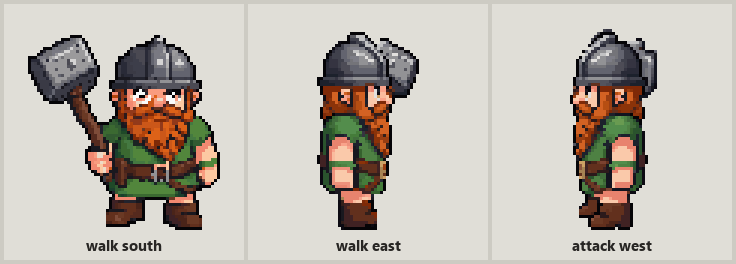

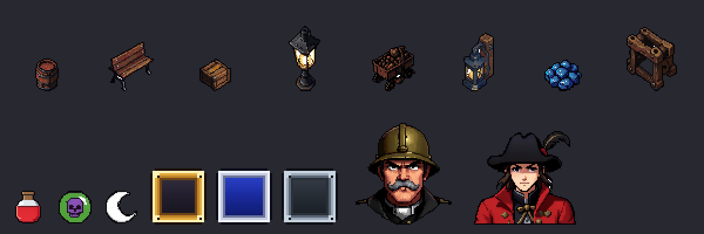

Host specs, every benchmark, screenshots and lessons: [workflows/local-pixel-art](workflows/local-pixel-art/README.md).
How a game uses it: SOP-16 "Generating pixel art locally".

## Wavesmith showcase (audio)
What Wavesmith makes and checks, rebuilt by one script from Wavesmith commands: effects and a loop made from code,
adaptive music as the engines play it, voices made on your own GPU with the typewriter and subtitles timed to them,
and the loudness of every asset and of the whole mix.

**Listen (plays in the browser, phones included):**
[sound from code (video)](https://cdn.jsdelivr.net/gh/Er2oneousbit/claude-code-game-kit@526a8a6/workflows/wavesmith-showcase/media/wavesmith_code.mp4) ·
[adaptive music (video)](https://cdn.jsdelivr.net/gh/Er2oneousbit/claude-code-game-kit@526a8a6/workflows/wavesmith-showcase/media/wavesmith_music.mp4) ·
[voices and dialogue (video)](https://cdn.jsdelivr.net/gh/Er2oneousbit/claude-code-game-kit@526a8a6/workflows/wavesmith-showcase/media/wavesmith_dialogue.mp4) ·
[a voice line](https://cdn.jsdelivr.net/gh/Er2oneousbit/claude-code-game-kit@526a8a6/workflows/wavesmith-showcase/media/voice_guide_1.mp3) ·
[the chase loop](https://cdn.jsdelivr.net/gh/Er2oneousbit/claude-code-game-kit@526a8a6/workflows/wavesmith-showcase/media/chiptune_chase.mp3) ·
[every sound](workflows/wavesmith-showcase/README.md#listen).
GitHub serves repository files as downloads, so these go through jsDelivr, a free CDN that serves them as audio and video.

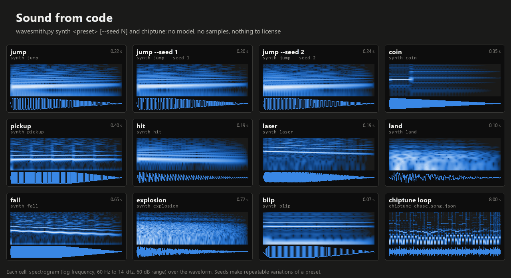

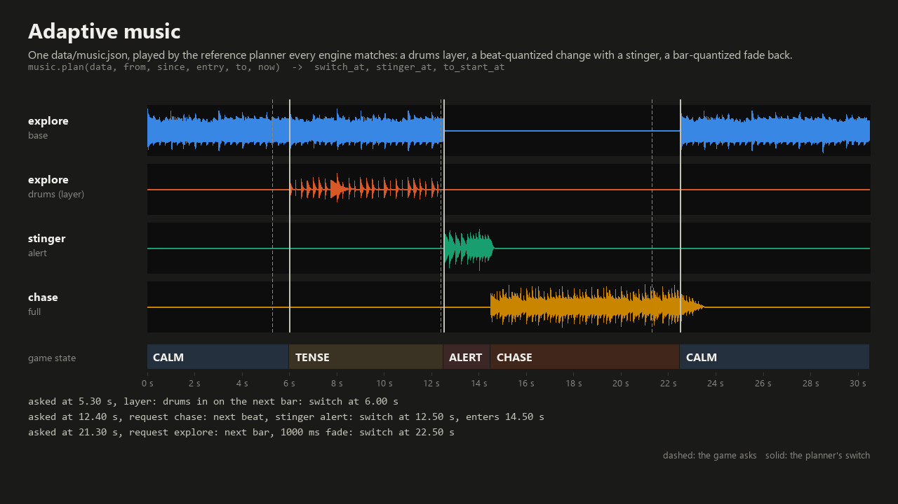

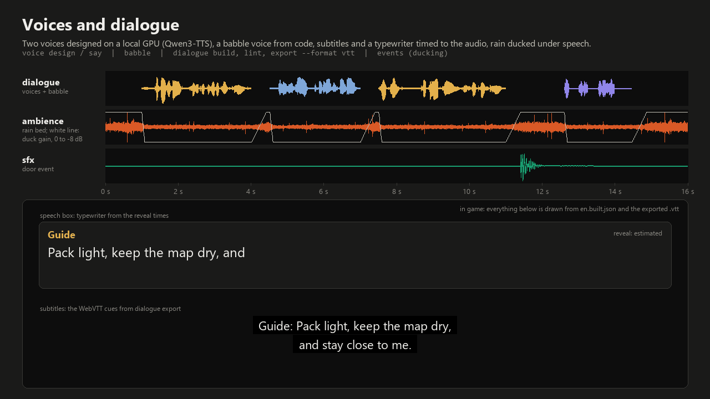

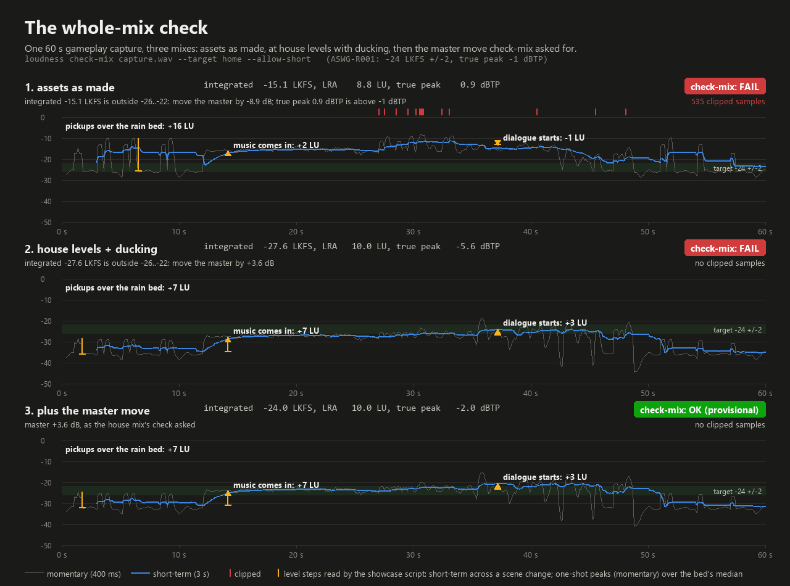

The same three clips with sound are MP4s in [workflows/wavesmith-showcase/media](workflows/wavesmith-showcase/media)
(`wavesmith_code.mp4`, `wavesmith_music.mp4`, `wavesmith_dialogue.mp4`). Commands, timings, credits and licences:
[workflows/wavesmith-showcase](workflows/wavesmith-showcase/README.md).

## Extending the kit
- New engine: copy `engines/_template`, follow its README. No scaffolder changes needed.
- New skill: `core/.claude/skills/<name>/SKILL.md`. New subagent: `core/.claude/agents/<name>.md`.
- Your favorite resources: add them to the matching file in `core/docs/resources/`.
- New video or source worth keeping: summarize it in `core/docs/evidence/video-notes.md`, add an `E##` row to `core/docs/EVIDENCE.md`, and change a SOP only if the finding reaches grade B.
- Placeholders in any text file: `{{GAME_NAME}}` `{{GAME_SLUG}}` `{{ENGINE}}` `{{ENGINE_LABEL}}` `{{DATE}}` `{{AUTHOR}}`, plus the profile lines described in `profiles/README.md`.

## Known limits
- 3D and animation: Claude scripts and automates (Blender, pipelines). Art quality still needs a human eye. See `core/docs/sop/SOP-11-3d-pipeline.md`.
- Licenses and store policies in `core/docs/resources/` were written from general knowledge, not live-checked. The per-asset page is the source of truth.
- Most video-derived tips are grade C (one creator). SOP rules come from grade A or B findings or this kit's own tests; every tip carries its source ID so you can judge it.
- Claude Code changes fast. If a setting or command in the kit stops working, `/doctor` in Claude Code and the [Claude Code docs](https://docs.claude.com/en/docs/claude-code/overview) win over this kit.

## License
The kit is MIT, see `LICENSE`. Projects you make with the kit are yours: the kit adds no license or credit line to them unless your profile sets one.

The example games in `examples/` are the exception: copyright er2oneousbit, all rights reserved, but free to read, run, study, link and reference (`examples/LICENSE.md`). The kit files inside them stay MIT. The art is CC0, but most of the audio is non-commercial (ElevenLabs non-commercial terms) or carries a generator's terms: see each example's credits and `examples/LICENSE.md`.
