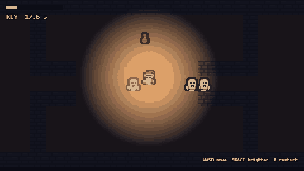
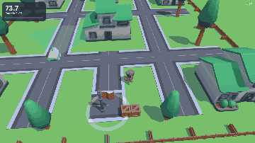
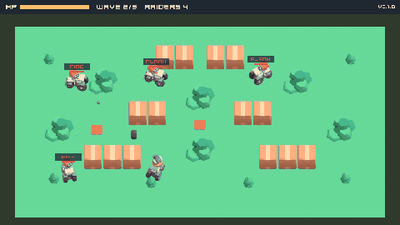
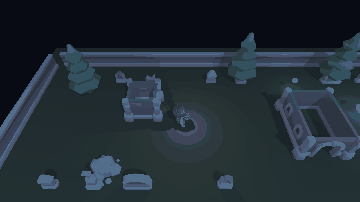
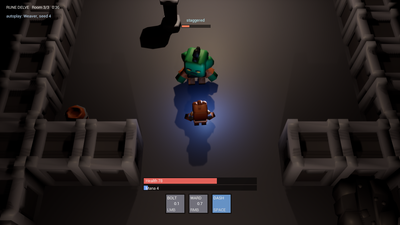
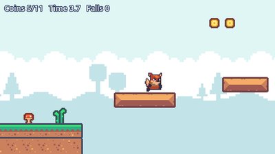
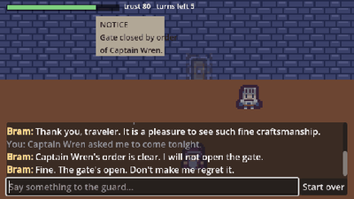
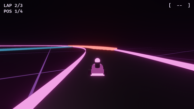

# Claude Code Game Kit

Make games with Claude Code that hold together. Every project gets the same commands, tests and habits on any of eight
engines (seven tested against their real toolchains; RPG Maker MZ is an untested proof of concept), so Claude builds, tests and checks your game instead of guessing. Free and open source (MIT).

**New to this?** Read **[START_HERE.md](START_HERE.md)**: install Claude Code and Python, open this folder in VS Code (or the Claude desktop app), open Claude Code and type **Start**. Claude interviews you about your game, writes a one-page game plan with you, then sets everything up. The steps below are the same thing done by hand.

## Made with the kit
One small game per engine, plus a local-AI pair. Six were built using only what is in the kit, with bots that test their
main idea; every one comes with a step-by-step HOW_IT_WAS_MADE, including what went wrong. Click one.

<table>
<tr>
<td width="50%"><a href="examples/ghost-lantern/"></a><br><b><a href="examples/ghost-lantern/">Ghost Lantern</a></b>, Web 2D (Phaser)<br>Slip out of a crypt past ghosts that fear your lantern.</td>
<td width="50%"><a href="examples/courier-dash/"></a><br><b><a href="examples/courier-dash/">Courier Dash</a></b>, Web 3D (Three.js)<br>Deliver parcels past a patrol robot you can read.</td>
</tr>
<tr>
<td width="50%"><a href="examples/scrap-tanks/"></a><br><b><a href="examples/scrap-tanks/">Scrap Tanks</a></b>, C++ and SDL2<br>Tank brawl against raiders on a behavior tree.</td>
<td width="50%"><a href="examples/graveyard-shift/"></a><br><b><a href="examples/graveyard-shift/">Graveyard Shift</a></b>, Unity 6<br>Light the lantern or creep in the dark past NavMesh ghosts.</td>
</tr>
<tr>
<td width="50%"><a href="examples/rune-delve/"></a><br><b><a href="examples/rune-delve/">Rune Delve</a></b>, Unreal Engine 5<br>Time your ward to the orc's swing: GAS spells, all C++.</td>
<td width="50%"><a href="examples/coyote-hop/"></a><br><b><a href="examples/coyote-hop/">Coyote Hop</a></b>, Godot 4<br>A one-level platformer with a reachability-tested level.</td>
</tr>
<tr>
<td width="50%"><a href="examples/gatekeeper-godot/"></a><br><b><a href="examples/gatekeeper-godot/">Gatekeeper</a></b>, Godot 4 and Web<br>Talk past a guard run by a small AI model on your own machine.</td>
<td width="50%"><b><a href="examples/lockpick-mz/">Lockpick MZ</a></b>, RPG Maker MZ<br>A lockpicking minigame plugin: timing beats mashing.<br><i>Untested proof of concept: built without MZ, tested in Node and a browser, never run in the engine.</i></td>
</tr>
<tr>
<td width="50%"><a href="examples/crimson-nebula/"></a><br><b><a href="examples/crimson-nebula/">Crimson Nebula</a></b>, Bevy (Rust)<br>Neon kart racing on a track that rewrites itself every lap.</td>
<td width="50%" align="center"><b>Your game next</b><br><br>Open this folder in VS Code, open Claude Code and type <b>Start</b>. <a href="START_HERE.md">START_HERE.md</a> walks you through it.</td>
</tr>
</table>

## Quick start

**1. Install the basics**
| Need | Get it | Check |
|---|---|---|
| Claude Code | [docs.claude.com/claude-code](https://docs.claude.com/en/docs/claude-code/overview) | `claude --version` |
| Python 3.8 or newer | [python.org](https://www.python.org/downloads/) (Windows: tick "Add to PATH") | `python --version` (`python3` on macOS/Linux) |
| Git | [git-scm.com](https://git-scm.com/downloads) (Windows: Git for Windows, Claude Code uses its Git Bash) | `git --version` |
| A game engine | First game and no strong preference? Use the **web** overlay (2D) or **web-3d** (3D): it needs only [Node.js](https://nodejs.org) 22.12+, the game runs in the browser, and `dev.py setup` installs the rest. Want a real engine with an editor? **Godot 4** is free, small and the easiest engine for Claude to read (its setup takes a few more steps). Not sure? Read `CHOOSING_AN_ENGINE.md` | Open it once (web: `node --version`) |

**2. Get the kit:** download this repo (Code > Download ZIP, then unzip) or `git clone` it.

**3. Make your game project** (run from the kit folder):
```
python scripts/new_game.py --name "My Game" --engine godot --dest ../my-game --git-init
```
Engines: `godot`, `web` (2D browser games: Phaser + TypeScript), `web-3d` (3D browser games: Three.js + TypeScript), `cpp-sdl2`, `unreal`, `unity`, `bevy` (Rust, Bevy 0.20; the first build compiles Bevy, 5 to 15 minutes), `rpgmaker-mz` (RPG Maker MZ plugins; an untested proof of concept, never run against MZ) (`--list-engines` shows them). Web projects: run `python tools/dev.py setup` once after scaffolding, from inside the new game folder. On macOS and Linux, type `python3` wherever these steps say `python` if `python` is not found. Engines without an overlay yet, and what one would take: `CHOOSING_AN_ENGINE.md`. Unity and Unreal: create the project in the engine first, then add `--adopt` (see "Already have a project?" below). RPG Maker MZ: scaffold, then, inside the game folder, `python tools/dev.py setup --from <a new MZ project>`.

**4. Check your setup:**
```
cd ../my-game
python tools/dev.py doctor
```
It tells you exactly what is missing (engine path, test framework, ...) and where the fix is described (`docs/ENGINE.md`).

**5. Start Claude Code in the project:**
```
claude
/start-session
```
Then open `docs/FIRST_HOUR.md` and follow it: pitch, pillars, a tiny vertical slice, and your first playable build.

Want to see results first? See **Made with the kit** above; every example has its own README and HOW_IT_WAS_MADE, and `examples/README.md` has the details.

## What you get in every project
- **One command contract**, the same on every engine: `python tools/dev.py check | test | smoke | build | run | clean | doctor`. Claude runs these instead of guessing flags, and a change is not done until `check` and `test` pass.
- **A lean `CLAUDE.md`** (project memory) plus docs Claude keeps up to date: game design doc, roadmap, handoff notes between sessions, architecture, asset log.
- **18 skills (slash commands):** `/start-session` `/end-session` `/new-feature` `/bug-hunt` `/stuck` `/playtest-report` `/asset-intake` `/gen-brief` `/model-pipeline` `/adr` `/gdd-sync` `/next-tier` `/perf-pass` `/release-check` `/publish-repo` `/triage-issues` `/game-ai` `/procgen`.
- **5 subagents:** `code-reviewer` `build-doctor` `design-critic` `playtest-analyst` `researcher`.
- **17 short SOPs:** features, bugs, playtests, assets and licenses, git, releases, Claude Code hygiene, scope control, testing, performance, 3D, job plans and budgets, publishing to GitHub, game AI (enemies and NPCs), language models in games (cloud vs local small models, with a reality check on training your own), the 2D art pipeline, and procedural generation (levels made at runtime that are proven fair).
- **Guardrails:** permission rules that block reading secrets and ask before destructive commands; a session hook that loads the handoff notes.
- **Resource lists** for music, SFX, art, fonts and AI tools, each with license caveats, and an **evidence ledger** that grades every sourced claim by how well it is backed (`docs/EVIDENCE.md`).
- **Tools:** health check, doc link checker, publish pre-flight (secrets, personal data, license), asset intake with license logging, a read-only second opinion from another AI model (`second_opinion.py`, Kimi Code CLI), a read-only GitHub Issues reader that fences player reports off as untrusted text (`issues.py`, with Bug and Feel issue forms), YouTube transcript grabber, chroma-key for AI sprites, GIF maker, a retro sound-effect synth and a chiptune renderer (text patterns to a seamlessly looping WAV), an opt-in ElevenLabs client (sound effects and music with your key, logged with your plan's license), a Fish Audio text-to-speech client (balance, voice search, lines), a WAV helper that normalizes and makes any download loop seamlessly, GIMP batch processing, Inkscape SVG export, and Blender scripts that validate models, prepare them for export (pivot, transforms, LODs) and render them into sprite sheets.

## Make it yours: profiles
By default projects get neutral wording and no file footer. To add your name, a footer line on new source files, and your own working-style rules for Claude, copy `profiles/default.json`, fill it in, and pass it:
```
python scripts/new_game.py --name "My Game" --engine godot --dest ../my-game --profile profiles/mine.json
```
`profiles/example.json` shows a filled-in one. Details: `profiles/README.md`.

## Already have a project?
Add `--adopt`. It never overwrites anything: a file that differs gets a `<file>.gold` copy next to yours (engines ignore it) so you can merge by hand. Preview with `--dry-run`.
- **Godot:** your `project.godot` stays; copy the `[autoload] Log=...` line from `project.godot.gold`, print `BOOT_OK` from your main scene, install GUT. Full steps: the "Adopting an existing project" section of the Godot flow guide.
- **C++/SDL2:** you get `CMakeLists.txt.gold` and `CMakePresets.json.gold`. `dev.py` needs presets named `debug` and `release` (binaryDir `build/<preset>`), the exe in `build/<preset>/bin/`, and a `--smoke N` flag that prints `BOOT_OK`. Easiest path: merge the presets, keep your CMakeLists.
- **Unreal:** adopt writes docs, `dev.py` and `.gitattributes` (check LFS before the next commit). Set `UE_ROOT`.
- **Unity:** adopt writes docs, `dev.py`, test assemblies and a build script. Set `UNITY_EDITOR`.
- **RPG Maker MZ:** a plain scaffold into a new folder (no `--adopt`), then move your MZ project into its `game/` folder
  (the editor's Deployment then exports the game, not the kit **(verify)**). Name your own plugins in `OWN_PLUGINS` at the top of the game's dev.py.
- Always: merge your old `CLAUDE.md` with `CLAUDE.md.gold`. The kit's one imports `docs/HANDOFF.md` and `docs/ENGINE.md`.

**Kit updated since you scaffolded?** Run the same command with `--upgrade`: it replaces kit files you never edited (tracked by content hashes in `.game-kit.json`), writes `.gold` copies only where you changed something, and leaves out kit files you deleted.

## Putting your game on GitHub
Run `/publish-repo` in the project. It follows `docs/sop/SOP-13-publish-to-github.md`: pick a license (code and assets can differ), check that every asset may be redistributed, scan for secrets and personal data (`tools/publish_check.py`), create the repo private, lock it down (branch ruleset, secret scanning, two-factor), and only then make it public.

## How the kit is laid out
```
core/                     copied into every game
  CLAUDE.md               lean project memory (imports docs/HANDOFF.md and docs/ENGINE.md)
  .claude/                settings.json, skills/, agents/, SessionStart hook config
  docs/                   FIRST_HOUR, GDD, ARCHITECTURE, ROADMAP, HANDOFF, STYLE, BRIEFS, CONCEPTS, VERTICAL_SLICE, ASSET_LOG
                          RESOURCES (index) + resources/, EVIDENCE (ledger) + evidence/ (raw notes), sop/, adr/
  tools/                  doctor.py, check_links.py, publish_check.py, yt_transcript.py, art/chroma_key.py,
                          blender/validate_asset.py, hooks/session_context.py (each with its exam where testable)
engines/<id>/             engine.json, ENGINE.md, FLOW.md, gitignore.append, settings.patch.json, skeleton/
engines/_template/        copy this to add GameMaker, Roblox, Love2D, etc.
profiles/                 author, footer and working-style presets for new_game.py --profile
scripts/new_game.py       the scaffolder (new, --adopt, --upgrade, --dry-run)
scripts/codename.py       a random placeholder name for a new game (Project_Cobalt_Wyvern)
examples/                 games made with the kit, each with HOW_IT_WAS_MADE.md (all rights reserved, free to reference)
media/gallery/            the README's example thumbnails (one frame of each example's GIF)
CHOOSING_AN_ENGINE.md     which overlay to pick
CHANGELOG.md              what changed and why
DISTILL_PROMPT.md, DISTILL_GOAL.txt, DISTILL_REPORT.md   how the kit's evidence was cleaned up (the report is a 10-19 snapshot)
PROCGEN_PROMPT.md, PROCGEN_GOAL.txt                      the brief and /goal line that built /procgen and SOP-17
```

## What was tested and what was not
Being straight about it, because it matters for trust. Everything below was run on Windows 11 unless noted.

| Piece | Status |
|---|---|
| Scaffolder: all 8 engines, dry-run, `--adopt`, `--upgrade` (hash-based), idempotent re-run, profiles, error paths, placeholder resolution | Tested (Windows, and Linux for the earlier version) |
| `tools/doctor.py`, session hook, settings JSON merge | Tested |
| Godot `dev.py` (`import`, `check`, `test`, `smoke`, `clean`, `doctor`) | Real Godot 4.7.2 with GUT 9.7.1, including planted failures. `build` exports Windows, Linux and Web from the shipped `export_presets.cfg` (the exported exe boots); `run` opens the game (`BOOT_OK` in Godot's log); `smoke --screenshot` and `--record` capture from a real window (a moving test node: 30 frames, the box advanced about 64 px per 6 frames, GIF made) |
| C++/SDL2 overlay (CMake presets, vcpkg, doctest, `dev.py`) | VS 2022 Build Tools (MSVC 14.44), bundled CMake and vcpkg, SDL2 2.32.10: `check`, `test`, `smoke` (including `--until`, `--fail-on`, `--screenshot`, `--record` and game options after `--`), release `build`, `clean`, with planted failures. Example game `examples/scrap-tanks` (SDL2_image, SDL2_ttf, SDL2_mixer via vcpkg). `run` (Scrap Tanks booted in a window). Linux/macOS **not** tested |
| Unity overlay (`dev.py`, `GameKitBuild.cs`, asmdefs, EditMode tests, PlayMode boot smoke) | Unity 6000.6.6f1: `doctor`, `check`, `test`, `smoke` (including `--until`, `--fail-on`, `--screenshot`, `--record`), `build`, `exec`, `clean`, with planted failures. Example game `examples/graveyard-shift` (AI Navigation 2.0.16; its built player replays a test night exactly). `run` launches the editor; on the test machine the GUI editor waited at Unity licensing (Hub sign-in), so a loaded editor is **not** confirmed. Batchmode commands are unaffected |
| Web overlay (Phaser 4.2, TypeScript 7, Vite 8, Vitest 5, Playwright 1.64) | Node 26 on Windows: `setup`, `check`, `test`, `build`, `smoke` in headless Chromium, `clean`, `doctor`, with planted failures (type error, failing test, no tests, boot exception, `Log.error`, missing asset as HTTP 404). `run` (the dev server serves a game that logs `BOOT_OK`) |
| Web 3D overlay (Three.js r186, same tooling as web) | Node 26 on Windows: `setup`, `check`, `test`, `build`, `smoke` (renders real frames in headless software WebGL), `doctor`, with planted failures (frame-loop exception, renderer failure); re-adopt and upgrade clean. Example game `examples/courier-dash`: its scenario pair passes in headless Chromium and in Vitest. `run` (dev server; the game renders and logs `BOOT_OK`) |
| Unreal `dev.py` | UE 5.8: `check`, `test`, `smoke` (including `--until`, `--fail-on`), `package`, `exec` (editor Python), `clean` on a C++ project with planted failures; example game `examples/rune-delve` (GAS, AI Perception, content from a headless script); `check` and `test` on a Blueprint-only project. `run` (opens the editor) and `genproj` on Rune Delve; Blueprint-only `package` **not** verified |
| Bevy overlay (Bevy 0.20, Rust 1.99.1, cargo, `dev.py`) | Windows 11 with VS 2022 Build Tools (MSVC): `doctor`, `check` (rustfmt, clippy), `test` (12 unit and 4 headless App tests), `smoke` (headless, `--until`, `--fail-on`, game options after `--`, `--screenshot` and `--record` in a window), release `build` (the exe ran from a clean folder), `run` (window on Vulkan), `clean`, with planted failures (compile error, failing test, unformatted code, `error!` at boot, panic, bad game option). Example game `examples/crimson-nebula` (a full headless race to `RACE_OVER`, `--record-from` for its GIF, `run` in a window). Linux/macOS **not** tested; web (WASM) builds not wired |
| RPG Maker MZ overlay (`dev.py`, `smoke.mjs`, `serve.mjs`, the plugin pair, `mzFake.js`) | **Not run against RPG Maker MZ** (not installed when it was built, 2026-10-23). Node 26 on Windows: `check` (five planted faults caught), `test`, `doctor`, `clean`, adopt; `setup --from`, `smoke` (headless Chromium) and `build` against a fake MZ project made of stand-in core scripts. The editor's side (annotations as the Plugin Manager reads them, `js/plugins.js` format, Deployment, `run --editor`) is marked (verify) |
| `examples/lockpick-mz` | 16 Node tests (rules, the bot pair over 40 seeds with sloppy copies, the glue against MZ stand-ins); `smoke --query autoplay --until LOCK_OPEN` and the masher's `LOCK_JAMMED` against the fake MZ. Untested proof of concept: never run in real MZ |
| `tools/check_links.py`, `tools/publish_check.py` | Exams 11/11 and 11/11 (gitleaks 8.30.1 clean on a fresh game with the shipped `.gitleaks.toml`), and zero broken references in all 8 scaffolded engines |
| `tools/art/chroma_key.py` | Exam 14/14 on synthetic images, not yet on real AI sprites |
| `tools/art/pixel_sprite.py` (first art drawn in code) | Exam 13/13 (standard library only): the reference hero's atlas, malformed PNGs refused cleanly, mirrored rows, the JSON layout, the PNG round trip; the first-art floor passes the hero and fails a dot, a flat circle and a one-color box. The ported hero matches the original Pillow script pixel for pixel (32 frames, 0 differences). Not yet run inside a game build by an engine |
| `tools/second_opinion.py` | Exam 24/24 offline (canned CLI results, plus real processes for the timeout); live with Kimi Code 2.3.0 on K3: a read-only review of the kit's Godot export change found a real stale claim, and a request to write a file failed for lack of a tool. Other vendors' CLIs not supported yet |
| `tools/issues.py` and `/triage-issues` (GitHub Issues) | Exam 14/14 offline (canned gh output): hidden-character cleaning (ANSI, bidi, zero-width, tag and variation-selector smuggling), a forged end marker stays inside the fence, spam-hidden comments skipped, links listed and never opened, gh failures mapped to exit codes, only read-only gh commands ever run. Live, read-only, against a public repo (cli/cli, gh 2.102.0): `check`, `list`, `show`. The issue forms parse as YAML; not yet seen rendered on GitHub, and the skill has not yet triaged a real game's issues |
| `tools/audio/sfx_synth.py`, `tools/audio/chiptune.py` | Exams 11/11 and 12/12 (pitch, timing, loop points, recipes, bad song numbers); every sound and the music in `examples/coyote-hop` made with them, the theme's loop picked up by Godot 4.7.2's default WAV import, notes checked by FFT against the song file. Sound quality is a human call: listen |
| `tools/art/pixellab.py` (PixelLab pixel art) | Exam 38/38 offline (a redirect test runs two local servers) against canned responses built from PixelLab's OpenAPI spec (v2, read 2026-10-24): job and resource polling, PNG/GIF/TTF/zip checks, download links never get the token, the token never written. Live (trial, 2026-10-24): `check`, one 16 px `character --legacy`. Live (Pixel Apprentice, 2026-10-26, 6.1 generations): `prop`, `vfx`, `iso-tile`, `tileset --kind sidescroller`, `edit`, `fix reduce-colors`. Not yet live: `image`, v3 `character`, `animate`, `animate-character`, top-down `tileset`, `ui`, `font`, `object`, `pixelate`, `tiles-pro`, `outfit` |
| `tools/audio/eleven_audio.py`, `tools/audio/wavfile.py` | Exams 18/18 offline (canned API, the key never written) and 7/7 (also reads the 32-bit WAV Godot's movie writer records); live on a free ElevenLabs plan: `check`, MP3 and WAV effects, a looping ambience, all of `examples/graveyard-shift`'s sound. Music returned "not available for free users" (HTTP 402), so the music path is tested offline only. Three bugs found live and fixed (stereo PCM, the 402 message, header names) |
| `tools/audio/fish_tts.py` | Exam 10/10 offline; live: `check` (API wallet $0, billed apart from the subscription), `voices --licensed`, a free-model line (4.8 s of clean mono speech). The runtime voice in `examples/gatekeeper-godot` spoke 5 lines live (about 2 s each), then from cache; bad key and no key both leave the game playable |
| `tools/art/gimp_batch.py`, `tools/art/svg_export.py` | Exams 13/13 against GIMP 3.2.6 and 12/12 against Inkscape 1.4 on Windows; macOS and Linux binary names unverified |
| `tools/blender/render_sprites.py`, `prep_export.py` | Exams 24/24 and 17/17 with the `bpy` 5.2.2 module; a Kenney CC0 character rendered into an 8-direction walk sheet, and every sprite of `examples/scrap-tanks` (32-direction hulls and turrets at one shared scale) |
| `/procgen` and SOP-17 (procedural generation) | Worked example: `examples/graveyard-shift` generates a new irregular yard (main body plus wings) each night (Unity 6000.6.6f1). EditMode property test over 250 night seeds (0 problems, 0 fallbacks), footprints checked against the meshes, pinned yards identical in Unity's Mono and .NET 8; PlayMode: the walk grid checked against the real NavMesh on 9 yards, no way out of the yard, every difficulty, the bot trio on the hand-made yard and on 8 generated nights at Easy (careful escapes 5 of 8, always lit 0), and at Normal logged. The skill itself has not yet been run on a fresh game by a new user; IL2CPP builds not checked |
| Local AI examples (`examples/gatekeeper-*`) | Real model runs on Windows with an RTX 5060 Ti: WebLLM in headed Chromium (0.5 to 1 s per reply), NobodyWho in Godot 4.7.2 (about 190 ms, 93% on a 14-line eval). Other GPUs, CPU-only and other browsers untested |
| `tools/blender/validate_asset.py` | Exam 24/24 with the `bpy` 5.2.2 module and inside Blender 5.2.2. FBX checked on the Kenney Graveyard Kit models of `examples/graveyard-shift`, OBJ on Kenney Mini Dungeon models. Ready for Blender 6 (no `use_nodes`). bpy wheels lag new Python releases: `uv run --python 3.13 --with bpy python tools/blender/validate_asset.py ...` |
| `tools/yt_transcript.py` | Live YouTube: captions API, yt-dlp subtitles, `--whisper` on CPU and CUDA with fallback |
| Claude Code config shapes (hooks, permissions, skill and agent frontmatter) | Confirmed live in a scaffolded project with Claude Code 2.1.302 (headless): the SessionStart hook runs and injects HANDOFF and ROADMAP, a deny rule blocks a Read of `.env`, and the `code-reviewer` subagent runs. Allow rules apply once the folder is trusted (the interactive trust prompt); `/hooks` and `/permissions` views not checked |

Everything known to be broken, flaky or never tried, kit and examples, is listed in `KNOWN_ISSUES.md`.
Items marked **(verify)** in the docs are the places most likely to need a tweak on first use. `DISTILL_REPORT.md` is a snapshot of the unverified claims from before the example games; the table above is current.

## Extending the kit
- New engine: copy `engines/_template`, follow its README. No scaffolder changes needed.
- New skill: `core/.claude/skills/<name>/SKILL.md`. New subagent: `core/.claude/agents/<name>.md`.
- Your favorite resources: add them to the matching file in `core/docs/resources/`.
- New video or source worth keeping: summarize it in `core/docs/evidence/video-notes.md`, add an `E##` row to `core/docs/EVIDENCE.md`, and change a SOP only if the finding reaches grade B.
- Placeholders in any text file: `{{GAME_NAME}}` `{{GAME_SLUG}}` `{{ENGINE}}` `{{ENGINE_LABEL}}` `{{DATE}}` `{{AUTHOR}}`, plus the profile lines described in `profiles/README.md`.

## Known limits
- 3D and animation: Claude scripts and automates (Blender, pipelines). Art quality still needs a human eye. See `core/docs/sop/SOP-11-3d-pipeline.md`.
- Licenses and store policies in `core/docs/resources/` were written from general knowledge, not live-checked. The per-asset page is the source of truth.
- Most video-derived tips are grade C (one creator). SOP rules come from grade A or B findings or this kit's own tests; every tip carries its source ID so you can judge it.
- Claude Code changes fast. If a setting or command in the kit stops working, `/doctor` in Claude Code and the [Claude Code docs](https://docs.claude.com/en/docs/claude-code/overview) win over this kit.

## License
The kit is MIT, see `LICENSE`. Projects you make with the kit are yours: the kit adds no license or credit line to them unless your profile sets one.

The example games in `examples/` are the exception: copyright er2oneousbit, all rights reserved, but free to read, run, study, link and reference (`examples/LICENSE.md`). The kit files inside them stay MIT. The art is CC0, but most of the audio is non-commercial (ElevenLabs free plan) or carries a generator's terms: see each example's credits and `examples/LICENSE.md`.
