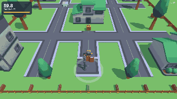

# Courier Dash



Carry five parcels across a toy town, one at a time, before the 90-second clock runs out. A patrol robot guards the
streets: its glow and the cone on the ground show what it sees, a "!" means it saw something, red means it is coming.
Made with the [Claude Code Game Kit](../../README.md) as its **Web 3D example**, built only with what the kit provides:
Three.js, Kenney CC0 models brought in with `tools/fetch_asset.py` and prepared with the kit's Blender tools, and a robot
built by SOP-14. Step by step, with every kit gap it found: [HOW_IT_WAS_MADE.md](HOW_IT_WAS_MADE.md).

## Play it
Needs Node.js 22.12+ and Python 3.8+.
```
python tools/dev.py setup     # once: npm install and the headless browser
python tools/dev.py run       # opens the game in your browser
```
WASD or arrow keys to move, Shift to sprint (watch the bar), R to restart. Gamepad: left stick, A or right trigger, Start.
The clock starts when you move, and the robot wakes up then too: watch its route first.

URL flags: `?debug` (robot state, path, collision boxes), `&god`, `&top` (camera above the block), `&close` or
`&close=robot` (close-up camera), `&speed=N`, `?autoplay` / `?autoplay=reckless` (bots play), `&start=N` (robot start).

## How it is built
| Piece | File |
|---|---|
| The whole run (rules, clock, stamina, parcels), engine-free and stepped at a fixed rate | `src/core/sim.ts`, `src/core/tuning.ts` |
| The robot: sight cone blocked by buildings, FSM (patrol, alert, chase, search, return), tank drive | `src/core/robot.ts` |
| Grid A* with string pulling, line of sight, move and slide | `src/core/nav.ts`, `src/core/geom.ts` |
| The town as data (each model is fitted into its collision box) | `src/core/level.ts`, `src/game/assets.ts` |
| Autoplay bots: `careful` waits, sidesteps and hides; `reckless` takes the shortest path | `src/core/bot.ts` |
| Three.js side: models, animations, the cone drawn as far as the robot sees, HUD, sound | `src/game/` |

Because every decision lives in `src/core` and the step is fixed, the same run plays out identically in the browser and in
Vitest: `tests/scenario.test.ts` plays the careful and the reckless bot from all four robot starts.

## Checks
```
python tools/dev.py check && python tools/dev.py test        # types, 60 tests (scenario pair included)
python tools/dev.py smoke --query "autoplay&speed=4" --until RUN_WON --fail-on CAUGHT,TIME_UP --timeout 240
python tools/dev.py smoke --query "autoplay=reckless&speed=4" --until CAUGHT --fail-on RUN_WON,TIME_UP --timeout 240
```

## Credits and licenses
- Game: copyright er2oneousbit, all rights reserved, free to read, run, study and reference (`../LICENSE.md`).
  Kit-provided files stay MIT (`../../LICENSE`).
- 3D models: [Kenney](https://kenney.nl) (Mini Characters, City Kit Suburban, City Kit Roads, Platformer Kit,
  Space Kit), CC0. Details and license copies: `docs/ASSET_LOG.md`, `docs/licenses/`.
- Sound effects and the town ambience: Created in collaboration with ElevenLabs (elevenlabs.io) (generated with the kit's `tools/audio/eleven_audio.py` on a free plan, so **non-commercial**: marked PLACEHOLDER in `docs/ASSET_LOG.md`, replace or regenerate on a paid plan before any commercial use). Earlier builds used Kenney Interface Sounds (CC0).
- Renderer: Three.js (MIT).
