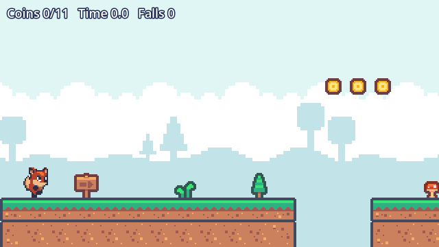

# Coyote Hop



A one-level Godot 4 platformer made with the [Claude Code Game Kit](../../README.md): run, jump with coyote time and a jump buffer, grab the coins, reach the flag. It is small on purpose, and it shows what a kit project looks like after a session: code, tests, docs and a clean asset log. **How it was built, step by step: [HOW_IT_WAS_MADE.md](HOW_IT_WAS_MADE.md).**

## Play it
1. Install Godot 4.7 (standard build): [godotengine.org](https://godotengine.org/download).
2. Open this folder in Godot (Import, pick `project.godot`) and press F5. Or from a terminal: `godot --path .`
3. Keys: A/D or arrows to move, Space/W/Up to jump (hold for higher), R to restart, F1 debug overlay. Gamepad: d-pad and A.

Watch the bot play it: `godot --path . -- --autoplay`.

## What to look at
| File | Shows |
|---|---|
| `scripts/game/tuning.gd` | Every gameplay number in one constants module |
| `scripts/game/level_data.gd` | The level as data, in tiles |
| `scripts/core/coyote_timer.gd`, `jump_buffer.gd`, `jump_math.gd` | Engine-free logic that unit tests run instantly |
| `tests/test_level_reachable.gd` | A design guard: fails if a gap or coin becomes unreachable with the current tuning |
| `tests/test_player_jump.gd`, `test_run_flow.gd` | Scene tests that boot the real level and press the keys tick by tick (jump height, the flag, the clock, restart) |
| `scripts/game/sprites.gd` | Atlas math for the Kenney sheets (`docs/tilesheet-labelled.png` shows the indices) |
| `scripts/game/main.gd` | Boot marker for `dev.py smoke`, debug overlay, autoplay bot, clean audio shutdown |
| `docs/ASSET_LOG.md`, `docs/licenses/` | Every asset with source, author, license and evidence |
| `docs/GDD.md`, `docs/HANDOFF.md`, `docs/ROADMAP.md` | The docs after one session |

## Kit commands
```
python tools/dev.py doctor    # environment check (set GODOT_BIN if godot is not on PATH)
python tools/dev.py check     # parse every script
python tools/dev.py test      # GUT tests (copy a GUT 9.x addons/gut/ in first; it is not committed)
python tools/dev.py smoke     # boot headless, fail on errors
```

## Credits and licenses
- Game: copyright er2oneousbit, all rights reserved, free to read, run, study and reference (`../LICENSE.md`). Kit-provided files (`tools/`, `.claude/`, the docs templates) stay MIT (`../../LICENSE`).
- Art: [Kenney](https://kenney.nl) (Pixel Platformer), CC0.
- Player fox: Luis Zuno ([ansimuz](https://opengameart.org/content/sunny-land-2d-pixel-art-pack)), Sunny Land, CC0.
- Sound effects and music: made for this game with the kit's `tools/audio/` synth (song files and recipes in `assets/audio/src/`, notes and presets written by Claude). Earlier builds used Kenney audio and "Level 1" by Juhani Junkala (SubspaceAudio), both CC0.
- CC0 needs no credit; it is given anyway. Details and license texts: `docs/ASSET_LOG.md` and `docs/licenses/`.
