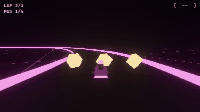

# Crimson Nebula



A neon-night kart racer where the track rewrites itself every lap: you against three rivals over three laps on one loop.
Lap 2 always closes a lane (its warning glows red, then an energy barrier rises), lap 3 brings a random change (the other
lane, or a shortcut across the infield that opens with a cyan glow), and item boxes give a boost. Codename
**Project_Crimson_Nebula**, from the `make-a-game` interview. Made with the [Claude Code Game Kit](../../README.md) as
its **Bevy example**: the whole race is engine-free Rust, so bots race it in unit tests in milliseconds. Step by step,
with every kit gap it found: [HOW_IT_WAS_MADE.md](HOW_IT_WAS_MADE.md).

## Play it
Needs Rust 1.97.1+ (rustup), Python 3.8+, and on Windows the MSVC build tools (`docs/ENGINE.md`). The first build
compiles Bevy: 5 to 15 minutes.
```
python tools/dev.py doctor    # checks Rust, clippy, rustfmt and the C++ build tools
python tools/dev.py run       # builds and opens the game
```
| Action | Keyboard | Gamepad |
|---|---|---|
| Gas / brake | W / S (or arrows) | Right / left trigger |
| Steer | A / D (or arrows) | Left stick |
| Drift (hold) | Shift | Right bumper |
| Use the boost | Space | A |
| After the race | Enter: a new track, Esc: quit | Start |

Game options go after `--`: `python tools/dev.py run -- --seed 3` replays a race, `--autoplay reader|late|ignorer`
lets a bot drive your kart.

## How it is built
| Piece | File |
|---|---|
| Every number that sets the feel (speeds, grip, warning time, zap, bot reaction) | `src/logic/tuning.rs` |
| The loop, two shortcuts, tapered lane closures, the drivable test | `src/logic/track.rs` |
| Arcade handling: forward speed plus slip, drift charge, boost | `src/logic/kart.rs` |
| The race: countdown, walls and barrier zaps, bumps, items, laps, the seeded change schedule, finish | `src/logic/race.rs` |
| Rivals: Vex reads the warning, Nova reacts once a change is live, Rook never reads the track | `src/logic/bots.rs` |
| Bevy side: the race in `FixedUpdate` at 60 Hz, log markers (`src/game/mod.rs`); the 3D view, chase camera, bloom, HUD, input (`src/game/present.rs`) | `src/game/` |

Nothing in `src/logic` uses Bevy, and the race is stepped at a fixed rate from a seed, so the same race plays out
identically in a unit test, in a headless smoke run and in the window. `bots::tests` races the reading bot against the
ignoring one over 20 seeds: reading the changes wins all 20, by 0.4 to 1.9 s.

## Checks
```
python tools/dev.py check     # rustfmt, clippy on every target
python tools/dev.py test      # 40 tests: 36 unit (bot pair included), 4 full headless races
python tools/dev.py smoke --frames 9000 --until RACE_OVER -- --autoplay reader --seed 3
```
Not committed (rule 7 of `../README.md`): `target/` (cargo rebuilds it) and `captures/` (screenshots and frames).

## Credits and licenses
- Game: copyright er2oneousbit, all rights reserved, free to read, run, study and reference (`../LICENSE.md`).
  Kit-provided files stay MIT (`../../LICENSE`).
- Art: none. Every kart, wall and barrier is built in code from shapes; the glow is emissive color plus Bevy's bloom.
- Sound: none yet.
- Engine: Bevy 0.20 (MIT or Apache-2.0). The HUD uses Bevy's built-in FiraMono font (SIL OFL 1.1), compiled in from
  the `bevy_text` crate: `docs/ASSET_LOG.md`.
