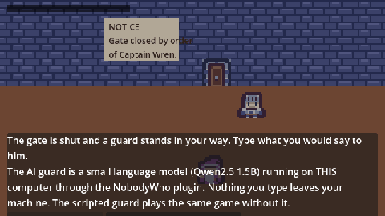

# Gatekeeper (Godot)



Talk your way past a gate guard. Type anything; the guard answers in character. Made with the
[Claude Code Game Kit](../../README.md) as its **local-AI example for native games**: a small language model runs inside
Godot through the NobodyWho plugin, on the player's GPU, and the game decides everything the model only words.
Its browser twin is [`../gatekeeper-web`](../gatekeeper-web/). Step by step, with the measurements: [HOW_IT_WAS_MADE.md](HOW_IT_WAS_MADE.md).

## Play it
Godot 4.6+ (tested on 4.7.2, Windows). The scripted guard works right away. For the AI guard:
```
python tools/setup_ai.py      # once: NobodyWho plugin + Qwen2.5 1.5B model, about 1.5 GB, checksums verified
```
then open the project in Godot (it imports the plugin) and pick "Talk to the AI guard". Hint: read the notice on the wall.

User args after `--`: `--debug`, `--autoplay` / `--autoplay=rude` (scripted runs), `--llm` (load the model at once),
`--voice` / `--no-voice` (live voice in headless runs / off).

### Live voice (optional proof of concept): bring your own Fish Audio key
Bram can speak every line, scripted or improvised, with [Fish Audio](https://fish.audio) text to speech. **It needs your
own Fish Audio API key**; nothing is shipped with the game, and without a key he stays silent (the game is unchanged).
1. Create an API key at fish.audio (Developers, API keys). Save it as a user environment variable named
   `FISH_API_KEY` (PowerShell: `[Environment]::SetEnvironmentVariable('FISH_API_KEY', (Read-Host 'key'), 'User')`), then
   restart Godot or the terminal so the game sees it.
2. Play. The log says `VOICE_ON`; each line takes about 2 s to arrive and is cached in `user://voice_cache`, so a repeat
   is instant and free.
- Cost: the default model `s2.1-pro-free` is free (2026-10). `s2.1-pro` (in `scripts/game/tuning.gd`) bills Fish Audio's
  developer API wallet, which is separate from a Fish Audio subscription: about $0.001 per line.
- Another voice: `python tools/audio/fish_tts.py voices --licensed --search narrator`, then set `FISH_VOICE_ID`. Many
  library voices imitate real people or famous characters; do not use those.
- Why a key per player, not one in the game: a key inside a build can be pulled out by anyone (`SOP-15` rule 1). This is
  a proof of concept for your own machine. A real release calls your own server, which holds the key and caps the spend.
- Fish Audio's terms for using generated speech in a released game are not in its API docs: read them first **(verify)**.

## How the AI is kept on a leash
| Piece | File |
|---|---|
| The rules: trust per intent, when the gate opens. The model never sees them | `scripts/core/gate_rules.gd` |
| Two model jobs, one call each: a label (regex: one exact intent, no history), then one sentence | `scripts/game/guard_brain.gd` |
| Checks on every model output, scripted fallback on anything late or wrong | `scripts/core/gate_intent.gd`, `scripts/core/guard_lines.gd` |
| Recorded model outputs the checks must accept or reject (shared with the web twin) | `tests/fixtures/recorded.json` |
| A live eval: 14 labelled lines through the real model | `tools/eval_guard.gd` (93%, about 190 ms per reply on an RTX 5060 Ti) |

## Checks
```
python tools/dev.py check && python tools/dev.py test && python tools/dev.py smoke
godot --headless --path . -- --autoplay           # scripted guard: GATE_OPEN
godot --headless --path . -- --llm --autoplay     # the real model: GATE_OPEN
godot --headless --path . -- --autoplay --voice   # live voice (needs FISH_API_KEY): VOICE_OK per line
godot --headless --path . --script res://tools/eval_guard.gd
```

## Credits and licenses
- Game: copyright er2oneousbit, all rights reserved, free to read, run, study and reference (`../LICENSE.md`).
  Kit-provided files stay MIT (`../../LICENSE`).
- NobodyWho Godot plugin v12.1.0, EUPL-1.2 (unmodified; its license ships in `addons/nobodywho/LICENSE`):
  [github.com/nobodywho-ooo/nobodywho](https://github.com/nobodywho-ooo/nobodywho).
- Model: Qwen2.5 1.5B Instruct (official Qwen GGUF), Apache-2.0.
- Art: [Kenney](https://kenney.nl) (Tiny Dungeon), CC0. Details: `docs/ASSET_LOG.md`.
- Sound effects and the night ambience at the wall: Created in collaboration with ElevenLabs (elevenlabs.io) (generated with the kit's `tools/audio/eleven_audio.py` under non-commercial terms, so **non-commercial**: marked PLACEHOLDER in `docs/ASSET_LOG.md`, replace or regenerate under a license that allows commercial use before any commercial use). Earlier builds used Kenney Interface Sounds (CC0). The same files as the web twin.
- Optional live voice: generated at runtime by Fish Audio with the player's own key (nothing generated ships).
