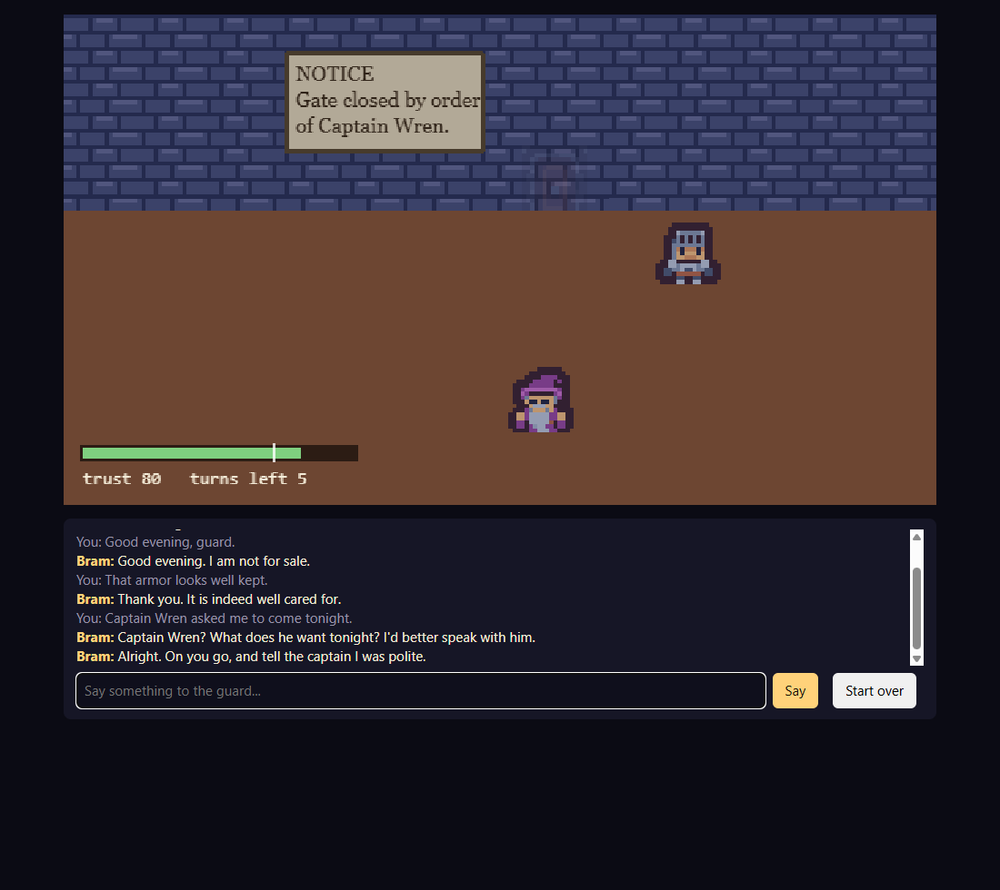

# Gatekeeper (web)



Talk your way past a gate guard. Type anything; the guard answers in character. Made with the
[Claude Code Game Kit](../../README.md) as its **local-AI example for browser games**: a small language model runs in the
player's browser (WebLLM on WebGPU), with no server and no API key, and the game decides everything the model only words.
Its native twin is [`../gatekeeper-godot`](../gatekeeper-godot/). Step by step, with what went wrong: [HOW_IT_WAS_MADE.md](HOW_IT_WAS_MADE.md).

## Play it
Needs Node.js 22.12+ and Python 3.8+. The AI guard needs a browser with WebGPU (current desktop Chrome or Edge) and downloads
about 880 MB the first time; everyone else gets the scripted guard, same game.
```
python tools/dev.py setup     # once
python tools/dev.py run       # opens the game
```
Hint: read the notice on the wall.

URL flags: `?debug` (intent, trust change and source of every reply), `?autoplay` / `?autoplay=rude` (scripted runs),
`&llm=1` (load the model at once).

## How the AI is kept on a leash
| Piece | File |
|---|---|
| The rules: trust per intent, when the gate opens. The model never sees them | `src/core/gatekeeper.ts` |
| Two model jobs, one call each: a label (grammar: one exact intent), then one sentence (grammar: no brackets) | `src/game/webllmBrain.ts`, `src/game/prompt.ts` |
| Checks on every model output, scripted fallback on anything late or wrong | `src/core/intent.ts`, `src/core/lines.ts` |
| Recorded model outputs the checks must accept or reject (shared with the Godot twin) | `tests/fixtures/recorded.json` |
| WebLLM loads only when the player picks the AI guard | `src/game/controller.ts` (dynamic import) |

## Checks
```
python tools/dev.py check && python tools/dev.py test
python tools/dev.py smoke --query autoplay --until GATE_OPEN --fail-on TURNED_AWAY           # scripted, headless
python tools/dev.py smoke --query autoplay=rude --until TURNED_AWAY --fail-on GATE_OPEN      # scripted, the losing script
python tools/dev.py smoke --headed --query "autoplay&llm=1" --until GATE_OPEN --timeout 300 --fail-on "FALLBACK,(fallback),model failed to load"  # the real model (GPU)
```
The real-model run needs its `--fail-on` list: the scripted guard wins the same script, so without it a run where the
model never loaded, or fell back on every line, passes too. `--fail-on` takes comma-separated markers and fails on any
console line containing one: `FALLBACK` (a model reply replaced), `(fallback)` (a turn the scripted guard judged),
`model failed to load`.

## Credits and licenses
- Game: copyright er2oneousbit, all rights reserved, free to read, run, study and reference (`../LICENSE.md`).
  Kit-provided files stay MIT (`../../LICENSE`).
- Model: Qwen2.5 1.5B Instruct by the Qwen team, Apache-2.0, downloaded by the player's browser through WebLLM (Apache-2.0).
- Art: [Kenney](https://kenney.nl) (Tiny Dungeon), CC0. Details: `docs/ASSET_LOG.md`.
- Sound effects and the night ambience at the wall: Created in collaboration with ElevenLabs (elevenlabs.io) (generated with the kit's `tools/audio/eleven_audio.py` under non-commercial terms, so **non-commercial**: marked PLACEHOLDER in `docs/ASSET_LOG.md`, replace or regenerate under a license that allows commercial use before any commercial use). Earlier builds used Kenney Interface Sounds (CC0). The Godot twin plays the same files.
