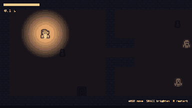

# Ghost Lantern



A top-down browser game made with the [Claude Code Game Kit](../../README.md): ghosts hunt you but fear your lantern, and
the lantern is running out of oil. Grab the key from the chest in the last room and get back to the door.

It is the kit's **"only what is in the kit"** example: built by following `docs/FIRST_HOUR.md`, the SOPs and the kit's own
tools, nothing else. Every step, every bug the checks caught and every gap it exposed in the kit: [HOW_IT_WAS_MADE.md](HOW_IT_WAS_MADE.md).

## Play it
Needs [Node.js](https://nodejs.org) 22.12 or newer and Python 3.8+.
```
python tools/dev.py setup     # once: npm install + the headless browser for smoke
python tools/dev.py run       # opens the game in your browser
```
WASD or arrows to move, hold SPACE (or SHIFT) to brighten the lantern, R to restart.
Bright light makes ghosts flee and stops them touching you, but burns oil about three times faster. Dim light lets you see.

URL flags: `?debug` (ghost paths, sense range and a live table of each ghost's utility scores; I = infinite oil, G = freeze
ghosts), `?autoplay` (a bot plays), `?autoplay=dark` (the bot never brightens), `?seed=N` (replay a run).

## What to look at
| File | Shows |
|---|---|
| `src/core/ghostBrain.ts` | Utility AI in about 60 lines: chase, flee and wander scored from distance, light and memory (SOP-14, ADR 0001) |
| `src/core/astar.ts`, `src/core/separation.ts` | Movement layer: grid A* and separation steering, engine-free |
| `src/core/lantern.ts` | The resource: oil, radius, and how much light scares |
| `src/game/tuning.ts` | Every number, with comments on why it changed during playtests |
| `tests/` | 40 Vitest tests, including "never chases into strong light" and "the key and exit are reachable" |
| `src/game/GameScene.ts` | Perception, the autoplay bot, the darkness overlay, the debug view |
| `docs/` | GDD, concept lock, slice brief with results, ADR, troubleshooting, asset log with license evidence |

## Checks
```
python tools/dev.py check     # TypeScript
python tools/dev.py test      # 40 unit tests
python tools/dev.py smoke     # boots the production build in headless Chromium
python tools/dev.py smoke --query autoplay --until ESCAPED --fail-on CAUGHT    # the lantern saves you
python tools/dev.py smoke --query autoplay=dark --until CAUGHT                 # ...and without it you are caught
```

## Credits and licenses
- Game: copyright er2oneousbit, all rights reserved, free to read, run, study and reference (`../LICENSE.md`).
  Kit-provided files (`tools/`, `.claude/`, the docs templates) stay MIT (`../../LICENSE`).
- Art: [Kenney](https://kenney.nl) (Tiny Dungeon), CC0. Details: `docs/ASSET_LOG.md`, `docs/licenses/`.
- Sound effects and the haunted-house ambience: Created in collaboration with ElevenLabs (elevenlabs.io) (generated with the kit's `tools/audio/eleven_audio.py` under non-commercial terms, so **non-commercial**: marked PLACEHOLDER in `docs/ASSET_LOG.md`, replace or regenerate under a license that allows commercial use before any commercial use). Earlier builds used Kenney Interface Sounds (CC0).
