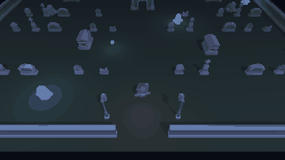

# Graveyard Shift



A night in a haunted graveyard: you are the caretaker, twelve lost souls drift between the graves and the crypts, and
ghosts patrol the paths. Light your lantern to move fast and see, or put it out and creep, nearly invisible. Ghosts glow their mood
(blue calm, yellow wary, red hunting), so you can read them before they read you. Made with the
[Claude Code Game Kit](../../README.md) as its **Unity 3D example**, built only with what the kit provides: Kenney CC0
models, a scene built from code, Unity's NavMesh, a ghost state machine from SOP-14, and a bot trio that refuted the
main pillar before a redesign made it hold. Every night after the first is a **new graveyard**, an irregular yard
with wings, generated from a seed and checked for fairness before you see it (the kit's SOP-17). Pick Easy, Normal, Hard
or Insane on the title screen: each step is darker and has two more ghosts. Step by step: [HOW_IT_WAS_MADE.md](HOW_IT_WAS_MADE.md).

## Play it
Needs Unity **6000.6.6f1** (Unity Hub) and Python 3.8+. Set `UNITY_EDITOR` to the editor's `Unity.exe`
(`docs/ENGINE.md`). The first open imports the project (a few minutes).
```
python tools/dev.py run          # opens the editor; press Play
python tools/dev.py build        # a Windows player in Build/
```
WASD or arrows to move, Space or F for the lantern, R to restart. Gamepad: left stick, Y for the lantern, Start restarts.
Collect all twelve souls, and the iron gate swings open: walk out through it. Get caught and you wake at the gate, and the last soul you found slips back
to its grave. Dawn is the only way to lose. Your first night is the hand-made yard; each finished night moves you to the
next seed, a yard nobody has tuned by hand. The seed and the difficulty are at the bottom of the screen; Esc goes back
to the title screen. On Insane the souls do not glow: listen for their whispers.

Options for the built player go after `--`, for example `Build/game.exe -- --debug-ai`:
`--difficulty easy|normal|hard|insane` (skips the title screen), `--autoplay careful|lit|dark` (a bot plays), `--seed N` (replay that night: its yard, and which corner each ghost starts
in and which way it walks; 0 is the hand-made yard), `--handmade` (the hand-made yard whatever the seed),
`--fixed-fps` (fixed 1/60 s frames: the nights checked replay to the tenth of a second), `--shot FILE` (save one frame with the HUD after
about 1.5 s; windowed only), `--god`, `--debug-ai` (ghost states and the bot's reason).

## How it is built
| Piece | File |
|---|---|
| The rules of a night: clock, souls, gate, caught costs a soul | `Assets/Scripts/Core/NightRules.cs` |
| The ghosts' state machine (ADR 0003) and what they can see | `Assets/Scripts/Core/GhostBrain.cs`, `Perception.cs` |
| The level as data, built at runtime with a NavMesh baked from its colliders (ADR 0002) | `Assets/Scripts/Core/Level.cs`, `Assets/Scripts/Game/LevelBuilder.cs` |
| A new yard each night: the generator, the fairness checks every yard must pass, measured prop sizes, seeded numbers | `Assets/Scripts/Core/LevelGenerator.cs`, `LevelCheck.cs`, `Footprint.cs`, `SeededRandom.cs` |
| Difficulties (light, extra ghosts) and the title screen | `Assets/Scripts/Core/Difficulty.cs`, `Assets/Scripts/Game/Hud.cs` |
| The iron gate | `Assets/Scripts/Game/GateSwing.cs` (built by `LevelBuilder.cs`) |
| Tunables (one asset, defaults in code) | `Assets/Config/SO_GraveyardSetup.asset`, `Assets/Scripts/Core/GameTuning.cs` |
| Versioned save with a v1 to v2 migration | `Assets/Scripts/Core/SaveData.cs`, `Assets/Scripts/Game/SaveStore.cs` |
| Autoplay bots: careful, always lit, always dark, on one movement brain | `Assets/Scripts/Game/KeeperBot.cs` |
| The scene, setup asset and version, made from code | `Assets/Editor/SceneBuilder.cs` (`python tools/dev.py exec SceneBuilder.Build`) |

Everything in `Assets/Scripts/Core` is plain C# with EditMode tests; `Game/` is the Unity side (ADR 0001: Built-in render
pipeline, Input Manager, an IMGUI HUD).

## Checks
```
python tools/dev.py check && python tools/dev.py test     # compile, then 112 EditMode tests (250 generated yards among them, about 2.5 minutes)
python tools/dev.py smoke                                 # 20 tests: boot, 80 bot nights, the NavMesh, no-way-out, difficulty and review-fix checks (13 to 18 minutes)
python tools/dev.py build && Build/game.exe -batchmode -nographics -logFile Logs/night.log -- --autoplay careful --handmade --seed 6 --fixed-fps
```
The last line plays the same night as the GIF in the shipped player (exit 0 on escape, 3 at dawn); without `--handmade`,
`--seed 6` is a generated yard. A look at three generated yards from above: `docs/procgen/` (the GIF and those pictures
show the old, small yard; the 4x yard came later, HOW_IT_WAS_MADE "Later: four times the yard"; and every generated
yard changed again with the review fixes of 2026-10-26, so no picture there shows a yard as it is generated now).
Close the Unity editor before running any of these.

## Credits and licenses
- Game: copyright er2oneousbit, all rights reserved, free to read, run, study and reference (`../LICENSE.md`).
  Kit-provided files stay MIT (`../../LICENSE`).
- 3D models: [Kenney](https://kenney.nl) (Graveyard Kit and, for the trees and bushes outside the wall, Nature Kit), CC0. Details and license copies: `docs/ASSET_LOG.md`,
  `docs/licenses/`.
- Sound effects, night ambience and the world sounds (soul whispers, ghost moans, footsteps, lantern flame): Created in collaboration with ElevenLabs (elevenlabs.io) (generated with the kit's
  `tools/audio/eleven_audio.py` under non-commercial terms, so **non-commercial**: marked PLACEHOLDER in `docs/ASSET_LOG.md`,
  replace or regenerate under a license that allows commercial use before any commercial use). Earlier builds used Kenney Interface Sounds (CC0).
- Voices: generated with Fish Audio text to speech (free model): the ghosts ("Creepy Whisper"), the keeper ("Old man")
  and the narrator ("Warm Storyteller"), all library voices; `docs/ASSET_LOG.md` A-0014, A-0015 and A-0017 to A-0025.
  Fish Audio's terms apply (verify before any release).
- Music: two takes of a night theme made with Suno from the brief in `docs/BRIEFS.md`, looped with the
  kit's `tools/audio/wavfile.py`; the game plays them in turn, one per finished night. Details: `docs/ASSET_LOG.md` A-0009.
- Unity packages: AI Navigation 2.0.16 (Unity Companion License), Unity Test Framework.
