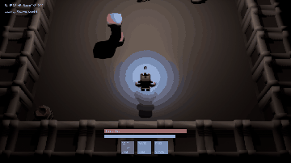

# Rune Delve



A rune-mage goes down into a dungeon held by orcs: three rooms, then the orc warden. You have three spells. The bolt is
cheap and quick, but loud. The ward lasts less than half a second: raise it as an orc's swing lands and the orc reels,
taking double damage. Raise it early and you have wasted your mana. Orcs glow red and raise their weapon before every
swing, so you can read them. Made with the [Claude Code Game Kit](../../README.md) as its **Unreal Engine 5 example**,
built only with what the kit provides and without the editor UI: every spell is Gameplay Ability System C++, the orcs
use Unreal's AI Perception and NavMesh, all content comes from one headless Python script, and two autoplay bots prove
that timing beats spam. Step by step: [HOW_IT_WAS_MADE.md](HOW_IT_WAS_MADE.md).

## Play it
Needs Unreal Engine **5.8** (Epic Launcher), Visual Studio 2022 Build Tools with the "Desktop development with C++"
workload and the .NET Framework 4.8 SDK, and Python 3.8+. Set `UE_ROOT` to the engine folder (`docs/ENGINE.md`). Close
any open Unreal editor first.
```
python tools/dev.py check                                  # compiles the game (the editor needs it before anything else)
python tools/dev.py exec tools/unreal/build_content.py    # imports the art and sound, makes the map (Content/ is not committed)
python tools/dev.py run                                    # opens the editor; press Play
python tools/dev.py package                                # a Windows build in Packaged/
```
WASD to move, mouse to aim, left click to bolt (hold to keep casting), right click to ward, Space to dash, R to restart.
Gamepad: left stick moves, right stick aims, right trigger bolts, left trigger wards, A dashes, Start restarts.
Clear a room and its gate opens and you heal. Fall and the game stops: press R (or Start) to begin the delve again.

Options for the packaged game: `Packaged/Windows/RuneDelve.exe -autoplay=weaver -seed=6 -fixedfps`:
`-autoplay=weaver|masher` (a bot plays), `-seed=N` (where the orcs stand), `-fixedfps` (1/60 s frames, as fast as the
machine allows), `-quitatend` (exit 0 after a full clear, 3 otherwise), `-god`, `-debugai` (orc states and the bot's
reason), `-record=<dir> -recordevery=N` (screenshots for a GIF).

## How it is built
| Piece | File |
|---|---|
| Combat rules: dash dodges, ward blocks and staggers, stagger doubles damage | `Source/RuneDelve/Private/Core/RDRules.cpp` |
| The orcs' state machine (sleep, hunt, wind-up, recover, staggered) | `Source/RuneDelve/Private/Core/RDOrcBrain.cpp` |
| The dungeon as data: rooms, walls, gates, props, seeded orcs | `Source/RuneDelve/Private/Core/RDLevel.cpp` |
| The two bots | `Source/RuneDelve/Private/Core/RDBotPolicy.cpp` |
| Spells as GAS abilities and effects, all C++ (ADR 0001) | `Source/RuneDelve/Private/Abilities/` |
| Orc senses (AI Perception) and NavMesh chase (ADR 0002) | `Source/RuneDelve/Private/Game/RDOrc.cpp`, `RDOrcController.cpp` |
| Every number | `Config/DefaultGame.ini` (the RDTuning section) |
| All content, made headless (ADR 0003) | `tools/unreal/build_content.py` |

Everything in `Core/` is plain C++ with unit tests; the rest is the Unreal side. No Blueprints, no input or effect
assets: input actions and mappings are built in C++ at runtime.

## Checks
```
python tools/dev.py test --filter RuneDelve.Core     # 5 unit test groups
python tools/dev.py smoke                            # boot, the review regressions, 16 bot delves in Play In Editor (about 3.5 minutes)
python tools/dev.py package && Packaged/Windows/RuneDelve.exe -autoplay=weaver -seed=6 -fixedfps -quitatend
```
The last line plays seed 6 in the shipped game, the same delve as the smoke test, and logs `DELVE_COMPLETE` when it is
cleared. The GIF shows seed 4 from before the 2026-10-26 review fixes; since a ward stops one swing, that seed ends at
the warden.

## Credits and licenses
- Game: copyright er2oneousbit, all rights reserved, free to read, run, study and reference (`../LICENSE.md`).
  Kit-provided files stay MIT (`../../LICENSE`).
- 3D models: [Kenney](https://kenney.nl) (Mini Dungeon), CC0. Details and license copies: `docs/ASSET_LOG.md`,
  `docs/licenses/`.
- Sound effects and the dungeon ambience: Created in collaboration with ElevenLabs (elevenlabs.io) (generated with the kit's `tools/audio/eleven_audio.py` on a free plan, so **non-commercial**: marked PLACEHOLDER in `docs/ASSET_LOG.md`, replace or regenerate on a paid plan before any commercial use). Earlier builds used Kenney Sci-fi Sounds, Impact Sounds and RPG Audio (CC0).
- Unreal Engine plugins used: Gameplay Abilities, Enhanced Input, Python Editor Script Plugin (Epic, part of the engine).
