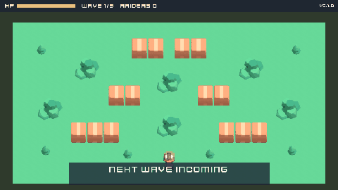

# Scrap Tanks



A one-screen tank brawl in a scrapyard: your tractor-tank against raiders whose behavior tree you can read over their
heads (FLANK, FIRE, COVER, RETREAT). Shells stop at crates, rocks and trees, so where you stand matters more than how fast
you click. Made with the [Claude Code Game Kit](../../README.md) as its **C++ / SDL2 example**, built only with what the
kit provides: Kenney CC0 3D models rendered into sprite sheets with the kit's Blender tools, a behavior tree built by
SOP-14, and a scenario pair that proved the main pillar wrong three times before it held. Step by step:
[HOW_IT_WAS_MADE.md](HOW_IT_WAS_MADE.md).

## Play it
Needs CMake 3.21+, a C++17 compiler and vcpkg (on Windows, Visual Studio 2022 Build Tools include all three), and Python
3.8+. Set `VCPKG_ROOT` and put CMake on `PATH` (`docs/ENGINE.md`). The first build fetches SDL2 and its image, font and
sound libraries (a few minutes).
```
python tools/dev.py run
```
WASD to drive (tank controls), mouse to aim, left click or Space to fire, R to restart. Gamepad: left stick drives, right
stick aims, right trigger or A fires, Start restarts. Red labels are coming for you; blue ones are hiding.

Game options go after `--`, for example `build/debug/bin/Debug/scrap_tanks.exe -- --debug-ai`:
`--autoplay skilled|reckless` (a bot plays), `--seed N` (same seed, same fight), `--god`, `--debug-ai` (raider paths,
chosen spots, who can hit you, the tree).

## How it is built
| Piece | File |
|---|---|
| The whole fight, engine-free and fixed-step: tanks, shells, cover, scrap, waves | `src/core/Sim.cpp`, `src/core/Tuning.hpp` |
| A small behavior-tree library (ADR 0002) and the raiders' tree | `src/core/Bt.hpp`, `src/core/EnemyBrain.cpp` |
| Cover and firing spots, aim leading, grid A* | `src/core/Tactics.cpp`, `src/core/Nav.cpp` |
| Autoplay bots: `skilled` hides by exposure count, `reckless` charges | `src/core/Bot.cpp` |
| The camera and which of 32 sprite rows faces where | `src/core/View.hpp` |
| SDL side: sprites, labels, HUD, sound, input (ADR 0001: SDL2_image, SDL2_ttf, SDL2_mixer) | `src/game/` |
| Kenney 3D models to sprite sheets, one table | `tools/make_sprites.py` |

## Checks
```
python tools/dev.py check && python tools/dev.py test      # 46 test cases, the pillar check plays 80 fights
python tools/dev.py smoke --frames 30000 --timeout 900 --until RUN_WON --fail-on PLAYER_DESTROYED -- --autoplay skilled --seed 7
python tools/dev.py smoke --frames 30000 --timeout 900 --until PLAYER_DESTROYED --fail-on RUN_WON -- --autoplay reckless --seed 7
```

## Credits and licenses
- Game: copyright er2oneousbit, all rights reserved, free to read, run, study and reference (`../LICENSE.md`).
  Kit-provided files stay MIT (`../../LICENSE`).
- 3D models (rendered to sprites) and font: [Kenney](https://kenney.nl) (Car Kit, Tower Defense Kit, Kenney Fonts), CC0.
  Details and license copies: `docs/ASSET_LOG.md`, `docs/licenses/`.
- Sound effects and the scrapyard wind: Created in collaboration with ElevenLabs (elevenlabs.io) (generated with the kit's `tools/audio/eleven_audio.py` under non-commercial terms, so **non-commercial**: marked PLACEHOLDER in `docs/ASSET_LOG.md`, replace or regenerate under a license that allows commercial use before any commercial use). Earlier builds used Kenney Sci-fi Sounds (CC0).
- Libraries: SDL2, SDL2_image, SDL2_ttf, SDL2_mixer (zlib), doctest (MIT), via vcpkg.
