# Local pixel art with ComfyUI (experimental)

An experiment in making a game's pixel art on your own GPU instead of a paid service: ComfyUI plus the SpriteKiln node
pack, with a few scripts around it. It ran on one test machine, so treat every number here as a
data point, not a promise. It is a proof of concept that local generation is viable for a game's art, not a
showcase of finished art: some outputs still need a human pass. The rules for using it in a game are in the game's `docs/sop/SOP-16-2d-art-pipeline.md`
("Generating pixel art locally"); the evidence entry is E68 in `core/docs/EVIDENCE.md`.

**Verdict so far:**

| Asset type | Status |
|---|---|
| Characters, props, icons, UI pieces, isometric pieces | Usable, about 16 s each |
| Seamless 128 px terrain, corner autotiles | Usable |
| Rotation (4 directions), edits, inpainting, normal maps | Usable |
| Animation sets: idle, walk, kick in 4 directions, exported to Godot 4 | Good, about 1.7 min per clip |
| Portraits | Need a better prompt |
| 32 px tiles, whole-scene maps | Not good enough |
| Effects (fireball, explosion, muzzle flash, heal, steam) and casting or firing poses | Good to excellent, about 2 min per clip |
| 8-direction objects; sidescroller tiles | Not run yet |
| **Dotwork:** a whole pack from one JSON spec, as Godot resources, proven by an import into a kit project | Works: a character pack and a sample pack of every asset type passed; an Aseprite round trip for hand polish keeps it verified |

Final art still gets a human pass.

## Test host
| Part | Spec |
|---|---|
| GPU | NVIDIA GeForce RTX 5060 Ti, 16 GB (Blackwell), driver 610.88 |
| CPU | AMD Ryzen 7 5700G (8 cores) |
| RAM | 64 GB |
| Storage | ComfyUI and its models on an NVMe SSD (WD_BLACK SN850X) |
| OS | Windows 11 Pro |
| Software | ComfyUI 0.43.0 (git clone), Python 3.12.12 in its own venv, PyTorch 2.14.1 for CUDA 13.0, Aseprite 1.3.18 for the finishing step |

RTX 50 cards need PyTorch built for CUDA 12.8 or newer. 64 GB of RAM mattered: weights stay cached between jobs (cold
starts were only a second or two slower), and the one crash in the first test run was system RAM running out, not VRAM.

## What was installed
| Piece | License | Role |
|---|---|---|
| [ComfyUI](https://github.com/comfyanonymous/ComfyUI) | GPL-3.0 | Runs the models as node graphs, UI on `127.0.0.1:8188`, HTTP API |
| [SpriteKiln](https://github.com/brunocpf/spritekiln) | GPL-3.0 | About 30 pixel-art workflows: text, image or style reference to pixel art, edit, inpaint, rotate, walk sheets, tiles |
| [ComfyUI-GGUF](https://github.com/city96/ComfyUI-GGUF) | Apache-2.0 | Loads the quantized Qwen and Wan models |
| [ComfyUI_essentials](https://github.com/cubiq/ComfyUI_essentials) | MIT | PixelOE pixelize |
| [ComfyUI-PixelArt-Detector](https://github.com/dimtoneff/ComfyUI-PixelArt-Detector) | MIT | Palette tools |

Each pack was read in a quarantine folder before it was copied in, pinned to a commit and patched where needed
(a path escape in SpriteKiln's part saver; an import-time `pip install` removed from PixelArt-Detector). Models: 30
files, `.safetensors` or `.gguf` only, pinned to a Hugging Face commit with a SHA-256.

| Model tier | Size | Main models |
|---|---|---|
| core | 38 GB | FLUX.2 klein 4B (Apache-2.0), Z-Image Turbo, BiRefNet background removal, pixel-art LoRAs |
| hq-rotate | 31 GB | Qwen-Image-Edit 2511 (Q4 GGUF) + Multiple-Angles LoRA |
| anim | 36 GB | Wan 2.2 image-to-video 14B (Q4 GGUF) + Lightning LoRAs |
| parts | 2 GB | SAM 3.1, MoGe |
| sdxl | 8 GB | SDXL base + Pixel Art XL (not recommended, see below) |

FLUX.2 klein 9B was skipped on purpose: its license is non-commercial. Check every model card before shipping art made
with it; several LoRAs come from single uploaders.

## Dotwork: one command to Godot-ready assets
The later scripts were folded into one tool, Dotwork, built to the kit's asset rules (SOP-16, the Godot overlay's
conventions). It starts ComfyUI on `127.0.0.1`, renders a whole pack from a JSON spec, stops ComfyUI when done and
proves the result imports. It now ships in every game made with the kit as `tools/art/dotwork/` (setup, models and
every lane: `core/tools/art/dotwork/README.md` in the kit).

**About the pictures in this write-up.** Every picture comes from the shipped Dotwork alone: no style reference
unless a caption says so, the shipped palettes, the Apache-2.0 VAE. The text describes the test runs and what they
taught.

Run from the game's folder:
```
dotwork.py pack --spec packs/sample.json           # whole pack, then the Godot proof
dotwork.py character --name guard --prompt "a town guard in a brass helmet" --actions idle walk attack
dotwork.py character ... --fix punch_w:keep=4 punch_n:seed=5151   # re-render or trim only the clips that need it
dotwork.py verify                                 # load every Dotwork asset in the game, then its smoke test
```
- **Output follows the kit's Godot layout:** `assets/art/{characters,props,fx,tiles,ui,portraits}/` for the game,
  `assets_src/` for rotations, candidate sheets and review sheets. snake_case names (`spr_<thing>_<state>.png`,
  `ui_<thing>.png`, `<name>_<anim>_sheet.png` + JSON), animations named `<action>_<dir>`. No `.godot/`, `*.import`
  or `*.uid` files; no ComfyUI metadata in any shipped PNG (0 of 122 checked).
- **Godot resources, not just PNGs:**
  - Characters get a SpriteFrames for an AnimatedSprite2D: 4 directions, west mirrored unless the character is
    marked asymmetric (then generated, so a weapon hand stays on its arm). idle and walk loop at 8 fps; attack plays
    once at 10. One canvas per character, feet at the bottom center.
  - Effects get SpriteFrames, an additive CanvasItemMaterial and an autoplaying scene.
  - Terrain gets a 32 px match-corners TileSet.
  - UI gets a 9-slice PNG and a NinePatchRect scene with the margins set.
- **A manifest per pack:** one row per shipped file (prompt, seed, workflow, models with their Hugging Face commit and
  SHA-256, date, file hash, canvas, anchor, fps, QA notes) plus a list of assumptions. That is what becomes the
  game's `ASSET_LOG.md` rows.
- **Proof:** the pack is copied into a project made with the kit's own `new_game.py`. There it runs `dev.py import`,
  loads every `.tres` and `.tscn` headless, paints terrain (rectangles, bumps, diagonals, single cells, lines; 0
  mismatched corners required) and finishes with `dev.py smoke`.
- **Licenses:** every model Dotwork uses is Apache-2.0 or MIT per its model card (read 2026-10-29).

### What two packs produced
- **A character pack:** an asymmetric reference character made for the test (a heavy gauntlet on one arm). idle, walk and punch
  in 4 directions, 12 animations; verify passed.
- **A sample pack**, one of each asset type: a new NPC (12 animations), 3 props, 2 icons at 16 and 32 px, a portrait,
  a fireball loop, an explosion, a grass and cobble TileSet, and a dialog panel and button; 141 manifest rows,
  verify passed.

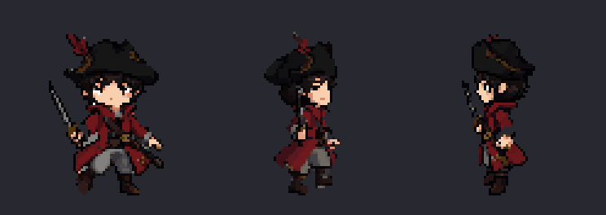

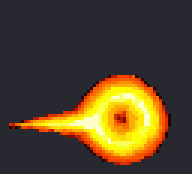 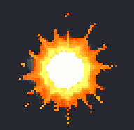

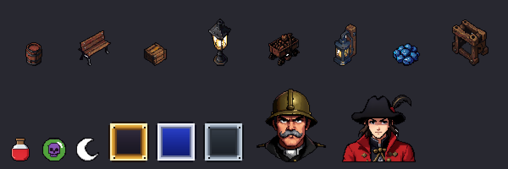

What a review still catches (this is why every character run writes a review sheet with every frame):
- **The test character's punch, after one round of fixes:**
  - South now swings the brass fist; the fix was naming it in the motion text (Dotwork's `--motion "punch=..."`).
  - North was re-seeded, then trimmed to 5 frames once a grin appeared on the back of the head.
  - East holds the side view.
  - West took an audition: 4 seeds x 2 motion wordings, 8 takes on one sheet.
    - With the default wording, 3 of 4 turned to face the camera by frame 3 or 4; the fourth held profile but
      punched with the plain glove.
    - With a profile-locked wording ("keeps his head and body in side profile facing left the whole time, only the
      near arm moves: the big brass mechanical gauntlet punches straight forward"), 1 of 4 was clean. It shipped,
      trimmed to 5 frames played out and back. At full reach the gauntlet looks a little telescopic.
  - East failed its audition: 4 of 4 takes barely moved (0 to 8 px of reach) and never punched. The cause is the
    starting sprite, not the seed: the east rotation is closer to three-quarter than profile, and the gauntlet arm
    is hidden behind the body, so the model has nothing to swing. The fix is to edit the east sprite into a true
    profile with the gauntlet in view, then re-render every east clip from it.
  - Still open: north swings the gloved hand; east turns toward the camera on its last frame and keeps a shadow strip
    in frames 5 to 7; a faint grey ground shadow remains under the south frames.

  The fix for any of these is a hand-polish pass or another audition.
- **The sample NPC** came out younger than the prompt. The south sprite is picked by a technical score, not by how
  well it matches the prompt; the candidate sheet is there to swap it.
- **The cobble's repeat** is obvious at 640x360, and the grass is nearly flat.
- **The dialog panel** has a grey smear in its center.

Timing on the host above:

| Asset | Time |
|---|---|
| Sprite, prop, icon, portrait or UI piece | about 16 s |
| Rotation to 4 directions | about 2.2 min |
| One animation clip (one action, one direction) | about 1.7 min |
| A character with 3 actions in 4 directions, west mirrored | about 19 min |
| Effect | about 2 min |
| Terrain pair (2 textures, autotiles, TileSet) | about 30 s to 1 min |

Animation needs about 20 GB of free system RAM. Dotwork checks before every clip and stops cleanly; re-running resumes
where it stopped.

### More packs: attacks, sprite tools, image to pixel art, isometric
Four smaller packs, each verified the same way:
- **Attack with effects:**
  - The caster is rotated, then animated from its east view, so the cast reads sideways.
  - The fireball loop keeps 4 frames played back and forth, so its trail no longer smears into a cloud.
  - The explosion keeps 3 frames, then gets a dithered dissolve inside a round vignette.
  - A compositing script spawns the fireball at the staff tip on the peak frame (the one with the furthest
    reach), holds the pose while it travels, and keeps the impact inside the frame.
- **Sprite tools** on the sample NPC's south view: three edits by instruction (red scarf, dark blue coat, goggles),
  a top hat inpainted over the head, and a normal map with two lit previews.
- **Image to pixel art:**
  - Two crops of a concept image become 96 px sprites: shrink, enlarge 8x by nearest neighbor, a light
    image-to-image pass at 0.3, grid sample, then lock to the environment palette.
  - The redraw gives clean pixel clusters on the test palette, but loses detail and cools the smoke. The plain
    shrink in the middle column keeps more. Judge per image.
- **Isometric props:**
  - Four pieces: a brick pillar, a grass path block, a pier and a workshop.
  - Terrain pieces lock to the environment palette; the character palette had turned the grass tan.

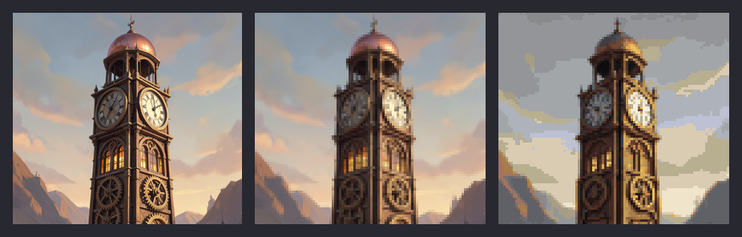

### Ground layers and maps from text
The 2-terrain TileSet above grew into a layered ground system:
- **One TileSet for a stack of TileMapLayers:**
  - A base layer of plain tiles in 4 seamless variants that border each other.
  - One layer per overlay terrain.
  - A decal layer.
  - Per terrain: relief (raised, sunken, flat), collision for solid terrain, and a `surface` custom data string.
- **Overlays are 47-tile blob sets** (Godot's Match Corners and Sides). A probe in Godot first found that in corner
  mode the visible edge sits half a tile inside the painted cells and single cells vanish. Blob mode is exact: paint
  on an empty layer with the editor's defaults and exactly the painted cells fill, single cells become islands, and
  1-wide lines become paths.
- **A map builder:** rows of characters plus a legend become `assets/maps/<name>.tscn`, painted by Godot's own
  terrain solver. The preview is rendered from the cells Godot chose, and each layer is checked. A layout can be
  written as text, by a person or by Claude.
- **Textures at native pixel scale:** 1024 px renders on an 8 px grid. The first method (512 px on a 16 px grid)
  made flat blobs; the sample pack's grass had 2 colors.
  - A catalog of 38 materials is rendered and reviewed: ground, water, snow and ice, interior floors, 6 wall
    facades and 5 roofs.
- **A bigger environment palette,** 80 colors grown to 112 (a superset). Water, copper roofs and brick were wrong
  under the 80; mean color error over the catalog fell from 0.033 to 0.017.

The proof pack has grass plus 8 overlays (sand, dirt, cobble, flagstone, shallow water, solid deep water, tall grass,
a flower bed) and 6 decals. Its 24x15 town-square map has 0 bad cells on every layer, and verify passed.

### Buildings, interiors and fonts
- **Buildings:**
  - Roofs (clay, slate, copper) and facades (brick, timber and plaster, stone) are blob overlays like the ground,
    but in a "structure" style.
  - Each tile fills its cell and gets trim on every open side. Roof: eaves with an overhang shadow at the front, a
    lighter ridge at the back, verges at the sides. Facade: an eave shadow at the top, a stone foundation, corner
    posts. All solid.
  - Doors, windows (lit and unlit), chimneys and a 2x1 shop sign are sprites fitted to their cells, cut into tiles
    and placed from the map's object list.
- **Interiors:**
  - An inn room: a plank floor, dark wall tops, a papered north wall with a baseboard, and black void outside.
  - Furniture in three views: front (bookshelf, fireplace, wall clock), top (barrel, chairs, plant), flat (rug,
    beds). The table is a weak take and needs a retake.
- **Fonts:** an image model cannot draw a consistent set of letters, so Dotwork has a glyph tool instead.
  - Claude writes each glyph as a text bitmap. Dotwork builds a PNG page and an AngelCode BMFont `.fnt`, which Godot
    imports as a FontFile with no plugin.
  - Two fonts so far: a proportional dialogue and menu font (all 94 printable ASCII characters, lowercase with
    descenders, a baked shadow, 22 px line) and a bold damage-number font (0 to 9, plus and minus, MISS, a baked
    outline).
  - Glyphs are white; tint them with `font_color`. Verify loads both and checks the line height and a sample width.

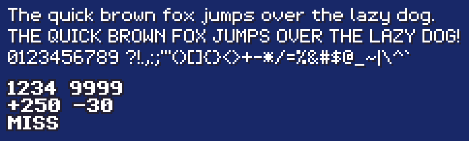

After one review round: the shop sign became a bracket sign on the facade, the houses were widened so windows no
longer crowd doors, doors fill two cells, the inn's chairs became stools and the table was retaken. Roofs got a
light-to-dark shingle band per tile with a lighter ridge and a darker eave, but still read fairly flat from above.

### Battle: backgrounds, enemies, poses, a mock screen
- **Battle backgrounds:** six so far (grassland, forest, mine cave, snowfield, steam factory, desert).
  - klein renders 2560x1024 on an 8 px grid, sampled to 320x128 real pixels, shipped as a Sprite2D scene at exactly
    2x (640x256) with nearest filtering. About 15 s each.
  - Raw renders are cached, so palette and color changes are instant.
- **Enemies:** six regulars at 64 to 104 px and a 192 px boss, all facing right with feet at the scene origin.
  - A new check removes white background trapped inside a sprite (between legs, inside a curled tail). It skips
    white subjects: a frost bear was left alone.
- **Party battle set:** the asymmetric test character facing left with idle, walk and attack, plus 7 still poses (ready, weak, KO,
  victory, hurt, defend, cast) made by instruction edits.
  - Vague pose wording made the edit model return the idle pose; the wordings that worked were found by audition.
- **Window skins drawn in code:** 9-slice plus NinePatchRect in classic blue, brass with rivets, and iron.
- **Title fonts:** brass and steel slab-serif fonts from the same glyph tool, with gradient ink, capitals only.
- **A mock battle screen:** a script composes the 640x360 screen from the packs (background, enemies, a party pose,
  windows, fonts, an action-time bar, damage and a MISS) to judge the art together before any game code.

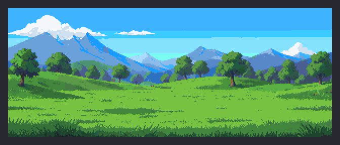

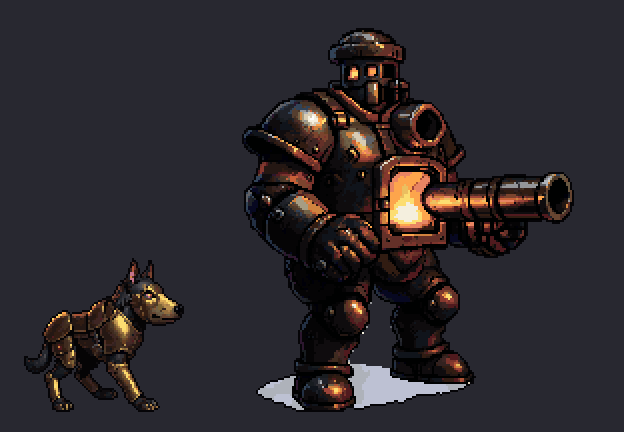

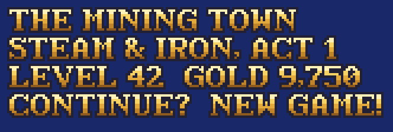

### Spells, props with collision, symbols and balloons
- **A spell library of 12 through the effect lane:** fire, ice, thunder, quake, cure, life, poison, haste (a loop),
  protect, drain, flare, and a steam burst. All are additive, and one-shots dither out.
  - 10 were good on the first pass. The steam burst grew a small man out of the steam, and cure showed two dark
    spots that read as eyes (the same face problem as before). Both were retaken: a clean steam blast, and cure as a
    column of rising motes.
- **61 props:** town, steam machinery, nature (oak, pine, snowy pine, dead tree), dungeon (chests open and closed,
  pots, spikes, a statue, a save crystal, torches) and interior.
  - Each ships a `prop_<name>.tscn` too: a StaticBody2D with its origin at the feet, ready to y-sort, and a
    footprint box.
  - Trees, lamps and posts get a narrow trunk footprint, so characters walk behind the canopy. Flat things
    (plates, spikes, reeds) are not solid.
- **A symbols font:** a hand cursor, arrows, a heart, a note, a star, a check, a cross and an ellipsis, mapped to
  real Unicode so they work inline in dialogue. The cursor and arrows also ship as single PNGs.
- **Seven emote balloons** (! ? ... heart, note, sweat, star) at sprite scale, each with a 2-frame pop animation.

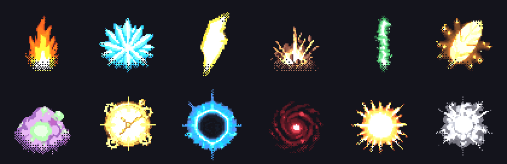

### Cliffs, the world map, and fences, pipes and rails
- **Cliffs without a new system:**
  - A plateau is a raised overlay. Below it runs a rock cliff-face strip, a "cliff" structure style with a lit top,
    a shadowed base, a lip shadow and turned ends.
  - Stairs are a 2x2 fixture; hedges are a solid, raised leafy overlay.
- **A world map:**
  - World terrains are blob overlays over a sea base: shallows, plains, desert, snowfield, swamp, forest canopy, and
    solid mountains.
  - Five location icons (town, castle, cave, tower, steam factory) ship as props.
  - The 28x12 two-continent map below was painted from text.
- **Connectors drawn in code:** fences, iron railings, steam pipes and mine-cart rails.
  - Each piece's shape comes from the sides Godot paints: straight, elbow, tee, cross and dead end.
  - Pipes get bolted junction boxes; rails get curves and buffer stops.
  - Fences and pipes are solid along the line; rails are not.
- **Long edges stopped repeating:** every texture variant now gets all 47 blob tiles, not only the interior tile,
  so paths, shores, cliff faces, eaves and wall faces no longer repeat every 32 px. Godot picks among the variants
  by probability; they share edges, so no seams.
- **A map-authoring tip:** paint the bank material under water (cobble under a canal, sand under a pond). The
  water's inset edge then shows the bank instead of the base grass.

What a review still catches:
- **The plateau top** looks the same as the ground below; only the cliff strip says it is higher.
- **The cliff face** still shows a regular rhythm along its length.
- **The world map** does not have its location icons placed yet.
- **The canal** has no bank, which the map tip above fixes.

### Auditions: pick a take from a sheet
```
dotwork.py audition --name guard --clip punch_w --seeds 8101 8102 8103 8104 --motion "" "keeps his head and body in side profile..."
dotwork.py audition ... --promote <take>      # ship that take without re-rendering
```
Renders every take to a side folder, scores them and lays them out on one sheet; the shipped clip is untouched until
a take is promoted. The score only sorts the sheet: the turn-around warning missed 3 takes that had turned, so a
person (or Claude reading the sheet) still picks. About 2 minutes per take.

### Hand polish in Aseprite (round trip)
```
dotwork.py aseprite              # editable sources under assets_src/aseprite/
(open the .aseprite files in Aseprite, fix pixels, save)
dotwork.py aseprite --reexport   # back to the shipped paths, then the Godot proof
```
- **Build:**
  - One `.aseprite` per character, with a frame tag per animation (`idle_s`, `walk_e`, ...) and frame durations
    from its fps.
  - One per effect, tagged `loop` or `play`.
  - One per prop, icon, portrait or UI piece.
  - Each is indexed on its own colors with index 0 transparent, so nothing shifts color, and a `.gpl` of those
    colors sits beside it.
  - Aseprite runs headless with a Lua script (`Aseprite.exe -b --script <file> --script-param key=value`).
- **Re-export:**
  - Every tag's frames go back to the same shipped paths as RGBA PNGs without metadata.
  - Then it rebuilds the SpriteFrames, the sheets and their JSON, and the manifest rows (marked "hand-polished in
    Aseprite").
  - Then the same Godot proof as a new pack.
  - Keep the tags and the canvas size. Frames added inside a tag lengthen that animation; a renamed tag renames
    the animation.
- **Tested:**
  - Build then re-export with no edits changed 0 of 120 PNGs.
  - A one-pixel edit changed exactly that frame and its sheet.

The "polish" above is a scripted stand-in for the eraser, not a human edit. A Lua script run inside the `.aseprite`
erased 249 px of faint olive floor shadow in frames 4 to 6 that the automatic cleanup missed. A sliver is still
visible at the bottom left, which is what a real artist's pass is for. The pack verified afterwards.

Windows and Lua quirks found on the way:
- **Aseprite.exe is a GUI-subsystem program.** Python's `subprocess.run` waits for it and gets the exit code.
  PowerShell's `&` does not wait, and `$LASTEXITCODE` stays empty, so use `ProcessStartInfo` and `WaitForExit`.
- **Indexed images lose their palette when saved alone.** In Lua, saving an indexed `Image` by itself drops the
  palette, so every pixel comes out black. Convert the sprite to RGB in memory before exporting; the `.aseprite`
  stays indexed.
- **Lua `io` works in batch mode** (`-b`) without a permission prompt.
- **`--script-param` takes `key=value`** with no spaces around the `=`. Pass paths with forward slashes or quoted.

Versions: Aseprite 1.3.18.6, Godot 4.7.2, Python 3.12, ComfyUI 0.43.0.

### Kit samples: one per lane, from the Dotwork that ships
After Dotwork moved into the kit (2026-10-30), a Claude Code session re-made one sample per lane with the shipped Dotwork: no style
reference, the shipped palettes, the Apache klein VAE. Every PNG was re-saved with image chunks only. Lanes with a
verified sample: a mount (steam walker, idle and walk in 4 directions), props, icons, a portrait, three spells, hit
sparks and slashes, five fonts, window skins, balloons, symbols, a mine tunnel with rails, a lever, a party member
with its battle set (the duelist above), a battle background and two enemies, three scenes, and image to pixel art.

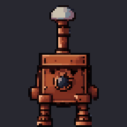
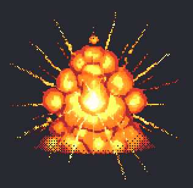

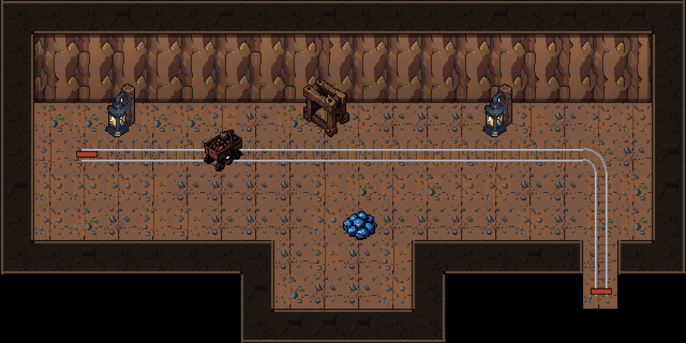

**With and without a style reference.** Same prompts and seeds. Top row: no reference. Middle row: four of Dotwork's
own props (bottom row) as the reference.

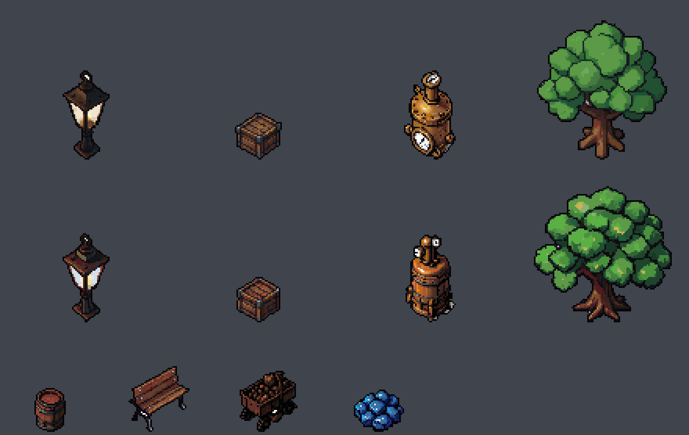

The effect is real but modest: outline weight and shading move toward the reference. It also changes the subject:
the boiler lost both gauges and gained two white dots that read as eyes, and the lamp glass turned blue. So check
every referenced sprite, not just the set's look. SOP-16 says to bring 3 or 4 of your own sprites.

What review still finds in these samples: the mine wall face and rock tops repeat visibly across a room, and floor
tile edges show as a grid; the mount's side-view walk smears mid-stride; the golem keeps a light-grey shadow slab;
image to pixel art bands the sky. The samples exposed two bugs, fixed before these renders: a fixed refine canvas
cropped 192 px bosses, and the palettes had no sky colours, so backdrops banded. The scenes were made with the shipped palette.
The image-to-pixel-art sources are concept images Dotwork painted itself (the model added fake signature marks, cropped off first). Left out on purpose: the
8-direction vehicle set (rotated one step) and sprite edits (their source sprites are not published).

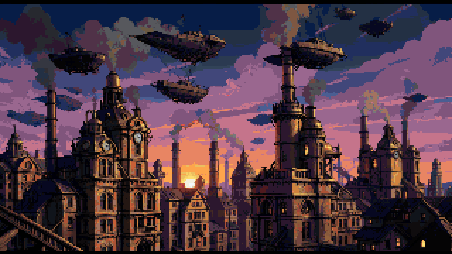

The shipped palettes were checked, not assumed: every prop's cache key matches the shipped palette file, and the
112 environment colours were extracted from Dotwork's own material renders.

### What Dotwork taught
- **Godot's corner solver needs a tile whose center matches the painted terrain.** With one copy of each of the 16
  wang tiles, single cells, 1-wide lines and diagonals came out wrong. Writing every tile twice (once with each
  terrain in the center) gave 0 mismatches.
- **Fill the base terrain first.** On an empty TileMapLayer, `set_cells_terrain_connect` with its default
  `ignore_empty_terrains = true` leaves the region's outer ring unpainted. Paint the base over the whole area first,
  or pass `false`.
- **Negative prompts do nothing for Wan in this workflow.** The 4-step Lightning LoRAs run it at cfg 1.0, so all
  steering is in the positive text or done afterwards.
- **Remove ground shadows before the palette lock.** The lock repaints Wan's shadow in the sprite's darkest colors,
  and then it cannot be told apart. Render the clip unlocked, remove the flat neutral blob at the feet, then lock to
  the sprite's palette. A thin strip can remain.
- **Back views grow faces.** Wan painted a face on the back of the head in 3 of 3 seeds for the north idle. Dotwork
  uses a 1 px breathing bob of the rotated back sprite instead.
- **Characters turn to face the camera,** mostly in attacks and north clips. A heuristic flags possible turns in the
  manifest but never trims by itself (it misfires on big south attacks). The fix is per clip: `keep=N` keeps the
  first N frames and plays them back to the rest pose; `seed=S` re-renders that clip with a new seed.
- **Long one-shot fades still grow faces,** even with the effect-only prompt. Keep about 3 frames of an explosion
  and fade with a dither; loops are fine.
- **Check each model file, not just the model's name.** The image VAE first used was the FLUX.2 [dev] file, which is
  non-commercial. The klein repository has its own Apache-2.0 VAE, with a different SHA-256. Dotwork uses that one,
  and art from the earlier file should be made again before it ships.

## Results by asset type
These runs came before Dotwork. Their images are not shown (clean Dotwork redos of the attack demo, sprite tools, image to
pixel art and isometric pieces are above): they were made with a VAE file whose license is
non-commercial (see "Check each model file" above), and so were anything rotated, animated or edited from them. The
numbers and lessons stand; the images shown above are Dotwork output, made with Apache-2.0 and MIT models only.

### The core sprite lane
Most rows below use one recipe:
1. FLUX.2 klein 4B plus SpriteKiln's klein pixel LoRA (strength 0.8). The style reference is a 2x2 collage of four
   reference sprites made for the test (not published). It renders at 1008x1008 on white.
2. Key out the white, crop, and box-downscale to the target height (66 px for characters).
3. Enlarge 8x by nearest neighbor, then run klein image-to-image at strength 0.45 with the same prompt and reference.
4. Take the dominant color of each 8 px cell, defringe, and drop stray islands.
5. Lock to a 64-color palette (built from the reference sprites) in OKLab, cap each sprite at 40 colors, and add a 1 px near-black outline.

About 16 s per asset. Compared with the hand-picked reference sprites, refined props came out at:

| Measure | Refined props | Test sprites |
|---|---|---|
| Colors per sprite | 37.5 | 40.5 |
| Isolated pixels | 18.9% | 18.5% |
| Dark outline | 100% | 99% |

### Characters
72 px canvas, one facing. All 10 were usable.

### Props and objects
| Asset | Size | Usable | Notes |
|---|---|---|---|
| Single props | 64 px canvas, 48 px longest side | 10 of 12 first try | Best lane. The valve wheel became crates; the telescope came out odd |
| Item icons | 32 px | 6 of 8 | The coal lump became a box; the health potion was not red |
| Dialogue portraits | 96 px | 3 of 6 framed right | Faces are good, but half were not head-and-shoulders. Needs a bust prompt or a top crop |
| UI panels, gauges, slots | 64 px | Good | No reference used |
| Isometric pieces (2:1 projection) | 64 px | 4 of 4 | One has a grey shadow artifact |
| 8-direction objects | | Not run yet | Character rotation works, so this should transfer |

### Tilesets
| Tileset | Method | Time | Verdict |
|---|---|---|---|
| Seamless 128 px terrain | See below | about 16 s | Usable, 6 of 8. Grass, cobble, water, brick, slate and iron are good; dirt and planks show marks where the seam was repaired |
| Seamless 32 px | Same method, 512 px render, 16 px grid | about 7 s | Seamless but flat |
| Corner autotiles (wang16) | A small script; no AI in this step | under 1 s | Usable: clean joins. Rims are subtle, cobble repeats visibly, and there is no quay or cliff edge yet |
| SpriteKiln's noise-edge autotiles (wang16, blob47) | SK_Tileset | about 1 s | Rejected: random blobs and islands |
| Sidescroller platforms; blob47 from the new script | | | Not run yet |

The 128 px textures:
1. Render with a klein texture prompt (LoRA 0.6) at 1024 px.
2. Shrink to 128 px, then run the refine step at strength 0.4.
3. Shift the tile by 64 px so its seams meet in the middle as a cross.
4. Inpaint that cross band (masked, strength 0.7), keeping the original outer 16 px ring.
5. Lock to an 80-color environment palette, with at most 24 colors per tile.

The autotile script draws 16 corner tiles per terrain pair: smooth corner shapes, edges kept straight at the tile
borders, and a dark rim with a drop shadow. It uses the 128 px textures as 16 offset variants, so the fill stays
detailed and continuous.

### Animation
**Walk, front view:** SpriteKiln workflow 10.
- **Models:** Wan 2.2 image-to-video 14B (Q4), 4-step Lightning LoRAs and SpriteKiln's pixel-animate LoRA.
- **Processing:** 33 frames with automatic loop selection, then grid snap, a palette lock to the input sprite, and
  stabilizing on the bottom center.
- **Speed:** 117 s for 8 frames.
- **Verdict: usable.** Identity and palette hold, the legs alternate and the arms swing. The body twists slightly toward
  a 3/4 view, with minor jitter.

- **The action has to be one of the node's 36 fixed values** (walk, idle, run, attack (ranged), hurt, fire or torch
  flicker, and so on). Free text fails validation.
- **It needs about 20 GB of free system RAM.** Closing other heavy apps was enough.

#### A full set: 4 directions x idle, walk, kick, into Godot 4
**Input:** one NPC rotated to 4 directions (Qwen, above).
**Per clip:** the walk workflow per direction and action, the same seed (4242) on every clip so the motion style
matches. West is east mirrored, so 9 clips are generated and 12 come out.

| What | Result |
|---|---|
| Time | 102 to 111 s per clip, about 16 min of GPU time for the set |
| Frames | idle and kick 6, walk 8; 80 in all |
| Scale | figure height 63 to 70 px across every clip |
| Colors | 88 to 100% of each clip's colors are in the south sprite |
| Verdict | **Good:** real stepping in the side views, a coherent back view, identity, palette and scale hold |

**Automatic clean-up:**
- **Ground shadow:** removed by shape: dark pixels in the bottom rows with nothing of the body above them (638 px, no
  feet clipped). A color test cannot do it, because after the palette lock the shadow uses legal colors.
- **North kick:** the model turned the character to face the camera in the last 2 frames. The clip was rebuilt
  from frames 0, 1, 2, 3, 1, 0.
- **Left for hand work:** one faint shadow under the south kick's raised foot, a quick fix in a pixel editor.

**Godot export:**
- **The file:** one `SpriteFrames` resource with 12 animations (`idle_s`, `walk_e`, `kick_n` ...). Idle and walk loop;
  kick plays once, at 8 fps.
- **Layout:** all 80 frames are padded onto one 64x74 canvas with the feet at the bottom center, so switching
  animations never jitters. An `AnimatedSprite2D` offset of (0, -37) puts the feet on the node.

**What we learned:**
- **Free the models between clips** (ComfyUI's `POST /free`). Back-to-back Wan clips pushed system RAM low enough
  that the PC stopped the job.
- **Name the view per direction:** "front view" (S), "side view" (E, W), "keep facing direction" (N).
- **Check the last frames of attack clips;** Wan can turn the character around.
- **Budget about 1.7 min per clip.** A 4-direction set of 6 actions is about 35 min.

### Effects (VFX), casting and firing
**How:**
1. **First frame:** the core lane drawn on **black**, with the prompt "pixel art game visual effect: <subject>, bright
   glowing energy". It is keyed from black and kept to 16 colors, with no outline. 9 to 15 s; all 5 were strong on the
   first try.
2. **Animate:** the same Wan workflow on a black background, 33 frames, 92 to 110 s per clip, with the models freed
   between clips.
3. **Draw with additive blending,** where black adds nothing. In Godot: a `CanvasItemMaterial` with `blend_mode` Add on
   the effect sprite.

| Effect | Verdict |
|---|---|
| Fireball (loop) | Excellent |
| Steam puff | Excellent |
| Heal ring | Excellent, with the prompt fix below |
| Explosion, muzzle flash | Good after keeping the good frames (5 and 4) and adding a 4-step Bayer-dither fade |
| Soldier firing, side view (a custom motion; see the demos) | Good: shoulders, aims, small recoil, lowers |
| Caster, side view (a custom staff thrust) | Good; the staff head reads as a pale knob instead of a flame |

**Key finding: effects grow faces.**
- **The symptom:** with SpriteKiln's animation preset prompt, one-shot effects turned into cartoon creatures as they
  faded. The explosion became a bomb creature, the heal ring a smiling slime, and smoke grew yellow critters. Turning
  off the pixel-animate LoRA did not help.
- **The cause:** the preset's prompt always includes "the character keeps facing exactly the same direction" and
  "consistent character design".
- **The fix:** replace the Wan text prompt for effects with an effect-only one, plus the negatives "face, eyes, mouth,
  smile, character, creature, person, cartoon mascot":

  > 2D pixel art visual effect animation of abstract glowing energy: <motion>. Static locked camera, no zoom, no
  > panning, the plain solid black background stays unchanged, crisp pixel art, abstract particles and light only, no
  > faces, no eyes, no characters, no creatures.

**Combat demos** (effects added over a street built from the seamless cobble texture). The first version had the
caster facing the camera while its fireball flew sideways, launched after the cast had ended; this is the redo.

- **Caster:** rotated to 4 directions first (Qwen, about 132 s), then animated from the east view with "side view" and
  a custom motion ("thrusts the glowing brass staff straight forward toward the right... holds it fully extended, then
  lowers it"). The "cast spell" preset made a messy white swirl. The fireball spawns at the staff tip on the peak
  frame, the pose holds 6 frames while it leaves, then the explosion.
- **Soldier:** the rotation hid the musket behind his body, and Wan's "attack (ranged)" preset then invented a pistol
  firing a pink beam. Fixed by a reference edit on the east sprite ("long wooden musket... pointing to the right",
  20 s), a custom motion (shoulder, aim right, small recoil, lower) and the negatives "laser, beam, light streak,
  projectile trail, bullet tracer, pistol, handgun". The pose holds through the flash and smoke.
- **Heal:** over a test character's idle loop, trimmed to 7 frames and a dither fade.

**What the redo taught:**
- **Turn the character to face the direction of travel first,** then animate the side view. Check facing on the pixels
  (which side of the head the skin is on), not by trusting file order.
- **Fire on the peak frame:** the frame whose upper body reaches furthest toward the target. Hold it while the effect
  leaves.
- **Presets invent things.** Use a custom motion line plus negatives for what showed up (here a pistol and a beam).
- **Round off one-shot effects** with a round dither vignette, or the video frame's edge shows as a square of smoke.
- **The rotation's file order is S, W, N, E** (screen clockwise from south). The first animation set read the second
  image as east, so its east and west clips were swapped; it was fixed and the export regenerated.
- **Known nits:** Wan adds a small puff of its own in one soldier frame, which blends with the flash.

### Sprite tools: rotate, edit, inpaint, normal map
| Tool | Time | Verdict |
|---|---|---|
| Rotate to 4 directions (Qwen-Image-Edit + Multiple-Angles LoRA, SpriteKiln workflow 07) | 138 s | Good: identity, proportions and palette hold and the back view is coherent; side views are stiff |
| Edit by instruction (klein): add a scarf, a blue coat, goggles | 16 s | Good, 3 of 3. Lock to the full palette, not the sprite's own, or the new colors collapse |
| Masked inpaint (klein + SK_MaskedMerge): add a top hat | 13 s | Good: everything outside the mask is untouched |
| Normal map (SK_SpriteNormalMap) | 3 s | Good; the lit preview is correct |
| Grid recovery ("unzoom") | | Recovered the exact size from a sprite enlarged 5x, blurred and saved as JPEG |

### Scenes and maps
| Approach | Time | Verdict |
|---|---|---|
| One-shot whole-scene render | about 13 s per draft | Fails as a playable map: the angle and scale are inconsistent. Title art only |
| Map layout in code (80x45 tiles of 32 px) | under 1 s | Coherent but plain |
| klein repaint of the code map | 10 to 27 s | Strength 0.45 adds detail and mostly keeps the layout; 0.6 drifts (see the early tests below) |
| Image to pixel art (shrink to 96 px, 8x, klein image-to-image) | | Usable for scenes with big shapes; crowds turn to blobs |
| Region by region repaint, structure lock (ControlNet) | | Not run yet |

For image to pixel art, this model's schedule starts near full noise, so strength 0.45 ignored the source. About
0.3 (2 of 8 steps) worked.

### Next
- **Done in Dotwork:** effects and tiles into Godot (SpriteFrames with an additive material, a match-corners TileSet),
  a red potion icon, the portrait bust.
- **Done in Dotwork:** the Aseprite round trip (see "Hand polish in Aseprite" above).
- **Pixelorama:** the same round trip for the free editor.
- **Done in Dotwork:** layered ground with blob overlays, decals, and maps from text.
- **Done in Dotwork:** building kits, interiors, glyph fonts.
- **Done in Dotwork:** battle backgrounds, enemies, party battle poses, window skins, title fonts.
- **Done in Dotwork:** a spell library, 61 props with collision scenes, a symbols font, emote balloons.
- **Done in Dotwork:** cliffs, a world map, fences, pipes and rails, and every blob tile per texture variant.
- **Next in Dotwork:** status-effect icons, mounts and vehicles, field emote poses and a title screen.
- **Not run yet:** 8-direction objects, sidescroller tiles.

## Early tests (the first run)
These came before the core lane above. Kept for the numbers and the lessons. All on the host above, warm (models already loaded) unless noted. "Peak GPU" is the whole card from `nvidia-smi`,
including ComfyUI's cache, so it reads near 16 GB even when a job needs less.

### Style test: one prompt set, six lanes
Ten NPC prompts, same seeds on every lane, each output cut out, put on a 66 px grid, locked to a test character's palette and
padded to 72x72. The reference is that test character's sprite.

Rows top to bottom: A, E, B, B2, C, D.

| Lane | Model path | Usable | Warm s/img | Cold s | Verdict |
|---|---|---|---|---|---|
| E | FLUX.2 klein 4B + pixel LoRA + the test character as style reference | 10/10 | 14.1 | 15.4 | **Use this.** Closest to the reference; some NPCs borrow its coat |
| A | klein, text only | 10/10 | 10.3 | 13.1 | Concepts: consistent, muddier |
| B2 | Z-Image Turbo + PixelArtRedmond | 10/10 | 17.1 | 18.2 | Appealing, but a different game's look |
| B | Z-Image Turbo + SpriteKiln LoRA | 9/10 | 18.1 | 20.4 | Weak outlines |
| C | SDXL + Pixel Art XL + PixelOE | 7/10 | 13.0 | 19.1 | Skip: sheets of tiny characters, front views |
| D | SDXL + PixelArtRedmond + detector | 7/10 | 14.2 | 18.1 | Skip: same problems |

"Usable" is a judgment from the contact sheet (one whole character, framed right), not a metric.

### The refine step (sharper NPCs)
klein draws about 110 "fake pixels" tall at any canvas size, so shrinking its render straight to sprite size threw the
detail away. The refine step: shrink to the target size, enlarge 8x by nearest neighbor onto an exact grid, run klein
image-to-image at strength 0.45 with the same style reference, sample the grid, then clean up (defringe, 40 colors per
sprite, a near-black outline). About 20 s per NPC (10 s render, 11 s refine).

A 2x2 collage of four test sprites worked better as the style reference than one sprite: a single reference
also hands over its outfit and props.

### Rotation (the asymmetric test character, 8 directions, nothing mirrored)
| Path | 4 directions | 8 directions | Peak GPU | Result |
|---|---|---|---|---|
| Qwen-Image-Edit + Multiple-Angles LoRA | 172 s | 317 s | 15.4 GB | Pass: fist, backpack, goggles and scarf kept, the fist stays on the left arm |
| klein 4B edit | 45 s | 83 s | 14.9 GB | Fails for that character (drops the fist and backpack); fine for plain NPCs |

### Palette lock and the Aseprite finishing step
Palettes are built from existing sprites (k-means in OKLab, snapped to colors the art uses). Mean error at 32, 48
and 64 colors from one character alone: 0.0122, 0.0084, 0.0062 (about 0.02 is just noticeable); from all the reference sprites
at 48 or 64 colors: about 0.009. The finishing script locks each PNG to the palette in Aseprite (indexed, no
dithering), saves an editable `.aseprite`, exports the PNG and an optional sheet, then checks every pixel is on the
palette with hard alpha: 10 of 10 NPCs passed.

A palette built only from existing sprites cannot show new hues: with a mostly brown, brass and navy reference cast, the purple
dress went maroon and a face went orange (middle row). Add the missing hues (purples, olives, teals, a second skin
ramp) before locking new characters. Aseprite is a GUI program on Windows: a script must start it as a process and
wait for it to get a real exit code (PowerShell's `&` does neither).

### Tiles and maps
| Job | Time | Result |
|---|---|---|
| Seamless 32 px tile (SpriteKiln workflow 12, Z-Image), 13 textures x 3 seeds | 4 to 8 s each | Wraps seamlessly, but the content is noise: **unusable at 32 px** |
| 32 px walk sheet (klein base + 4-walk LoRA) | about 30 s | Clean cycles, but the LoRA's 32 px characters lose the test character's identity |
| Whole-scene map draft, klein 1920x1088 | about 13 s, 15.5 GB peak | Looks good as a thumbnail; angle, scale and proportions drift. Backdrop or title art at most |
| Refine of that draft at 2560x1440 (to a true 640x360) | 19 s | Same drift |
| Map drawn in code (80x45 tiles of 32 px) | under 1 s, no GPU | Coherent, generic |
| klein repaint of the code map, 2560x1440 | 10 to 27 s | See the strengths below |

Repaint strength: 0.3 changes almost nothing, 0.45 adds detail and mostly keeps the layout, 0.6 is nicer art but moves
buildings and breaks the canal. Above 0.5 the input's layout is gone. The style reference made little difference here.

The first run's Wan and autotile jobs were stopped when the PC ran low on memory; both ran later (above). Run heavy
jobs one at a time with other apps closed.

## Lessons for the kit
- Local for concepts, variants and style references; polish finals by hand.
- Never shrink a klein render straight to sprite size: use the refine step.
- Use a collage of several sprites as the style reference.
- Image-to-image strength is not linear on klein: 0.45 can wipe a busy scene, so try 0.3 first when the layout matters.
- A second redraw pass gave no visible gain.
- Palettes need extending for environments too (terrain got its own 80-color palette).
- Plain AI tiles at 32 px are noise. Use 128 px textures with the seam repair, or draw small tiles in code or by hand.
- Extend a palette built from existing art before locking new characters to it.
- AI upscalers (Upscayl, ESRGAN) blur pixel art: enlarge by nearest neighbor only.
- In a 640x360 game a "big" sprite is about 128 to 360 px; advice to draw at 2048 px does not apply.
- Reference art from a commercial generator: read its terms before training anything on it. Some forbid training
  models, LoRAs included, on their output, while using it as a style reference at generation time is allowed
  **(verify per service)**.
- Keep ComfyUI on `127.0.0.1`: it has no login.
- ComfyUI's saved PNGs embed the full prompt and workflow: re-save them before publishing.

## Credits
The setup, scripts and tests were done by a Claude Code session (Claude Opus 5.5) on one test machine,
2026-10-28/30. The early scripts stay on that machine; Dotwork, built from them, ships in the kit (`core/tools/art/dotwork/`). Images: made with Dotwork for
this write-up; all rights reserved, shown for reference.
