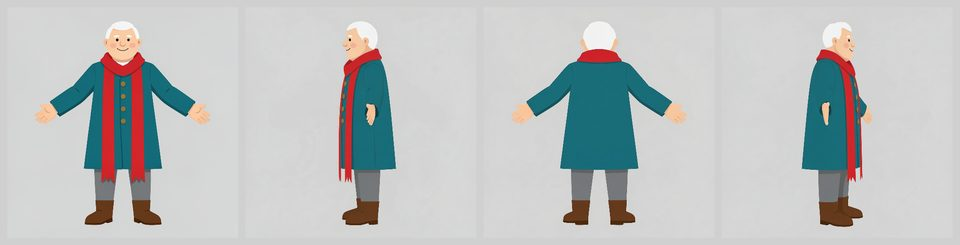
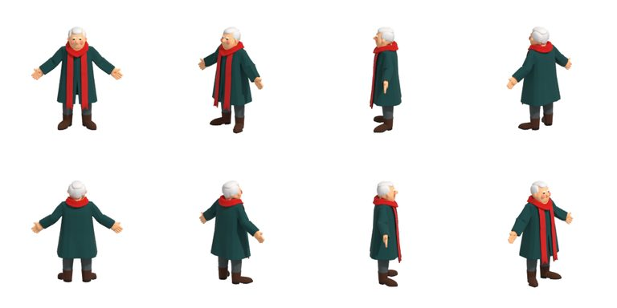
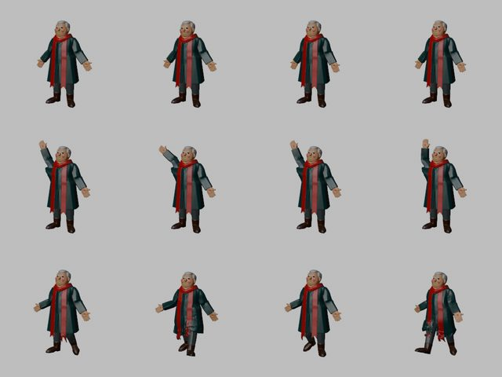
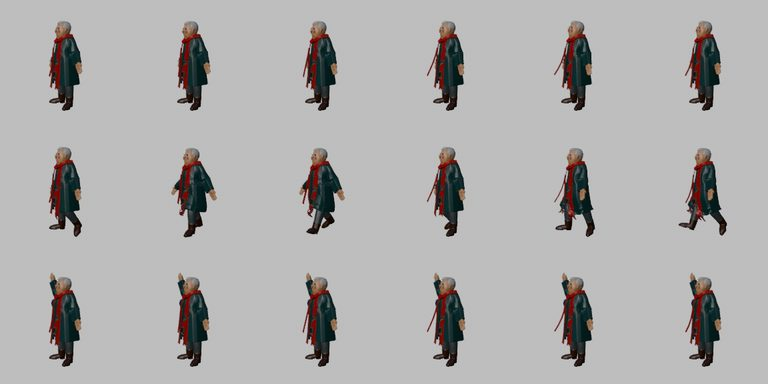
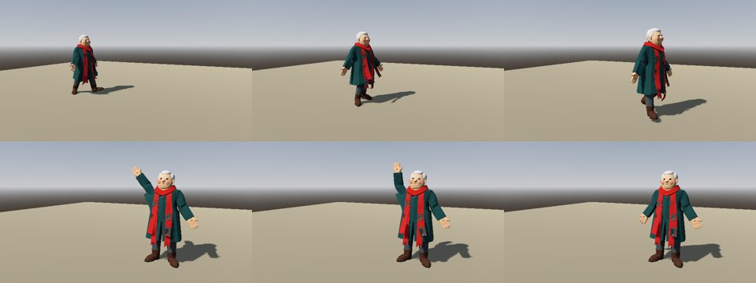
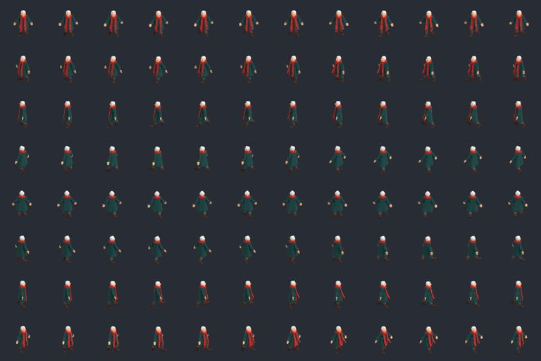
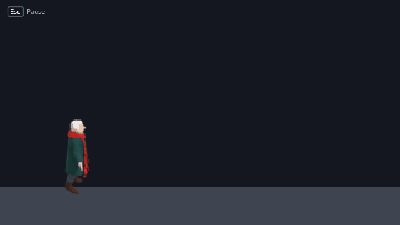

# Make a character: one sentence to a character walking in Godot and in LÖVE

The `/make-character` skill's path (`core/.claude/skills/make-character/`), run live on the free local route, end to
end, on one machine: an idea in one sentence, model-ready reference views, a 3D model, a rig with clips, a scarf that
swings, then the same character in a 3D game (Godot, through `KitCharacter`) and a 2D game (LÖVE, through 8-direction
sheets and a Dotwork asset manifest). The character is made up for this page: a stocky map-maker in a teal coat with a
long red scarf. No weapon, nothing from any game. What went wrong is shown next to what went right; four kit bugs the
run found were fixed on the way (listed at the end).


Machine: Windows 11, RTX 5060 Ti 16 GB, 64 GB RAM, ComfyUI 0.43.0, Blender 5.2.3, Godot 4.7.2, LÖVE 11.5 (K01,
2026-11-11). Both games were fresh kit scaffolds (`scripts/new_game.py --engine godot`, `--engine love2d`). VRAM is
the whole card, sampled every 2 s, and includes about 1.4 GB that desktop programs held before the run.

| Gate | Step | Command | Time | VRAM peak | Result |
|---|---|---|---|---|---|
| 1 | Concept | the sentence below | | | one prompt, seed 7 |
| 2 | Reference views | `bozzetto.py reference` | 178 s (front 12 s, side and back 48 to 62 s each) | 15.5 GB | four views; left and right swapped, fixed with `--swap-sides` in 1 s |
| 3 | Model | `bozzetto.py make --class hero` | 176 s (158 s on the GPU) | 10.9 GB | 53,996 triangles, 1.8 m, two LODs, budget passed with one warning |
| | Stop ComfyUI | | | 1.4 GB left | |
| 4 | Rig and clips | `bozzetto.py rig make` (UniRig) | 192 s | 15.7 GB | 46 bones, 22 with Mixamo names, `idle`, `wave`, `walk` |
| 5 | Scarf | `bozzetto.py rig chain` | 6 s (third try) | CPU | two 4-bone chains, rebuilt as strips |
| 6 | 3D game | Godot `KitCharacter`, `smoke --record` | seconds | | walks, waves, idles |
| 6 | 2D game | `render_sprites.py --manifest`, LÖVE starter | 83 s render (CPU) | | 8 directions x 3 clips; walks east |

## The commands
From the Godot game's root folder (`BLENDER_BIN` set to Blender 5.2, `UNIRIG_DIR` to a UniRig checkout set up as
`tools/bozzetto/README.md` "Rig a character" says):
```
# ComfyUI running (started from its own venv: python main.py in the ComfyUI folder)
python tools/bozzetto/bozzetto.py check
python tools/bozzetto/bozzetto.py reference npc_mapmaker --prompt "a stocky stylized map-maker with a round friendly face and short white hair, a teal knee-length coat with big brass buttons, grey trousers, brown boots, and one long bright red scarf hanging straight down the front to the knees, simple chunky shapes" --seed 7
python tools/bozzetto/bozzetto.py reference npc_mapmaker --swap-sides
python tools/bozzetto/bozzetto.py make npc_mapmaker --image assets_src/bozzetto/npc_mapmaker/reference/front.png --class hero --seed 7

# stop ComfyUI here: UniRig needs the card
python tools/bozzetto/bozzetto.py rig check
python tools/bozzetto/bozzetto.py rig make npc_mapmaker
python tools/bozzetto/bozzetto.py rig chain npc_mapmaker --part "scarf_l=colour:#c81e1e~0.3&box:0,0.62,0,0.4,1.25,0.6" --part "scarf_r=colour:#c81e1e~0.3&box:-0.4,0.62,0,0,1.25,0.6" --no-replace
python tools/bozzetto/bozzetto.py rig chain npc_mapmaker --part "scarf_l=colour:#c81e1e~0.3&box:0,0.62,0,0.4,1.25,0.6" --part "scarf_r=colour:#c81e1e~0.3&box:-0.4,0.62,0,0,1.25,0.6"

# Godot: src/showcase.gd on a Node3D scene made the main scene
python tools/dev.py import
python tools/dev.py smoke --frames 420 --record captures/frames
python tools/art/frames_to_gif.py captures/frames in_engine_godot.gif --fps 15 --width 400

# LÖVE: the rigged .glb copied to assets/models/ of the LÖVE game, then from its root
blender -b --python-exit-code 1 -P tools/blender/render_sprites.py -- assets/models/npc_mapmaker_rigged.glb --out assets/art/characters/npc_mapmaker/npc_mapmaker.png --actions all --step 2 --directions 8 --size 96 --manifest assets/dotwork/npc_mapmaker.assets.json --name npc_mapmaker
python tools/dev.py test
python tools/dev.py smoke --frames 240 --record captures/frames
```
`src/showcase.gd` is this folder's; copy it into the Godot game (`scripts/showcase/`).

## Gate 1: the idea
The sentence was written for the generators as much as for the look: chunky shapes (thin parts merge or vanish),
one colour used only on the part that should swing (red, so `rig chain` can find it by colour), the scarf hanging
down, not flying (Bozzetto's prompt asks for an A-pose and hanging cloth anyway). The skill draws only the front
first (`--views front`, about 12 s) so a look is cheap; here the first seed was kept.

## Gate 2: the reference views


FLUX.2 klein drew the front from the sentence, Qwen-Image-Edit with the Multiple-Angles LoRA turned it to the side and
back views (seeds 7 to 10). The look check passed (flat light background, the same height and feet line). What it
cannot see, the eye did:
- **Left and right were swapped**: `left.png` faced the picture's right edge, as in the first live run of #288. The
  tool's advice was "swap the two files"; doing that by hand would have left the turnaround sheet, the record's hashes
  and the asset log's evidence file describing the wrong pictures. `reference <name> --swap-sides` now does it with
  all three (the sheet above is after it).
- The side views hold the arms down along the body (the front's A-pose does not carry over). Only the front feeds the
  local `make`, so it did not matter here; a Tripo multiview make would get them as they are.
- The scarf stayed a scarf this time (in #288's run a flying scarf came back as a cape).

## Gate 3: the model


`--class hero` because the sentence describes the main character: 53,996 triangles (under the 60k budget), 1.8 m, a
2048 baked texture, LODs at half and a quarter. The budget check passed on UV coverage (61%, over the 55% floor that
stopped the textured beekeeper in `workflows/picture-to-game/`) with one warning: texel density varies 2.7x between
islands. What the model got wrong:
- the brass buttons are gone and the teal came out darker;
- the scarf ends are fused to the coat front (one surface, coloured red), which decides gate 5;
- the back and the sides are invented from the one front picture; they read as the same character.

## Gate 4: the rig and the clips


ComfyUI was stopped first; the card went back to 1.4 GB. UniRig had to be installed again on this machine: the
README's six setup lines (clone, `patch_unirig.py`, a Python 3.11 env, torch 2.7.0 cu128, the PyG wheels, spconv,
the requirements without `flash_attn`) ran in 53 s because uv's cache still held the wheels; a first install on a
fresh machine downloads several GB **(not measured here)**. The run: extract 25 s, skeleton 89 s (the first run also
fetches UniRig's checkpoint), skin 47 s, merge 12 s; every vertex weighted, the rig deforms (up to 57% of the height
when every bone bends 15 degrees). What to look for in `clips.png`:
- the knee-length coat and the scarf tails are skinned to the legs, so the coat hem and the scarf stretch when a leg
  steps forward (walk, second and fourth frames). That is the auto-rig's guess, and a human weight-paint pass is the
  real fix;
- the walk has no foot planting; the wave is one arm on a loop (game-jam quality, as in picture-to-game).

The run ended with "Unity: set the rig to Humanoid (Mixamo names map by themselves)", which #290 had already found
wrong (glTFast imports the clips Generic and a Humanoid avatar plays none of them). The next step now names
`rig chain` and the engine's ENGINE.md recipe.

## Gate 5: the scarf


Three tries, each a few seconds, all with `--no-replace` until the last:
1. `--part scarf=colour:#c81e1e`: refused, "is a lump (0.44 x 0.40 x 0.16 m)". The largest red piece was the part
   wrapped round the neck. The README says so: select the hanging part only.
2. `colour:#c81e1e&box:...` below the collar: a chain only 0.30 m long. The baked texture's shading broke the red into
   eleven pieces at the default tolerance (0.15), and the largest was a short one.
3. `~0.3` and one part per scarf end, split at x = 0 by the box, from 1.25 m down to 0.62 m (about the bottom of the
   scarf on the turntable): two 0.65 m chains of 4 bones on `mixamorig:Spine1`, each **rebuilt as a strip** (fused to the coat
   along 99% of its length), 0.11 m wide, the texture projected from the original. Every loop still loops (first and
   last frame equal), the body's keys are unchanged, the rig checks pass.

What the strips lose: folds and the fringe at the ends; the red paint stays on the coat behind them, so it shows when
a strip swings out; near the ends the projected texture picks up some coat colour. `chain.png` first showed every
clip from behind, where a scarf hanging down the chest cannot be seen; it now looks from the side the chain hangs on.

## Gate 6: in the games


**Godot 4.7.2**: `src/showcase.gd` loads `npc_mapmaker_rigged.glb` with `KitCharacter.load_scene`, turns it with
`look_at(target, Vector3.UP, true)` (the model's +Z front), plays `walk` while moving it, then `wave` and `idle`
(`KitCharacter.play` loops the clips and crossfades). `check` passed (GUT not installed in this scratch game, so no
`test`). The first two `smoke --record` runs ended in a crash of the windowed capture (exit codes 0xC0000374 and
0xC0000005) right after the first import; a plain windowed run and every capture after that passed with nothing
changed. Not reproduced **(verify)**.





**LÖVE 11.5**: `render_sprites.py` rendered `idle`, `walk` and `wave` in 8 directions at 96 px (every second frame:
24, 12 and 24 frames per direction), one sheet per clip, each frame's PNG, and `npc_mapmaker.assets.json` with 24
clips (`walk_e` ...), in 83 s on the CPU. The LÖVE starter scene picks the first manifest character with a walk and
draws it walking; nothing was written for it. `test` passed (198 tests) and `smoke` recorded the frames above. On
the way, the render said "'npc_mapmaker' (1.80 m) is 2.8x bigger than any other mesh ... If it is a helper, add:
--ignore": the body is not a helper, the scarf strips are small meshes of their own; following the advice would have
rendered an empty sheet. A skinned mesh no longer draws that warning.

## The paid routes (quotes only)
Nothing was paid for. The reference routes print their quote without a key (`--quote-only`), here for the same
character:
```
[quote] nanobanana (gemini-nano-banana-2.1): 4 of 4 view(s) to make, about $0.21 (each about $0.0336 for the picture, plus input and thinking tokens; prices read 2026-11-11, verify); cap --max-cost $1.0000
[quote] tripo (banana2): text_to_image, image_to_multiview to pay for, up to 20 credits ($0.20; text_to_image 10, image_to_multiview 10; upper bounds read 2026-11-11, verify); cap --max-cost 40 credits
```
`make --with tripo` and `rig make --with tripo` have no `--quote-only`: their quote is printed at the start of a real
run (which needs `TRIPO_API_KEY`), and the skill quotes the kit's table instead: 110 credits for a P2 model (measured
once, E153) and about 25 credits to rig plus 10 a clip **(verify)**. None of the paid routes ran in this showcase.

## The asset log
Three rows, written by the tools: A-0001 `art`, the reference views (FLUX.2 klein 4B and Qwen-Image-Edit-2511,
Apache-2.0, the prompt and seed; updated in place by `--swap-sides`); A-0002 `model`, the model and its LODs
(TRELLIS.2 MIT, DINOv3 License, "Built with DINOv3"); A-0003 `model`, the rig ("rig of A-0002", UniRig MIT,
Articulation-XL2.0 CC-BY-4.0) with the chain noted on it. The 2D sheets get no row from `render_sprites.py`: log them
with `/asset-intake` as made from A-0003.

## Kit bugs this run found (fixed, each with an exam that fails on the old code)
- `reference --swap-sides`: left and right swapped with the sheet, the record and the asset log kept in step.
- `rig make`'s last line pointed Unity users at Humanoid; it now names `rig chain` and the engine recipe.
- `rig chain`'s `chain.png` looked from behind only; it now looks from the side the chain hangs on.
- `render_sprites.py` called a chained character's body a helper mesh; a skinned mesh is never one.

## Take-aways
- Six looks, six places a generated character can go wrong without a failing exit code: the swapped sides, the lost
  buttons, the coat stretched by the legs, the scarf found as a lump, the preview that showed nothing, a warning that
  advised deleting the character.
- Choosing the part by colour works when the colour is the part's alone; on a baked texture, widen the tolerance and
  bound it with a box, and read the reported length against the turntable.
- One GPU at a time: ComfyUI stopped before UniRig kept the rig at about 3 minutes.
