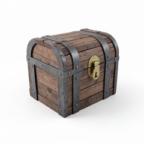
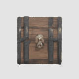
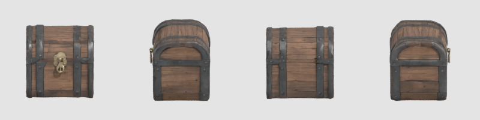
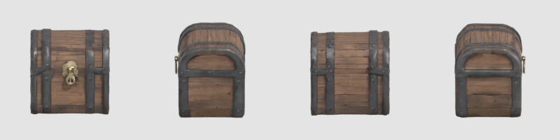
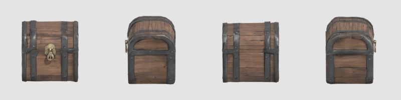
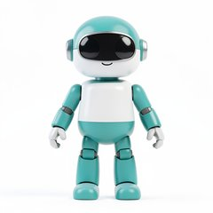
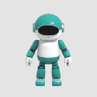
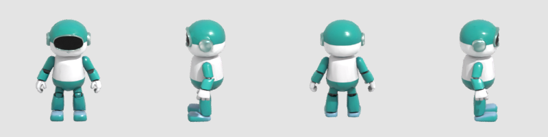
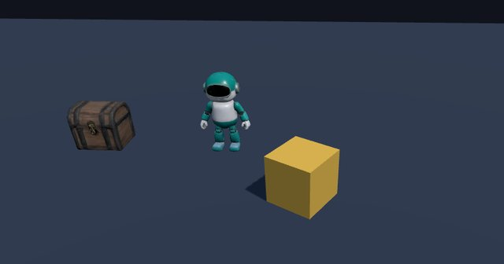

# Meshwright showcase: a prop and a character, from prompt to engine

Two kit test subjects made with Meshwright (`core/tools/meshwright/`, `tools/meshwright/` in a game) on one machine,
start to finish, with what went wrong shown next to what went right. Nothing here comes from anyone's own game.

Machine: Windows 11, RTX 5060 Ti 16 GB, 64 GB RAM, ComfyUI 0.43.0, Blender 5.2.3, Godot 4.7.2, Three.js r186
(2026-11-05, K01 / E150). The games were fresh kit scaffolds (`scripts/new_game.py --engine godot`, `--engine web-3d`).

## The commands
From the Godot game's root folder:
```
python tools/meshwright/meshwright.py check

# the prop: picture and mesh in one go
python tools/meshwright/meshwright.py make prop_chest --prompt "a sturdy wooden treasure chest with iron bands and a brass lock" --seed 11 --lods 0.5

# the character: audition two pictures (about 10 s each), then make the better one
python tools/meshwright/meshwright.py make npc_robot --prompt "a small friendly cartoon robot with a round head, two arms and two legs, painted teal and white" --class npc --seed 21 --reference-only
python tools/meshwright/meshwright.py make npc_robot --prompt "(same)" --class npc --seed 22 --reference-only
python tools/meshwright/meshwright.py make npc_robot --image assets_src/meshwright/npc_robot/reference_seed22.png --class npc --seed 22

# into the engine
python tools/dev.py import        # Godot: a new .glb is imported here (test and smoke do not re-import for it)
python tools/dev.py test          # a GUT test loads both and measures them (below)
python tools/dev.py smoke
```
For the web-3d game the two `.glb` files were copied to `public/assets/models/` (Meshwright's default folder there)
and loaded with Three.js's `GLTFLoader` from the game's scene; `python tools/dev.py smoke --until "MODEL_OK npc_robot"
--screenshot shot.png` waited for both and took the picture below.

The stills were rendered with Meshwright's own turntable script, the GIFs with the kit's frames_to_gif.py:
```
blender -b --python-exit-code 1 -P tools/meshwright/turntable.py -- assets/models/prop_chest.glb --out chest_clean.png --views 4 --cols 4 --size 200 --background "#e4e4e4"
blender -b --python-exit-code 1 -P tools/meshwright/turntable.py -- assets/models/prop_chest.glb --out sheet.png --views 1 --size 160 --frames-dir frames --frames 24 --background "#e4e4e4"
python tools/art/frames_to_gif.py frames chest_turntable.gif --fps 12 --width 160 --colors 64
```

## The prop: prop_chest
| Reference (FLUX.2 klein, seed 11) | Turntable |
|---|---|
|  |  |

Raw from TRELLIS.2 (front, left, back, right):

Cleaned, 1.0 m tall, pivot at the bottom centre:

LOD1 (half the triangles):


| Step | Result |
|---|---|
| Reference | 8 s on the GPU |
| TRELLIS.2 (normal quality) | 443 s (the model had to load again after the klein job), VRAM peak 13.9 GB, 2,698 triangles out of ComfyUI (decimated to 90% of the prop budget) |
| Cleanup | 704 vertices merged, 1 part, nothing dropped, scaled to 1.0 m (1.08 x 0.96 m footprint) |
| Export | 2,697 triangles; LOD1 1,347 |
| Budget check (`--class prop`) | Passed. One warning: texel density varies 6.8x between 68 UV islands (coverage 66%) |
| Whole `make` | 465 s; asset log row A-0001, evidence file, the three licence texts in `docs/licenses/` |

What it got wrong:
- **The lid is not a lid.** The chest is one closed shell: no separate lid to open, no inside. A chest that opens needs
  the lid cut off and re-pivoted by hand or by script (SOP-11).
- **The back is invented**, and plain: the brass lock exists only on the front, which is right, but the back's straps
  are TRELLIS.2's guess from one view.
- **Every LOD file carries its own copy of the textures** (2.7 MB each): `tools/blender/prep_export.py` writes each LOD as a
  complete `.glb`. Fine for a prop, wasteful for a set of LODs per model.
- At 200 px the raw and the cleaned chest look the same: ComfyUI already decimated it to the budget, so cleanup's
  work here was the scale, the pivot and the welded seams, not the shape.

## The character: npc_robot
| The two auditioned pictures | Used: seed 22 | Turntable |
|---|---|---|
| Seed 21's arms sat close to the body; seed 22 had clear gaps, which help TRELLIS.2 keep the arms separate |  |  |

Raw (front, left, back, right):

Cleaned, 1.8 m tall:

LOD1:


| Step | Result |
|---|---|
| TRELLIS.2 (normal quality, model already loaded) | 140 s, VRAM peak 13.8 GB, 13,500 triangles (90% of the npc budget) |
| Cleanup | 4,244 vertices merged, 3 parts (all kept: each over 1% of the faces), 1.8 m tall (1.17 x 0.71 m) |
| Export | 13,500 triangles; LOD1 6,750 |
| Budget check (`--class npc`) | Passed every check: 381 UV islands, coverage 63%, texel spread 1.6x |
| Whole `make` | 151 s |

What it got wrong:
- **The smile is gone.** The reference's small mouth under the visor did not survive; the face is the black visor only.
- **The ear pieces came out as glossy, glass-like domes** (the baked metallic and roughness maps), and **the feet
  turned pale blue** instead of the reference's teal.
- **The back is invented**: a plain white and teal shell.
- **No rig.** It is a statue: a stand-in NPC, a prop, or a sprite source (`--sprites`). Rigging and animation are
  SOP-11 work, not Meshwright's.
- Chunky, toy-like proportions came through faithfully (1.17 m wide at 1.8 m tall): the class height scales the
  whole model, so a chibi reference gives a wide 1.8 m character. Pass `--height` for what the game needs.

## In the engines


- **web-3d (Three.js r186)**: `GLTFLoader` loaded both in the headless smoke (`MODEL_OK prop_chest tris=2697
  height=1.000 minY=0.0000`, `MODEL_OK npc_robot tris=13500 height=1.800 minY=0.0000`), no console errors. The
  yellow box is the starter's 1 m cube: the scale is right.
- **Godot 4.7.2**: `dev.py import`, `check` (55 files), `test` (76 GUT tests, including one that instantiates both
  `.glb` scenes and measures them: 1.0 m and 1.8 m tall, bottom at 0) and `smoke` passed. Found on the way: Godot's
  `dev.py test` and `smoke` re-import only when `class_name` scripts change, so a model added after the last import
  is not seen until `dev.py import` runs (Meshwright says so after `make`).

## Earlier: the research run
Before Meshwright existed, the same workflow ran on a barrel drawn in code (1536 quality: 1,138 s cold, 15.9 GB
device peak, 19,996 triangles; 1024 warm: 281 s). The barrel's shape was right but **its top came back open**, in
both runs: TRELLIS.2 read the dark top face as a hole. A lid you can see clearly in the picture avoids it.

## Take-aways
- One clean picture per object: whole, centred, plain background, three-quarter view (characters: front, A-pose,
  gaps between arms and body). Audition pictures with `--reference-only`; they cost seconds, a mesh costs minutes.
- Budget is not the problem (both passed); shape and material details are. Look at the turntable every time.
- Treat each model as a draft: a fine background prop or stand-in as is, a starting point for anything the player
  handles or looks at closely.
