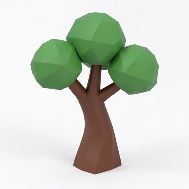
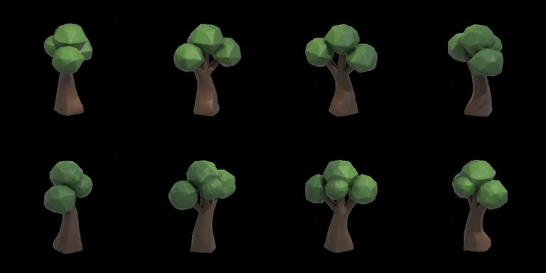
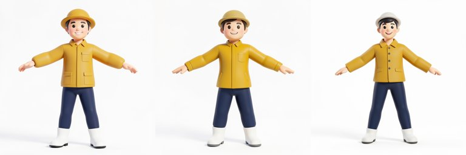
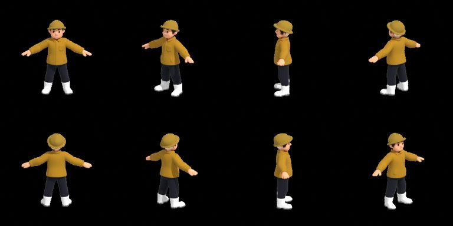
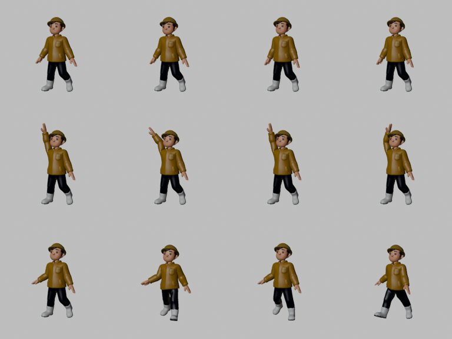
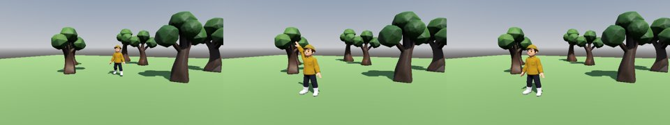

# Picture to game: a tree and an animated character, from one picture each

Two kit test subjects taken from a single generated picture to a running Godot scene on one machine: a tree that
stands in a grove, and a character that walks in, waves and idles. Every step runs locally. What went wrong is shown
next to what went right. Nothing here comes from anyone's own game.


Machine: Windows 11, RTX 5060 Ti 16 GB (Blackwell), 64 GB RAM, ComfyUI 0.43.0, Blender 5.2.3, Godot 4.7.2
(2026-11-05, K01 / E152). The game was a fresh kit scaffold (`scripts/new_game.py --engine godot`).

| Step | Tool | Tree | Character |
|---|---|---|---|
| Picture | FLUX.2 klein 4B (Bozzetto `--reference-only`) | 3 seeds, about 10 s each | 6 seeds, two rounds |
| Mesh, cleanup, budget check, asset log | Bozzetto (`tools/bozzetto/`) | 173 s, passed | failed twice, passed with `--material vertex` |
| Skeleton and skin weights | UniRig (`src/run_unirig.sh`) | n/a | 81 s |
| Animation: idle, wave, walk | Claude-written Blender script (`src/animate_rig.py`) | n/a | a few seconds |
| In the engine | Godot (`src/showcase.gd`) | 6 trees placed | plays the three clips |

## The commands
From the Godot game's root folder:
```
# pictures: audition seeds for seconds each, keep the best
python tools/bozzetto/bozzetto.py make kit_tree --class kit --prompt "a stylized low-poly game tree with a thick curved brown trunk and three large rounded green leaf clumps" --seed 31 --reference-only
python tools/bozzetto/bozzetto.py make npc_beekeeper --class npc --prompt "a stylized game character, a cheerful beekeeper in a mustard yellow jacket, navy trousers and white boots, arms held straight out to the sides at 45 degrees away from the body, legs apart, simple shapes" --seed 52 --reference-only

# meshes
python tools/bozzetto/bozzetto.py make kit_tree --class kit --image assets_src/bozzetto/kit_tree/reference_seed31.png --seed 31
python tools/bozzetto/bozzetto.py make npc_beekeeper --class npc --image assets_src/bozzetto/npc_beekeeper/reference_seed52.png --seed 53 --material vertex

# rig (free ComfyUI's VRAM first: UniRig needs nearly all 16 GB), then animate
curl -X POST http://127.0.0.1:8188/free -H "Content-Type: application/json" -d "{\"unload_models\": true, \"free_memory\": true}"
UNIRIG_DIR=<your UniRig checkout> bash src/run_unirig.sh assets/models/npc_beekeeper.glb beekeeper
blender -b --python-exit-code 1 -P src/animate_rig.py -- <UniRig>/results/beekeeper/rigged.glb --out assets/models/npc_beekeeper_animated.glb --sheet clips.png

# into the engine (showcase.gd on a Node3D scene made the main scene)
python tools/dev.py import
python tools/dev.py smoke --frames 660 --record captures/frames
python tools/art/frames_to_gif.py captures/frames in_engine_godot.gif --fps 15 --width 480
```
`src/` paths are this folder's; copy the three files into the game (or run them from here).

## The tree: kit_tree


The prompt asked for chunky, separate leaf clumps on purpose: TRELLIS.2 merges or drops thin parts (Bozzetto's
README, "What to expect"), so a tree with fine twigs and single leaves is the wrong first test. All three seeds gave a
usable picture; seed 31 has the clearest gaps between the clumps.



`kit` class: 7,200 triangles, 3.0 m tall, an LOD at half, 173 s for the whole `make`. The validator passed it with one
warning (texel density 2.1x between UV islands). The back was invented and still reads as the same tree from every
side. In Godot six copies, turned and scaled (0.9x to 1.3x), make a grove that does not look like one tree six times.

## The character: npc_beekeeper
### Round 1: rejected before any GPU time
The first prompt (a young traveller in a short green cloak, brown boots, a satchel) gave three clean pictures, and all
three were thrown away, for two reasons:
- **It looked too much like a famous game hero.** Green tunic, brown boots and hair, a satchel: nothing in the
  prompt named anyone, but the kit should not ship a look-alike. Change the palette and the outfit.
- **The arms hung against the body.** An auto-rigger then binds arm and torso skin together, and the arm cannot move
  on its own. Ask for the pose you need: arms out at 45 degrees, legs apart.



Round 2 fixed both. Seed 52 is the cleanest A-pose.

### The budget check said no, twice
`make` with the baked texture failed the `npc` budget on two 3D seeds: **UV coverage 51%, then 53%, under the 55%
floor** (TRELLIS.2's own unwrap of a character makes many small islands). Nothing was copied into the game either
time; the files stayed in `assets_src/bozzetto/npc_beekeeper/`. Copying the export in by hand would have worked and
would have been the wrong lesson. The run that passed used `--material vertex`: colours in the vertices, a UV map
from Blender's Smart UV Project, no bake. For a flat-coloured stylized character that loses little.



13,500 triangles, 1.8 m tall. (The 3D step took 2 s because ComfyUI reused the cached shape from the textured run
with the same picture and seed; a first run is about 100 s on the GPU.)

### Rigging: UniRig
[UniRig](https://github.com/VAST-AI-Research/UniRig) predicts a skeleton and skin weights for any mesh (E151). On the
beekeeper: 52 bones (fingers included), every vertex weighted, 81 s, peak 15.9 GB of VRAM. The bones are named
`bone_0` to `bone_51`, nothing says which one is an arm.

Licences: code MIT; the released checkpoint's card says MIT and it was trained on Articulation-XL2.0 (CC-BY-4.0:
credit it, as `docs/licenses/` and `tools/credits.py` do for Bozzetto's models). Its successor SkinTokens rigs better
but adds training data from VRoid Hub and ModelsResource (models taken from commercial games), so it is not used here.

Setup, in its own Python env (never ComfyUI's), with **standard wheels only**: no flash_attn, no Triton, no
community builds. `src/patch_unirig.py` makes four small changes to the checkout so it runs without them (the header
lists them; it is safe to run twice, and `--check` only reports):
```
git clone https://github.com/VAST-AI-Research/UniRig && cd UniRig
python <this folder>/src/patch_unirig.py .
uv venv --python 3.11 .venv          # bpy 4.2 pins Python 3.11
uv pip install torch==2.7.0 torchvision==0.22.0 --index-url https://download.pytorch.org/whl/cu128   # cu128: first CUDA with Blackwell
uv pip install torch_scatter torch_cluster -f https://data.pyg.org/whl/torch-2.7.0+cu128.html
uv pip install spconv-cu126
uv pip install -r requirements.txt numpy==1.26.4    # remove its flash_attn line first
```
Tested on a fresh clone (UniRig 6793c66) with that env: the beekeeper rigged in 82 s, peak 15.6 GB, every vertex
weighted. The flash_attn-free path matches the flash one: the same 45 joints exactly, and skin weights as close as two
runs of the flash env are to each other (GPU scatter and sparse convolution are not bit-for-bit repeatable: mean
difference 0.0004 both ways, the same strongest bone for 99% of points). `src/mha_sdpa.py` is the stand-in for
flash_attn's attention class: same weights, outputs within 1e-7.

How it got there. The first working env used a community flash_attn wheel and `triton-windows`, and three things
broke, each silently or nearly:
1. **Triton.** Not a UniRig bug: `transformers` imports flash_attn's rotary layer whenever flash_attn is installed,
   and that needs Triton, which PyTorch does not ship on Windows. Fix: `triton-windows`.
2. **The skin checkpoint would not load.** It pickles a python-box `Box`, and PyTorch 2.6+ loads weights only. The
   error offers `weights_only=False`, which lets the file run code. Do not: allowlist that one class instead, at the
   top of run.py in the UniRig checkout:
   ```python
   import torch, box
   torch.serialization.add_safe_globals([box.box.Box])
   ```
3. **A rig that does not move, with exit 0 everywhere.** flash_attn's kernels returned wrong results at head
   dimension 16 on this GPU (up to 1.35 off PyTorch's own attention; 0.0002 at 32 and 64), and the skin model's point
   encoder (PTv3) uses 16 at every stage. The skin prediction came out 100% NaN, the merge turned NaN into zeros, and
   the glTF put every vertex on a placeholder bone: a file with a skeleton that deforms nothing. Fix: in the UniRig
   checkout's skin model config (configs/model/unirig_skin.yaml), under `mesh_encoder:`, add `enable_flash: False`
   (PTv3's own attention path).
   It costs memory: the 15.9 GB peak above. Check every rig: a vertex count per bone, not just "weighted" (a check that
   counts the placeholder bone as a bone passes this broken rig).

Then the question was whether flash_attn was needed at all. UniRig's skin model builds flash_attn's attention class
with its defaults, and those run plain PyTorch, not flash kernels; the skeleton model's transformer accepts PyTorch's
own `sdpa`. With a stand-in class and one config line, nothing needs flash_attn, so nothing needs Triton, and the
head_dim-16 bug cannot happen: the setup above.

### Animation: written, not generated
No local tool makes game animation you can ship (pose-from-video tools build on SMPL-X, which is non-commercial), so
Claude wrote it: `src/animate_rig.py` finds the body from the skeleton's shape and keys three loops.
- **Spine and head**: the path from the root to the highest bone tip.
- **Limbs**: everything hanging off the spine. The two reaching the floor are legs, the two reaching farthest out
  sideways are arms; left and right by the sign of X. A third limb on the floor stops it: quadrupeds need their own
  gaits (the script says so and exits 1).
- **Motion**: rotations chosen in the character's frame (side, front, up) and converted into each bone's own frame,
  so UniRig's arbitrary bone rolls never flip a swing. Arms first drop from the A-pose to a relaxed angle measured from
  their own rest pose, then sway (idle), counter-swing (walk) or wave.



Game-jam quality, not mocap: the walk has no foot planting, and the wave is one arm on a loop. Every number is a
constant at the top of the script.

What went wrong on the way, so you do not repeat it:
- A first check counted a vertex as weighted when its weight went to glTF's placeholder bone (`neutral_bone`); see
  rigging point 3.
- The wave raised the wrong way (the arm swung down across the body): the sign of a rotation about the front axis
  flips with the side the arm is on, and the first version had it backwards. Look at the preview sheet every time.
- A checker that read the glTF's min and max per animation channel said every clip was flat. glTF only requires
  min and max on the time track, so the checker was wrong, not the clips: decode the key values themselves.

## In the engine


`src/showcase.gd` builds the scene in code: sky, sun with shadows, ground, six trees, the character walking from
the back of the grove, then wave for two seconds, then idle, with a quarter-second blend between clips. Two Godot
notes:
- glTF clips import without looping: set `loop_mode = Animation.LOOP_LINEAR` on each.
- **A vertex-coloured model renders white.** Godot 4.7.2 imports `COLOR_0` but leaves
  `vertex_color_use_as_albedo` off on the material; the script turns it on (`_use_vertex_colours`).

## Take-aways
- Pick subjects the generator is good at: chunky stylized shapes, an A-pose with clear gaps. The prompt is part of the
  pipeline.
- The budget check is the point. Twice it stopped a model that looked fine; the fix was a setting, not a bypass.
- Exit codes lie. Three separate steps finished with 0 while producing nothing usable (NaN skin weights, a rig on a
  placeholder bone, a checker reading the wrong field). Look at the picture, decode the numbers.
- The tools make the parts; the glue is the work: finding an arm in `bone_25`, a sign per side, a material flag in the
  engine.
