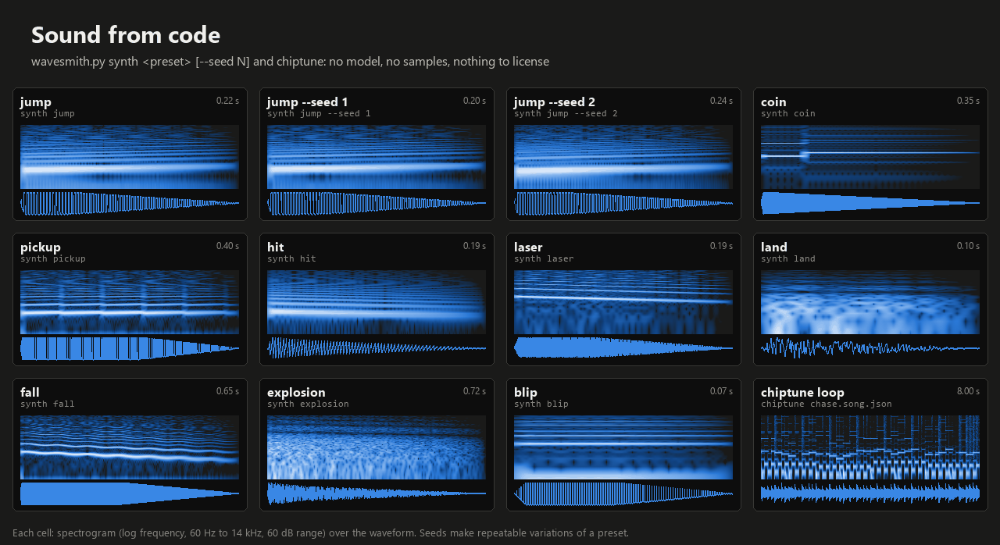
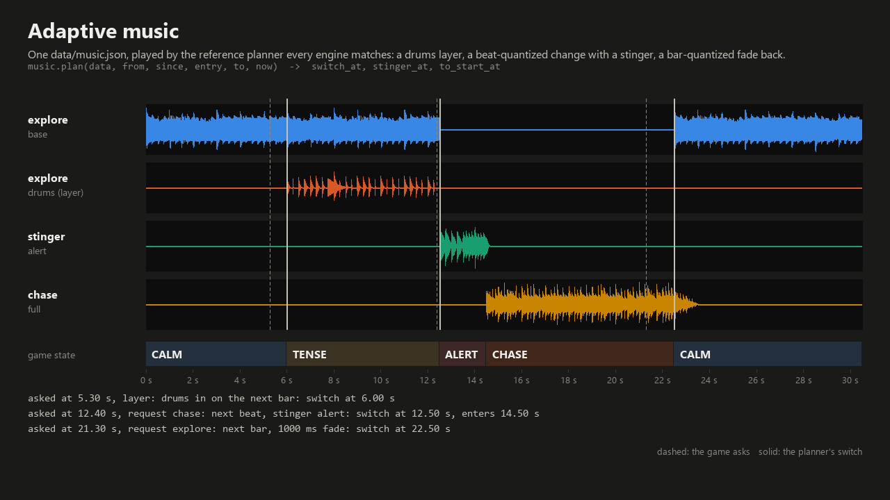
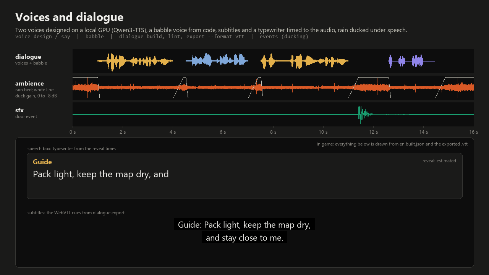
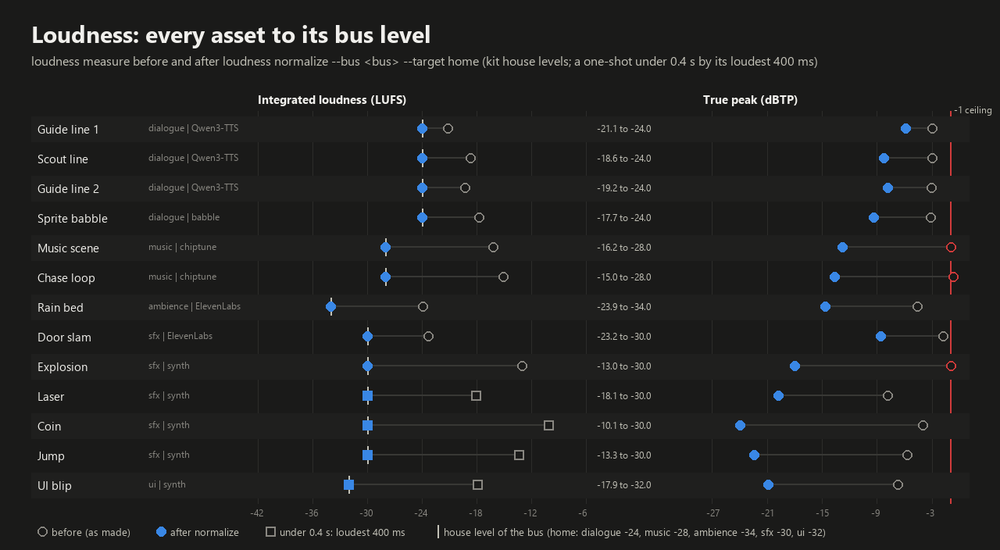
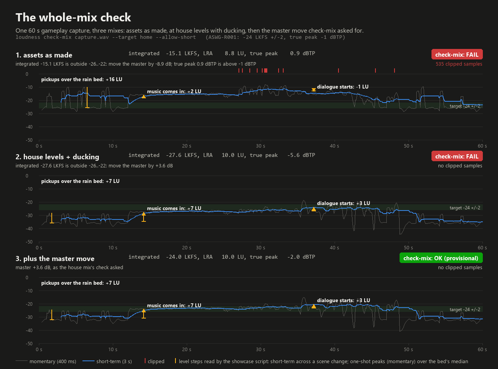

# Wavesmith showcase (audio)

The audio twin of [local pixel art](../local-pixel-art/README.md): what Wavesmith (`tools/audio/wavesmith/` in every
game, `core/tools/audio/wavesmith/` in the kit) makes and checks, as short videos and charts. Every sound here came
from a Wavesmith command; `build_showcase.py` in this folder only places the sounds in time, mixes them the way the
engines play them, and draws the pictures. It ran on one test machine (Windows 11, RTX 5060 Ti 16 GB, Python 3.14,
ffmpeg 9.0.2), so treat every time here as a data point.

| Media | What it shows | Length | Size |
|---|---|---|---|
| [wavesmith_code.mp4](media/wavesmith_code.mp4) | Eleven retro effects from `synth` presets and seeds, then a `chiptune` loop played twice | 26.7 s | 0.8 MB |
| [wavesmith_code_sheet.png](media/wavesmith_code_sheet.png) | The same sounds as a sheet: spectrogram and waveform per sound | still | 220 KB |
| [wavesmith_music.mp4](media/wavesmith_music.mp4) | Adaptive music: calm, a drums layer for tension, a beat-quantized change to the chase with a stinger, a bar-quantized fade back | 30.5 s | 0.7 MB |
| [wavesmith_music.png](media/wavesmith_music.png) | The music timeline: stems, requests and the planner's switch points | still | 23 KB |
| [wavesmith_dialogue.mp4](media/wavesmith_dialogue.mp4) | Two voices made on the local GPU, a babble voice from code, the typewriter and the subtitles timed to the audio, a captioned door, rain ducked under speech | 16.0 s | 0.35 MB |
| [wavesmith_dialogue.png](media/wavesmith_dialogue.png) | One frame of it (the typewriter mid-line, the full subtitle cue) | still | 25 KB |
| [wavesmith_loudness.png](media/wavesmith_loudness.png) | 13 assets before and after `loudness normalize --bus`: loudness and true peak | chart | 29 KB |
| [wavesmith_mix_check.png](media/wavesmith_mix_check.png) | One 60 s capture mixed three ways and run through `loudness check-mix`: clipping, level steps, the verdict | chart | 46 KB |

Videos are H.264 + AAC (mono, 96 kb/s) at 1280x720 and 30 fps. Their audio is normalized to -16 LUFS so they play
at one level (the dialogue clip stops at -20.5 LUFS, where its loudest peak meets the -1 dBTP ceiling).

## Listen
Every sound is in `media/` twice: OGG (what games ship and what the build reads) and an MP3 copy (Safari and some
phones do not play OGG). GitHub serves repository files as downloads, so the links below go through jsDelivr, a free
CDN for public GitHub repositories that serves them as audio: they play in the browser, phones included. The links are
pinned to commit 83b341a, so they keep working; the same files are in `media/` here.

| Sound | MP3 | OGG |
|---|---|---|
| Synth: jump, coin, explosion (code) | [jump](https://cdn.jsdelivr.net/gh/Er2oneousbit/claude-code-game-kit@83b341a/workflows/wavesmith-showcase/media/synth_jump.mp3), [coin](https://cdn.jsdelivr.net/gh/Er2oneousbit/claude-code-game-kit@83b341a/workflows/wavesmith-showcase/media/synth_coin.mp3), [explosion](https://cdn.jsdelivr.net/gh/Er2oneousbit/claude-code-game-kit@83b341a/workflows/wavesmith-showcase/media/synth_explosion.mp3) | [jump](https://cdn.jsdelivr.net/gh/Er2oneousbit/claude-code-game-kit@83b341a/workflows/wavesmith-showcase/media/synth_jump.ogg), [coin](https://cdn.jsdelivr.net/gh/Er2oneousbit/claude-code-game-kit@83b341a/workflows/wavesmith-showcase/media/synth_coin.ogg), [explosion](https://cdn.jsdelivr.net/gh/Er2oneousbit/claude-code-game-kit@83b341a/workflows/wavesmith-showcase/media/synth_explosion.ogg) |
| Chiptune: explore, drums layer, chase, alert stinger (code) | [explore](https://cdn.jsdelivr.net/gh/Er2oneousbit/claude-code-game-kit@83b341a/workflows/wavesmith-showcase/media/chiptune_explore_base.mp3), [drums](https://cdn.jsdelivr.net/gh/Er2oneousbit/claude-code-game-kit@83b341a/workflows/wavesmith-showcase/media/chiptune_explore_drums.mp3), [chase](https://cdn.jsdelivr.net/gh/Er2oneousbit/claude-code-game-kit@83b341a/workflows/wavesmith-showcase/media/chiptune_chase.mp3), [alert](https://cdn.jsdelivr.net/gh/Er2oneousbit/claude-code-game-kit@83b341a/workflows/wavesmith-showcase/media/chiptune_alert.mp3) | [explore](https://cdn.jsdelivr.net/gh/Er2oneousbit/claude-code-game-kit@83b341a/workflows/wavesmith-showcase/media/chiptune_explore_base.ogg), [drums](https://cdn.jsdelivr.net/gh/Er2oneousbit/claude-code-game-kit@83b341a/workflows/wavesmith-showcase/media/chiptune_explore_drums.ogg), [chase](https://cdn.jsdelivr.net/gh/Er2oneousbit/claude-code-game-kit@83b341a/workflows/wavesmith-showcase/media/chiptune_chase.ogg), [alert](https://cdn.jsdelivr.net/gh/Er2oneousbit/claude-code-game-kit@83b341a/workflows/wavesmith-showcase/media/chiptune_alert.ogg) |
| Voices: guide, scout (local GPU) and a babble voice (code) | [guide 1](https://cdn.jsdelivr.net/gh/Er2oneousbit/claude-code-game-kit@83b341a/workflows/wavesmith-showcase/media/voice_guide_1.mp3), [guide 2](https://cdn.jsdelivr.net/gh/Er2oneousbit/claude-code-game-kit@83b341a/workflows/wavesmith-showcase/media/voice_guide_2.mp3), [scout](https://cdn.jsdelivr.net/gh/Er2oneousbit/claude-code-game-kit@83b341a/workflows/wavesmith-showcase/media/voice_scout_1.mp3), [babble](https://cdn.jsdelivr.net/gh/Er2oneousbit/claude-code-game-kit@83b341a/workflows/wavesmith-showcase/media/babble_sprite.mp3) | [guide 1](https://cdn.jsdelivr.net/gh/Er2oneousbit/claude-code-game-kit@83b341a/workflows/wavesmith-showcase/media/voice_guide_1.ogg), [guide 2](https://cdn.jsdelivr.net/gh/Er2oneousbit/claude-code-game-kit@83b341a/workflows/wavesmith-showcase/media/voice_guide_2.ogg), [scout](https://cdn.jsdelivr.net/gh/Er2oneousbit/claude-code-game-kit@83b341a/workflows/wavesmith-showcase/media/voice_scout_1.ogg), [babble](https://cdn.jsdelivr.net/gh/Er2oneousbit/claude-code-game-kit@83b341a/workflows/wavesmith-showcase/media/babble_sprite.ogg) |
| Effects: rain, door (ElevenLabs free plan, non-commercial) | [rain](https://cdn.jsdelivr.net/gh/Er2oneousbit/claude-code-game-kit@83b341a/workflows/wavesmith-showcase/media/eleven_rain.mp3), [door](https://cdn.jsdelivr.net/gh/Er2oneousbit/claude-code-game-kit@83b341a/workflows/wavesmith-showcase/media/eleven_door.mp3) | [rain](https://cdn.jsdelivr.net/gh/Er2oneousbit/claude-code-game-kit@83b341a/workflows/wavesmith-showcase/media/eleven_rain.ogg), [door](https://cdn.jsdelivr.net/gh/Er2oneousbit/claude-code-game-kit@83b341a/workflows/wavesmith-showcase/media/eleven_door.ogg) |

## Videos in the main README
GitHub plays a video inside a README only from a file uploaded through its web editor (a `user-attachments` URL), not
from a file in the repo. The MP4s are committed here; to show them in the main README:
1. Open `README.md` on GitHub, click the pencil (Edit), and find the section "Wavesmith showcase (audio)" (right
   after "Experimental: local pixel art").
2. Drag each file from your copy of `workflows/wavesmith-showcase/media/` into the editor, each on its own line:
   - `wavesmith_code.mp4` after the sound sheet image (sound from code),
   - `wavesmith_music.mp4` after the music timeline image (adaptive music),
   - `wavesmith_dialogue.mp4` after the dialogue image (voices and dialogue).
3. GitHub replaces each drop with a `https://github.com/user-attachments/assets/...` line that plays inline. Keep the
   images above them (they show in places that do not play video), change the line "The same three clips with sound
   are MP4s in ..." to say the videos play above, and commit.

## 1. Sound from code


`synth` makes retro effects from presets; a seed makes a repeatable variation (`jump --seed 1`, `--seed 2`). Each WAV
gets a `.sfx.json` recipe that renders it again exactly. `chiptune` renders a song written as text patterns (one bar
per pattern, `C5 - E5 .` style) to a WAV whose loop point is on the bar grid, so the loop in the video has no seam.
No model and no samples: these sounds are yours to ship.
```
python core/tools/audio/wavesmith/wavesmith.py synth jump --out jump.wav
python core/tools/audio/wavesmith/wavesmith.py synth jump --seed 2 --out jump_s2.wav
python core/tools/audio/wavesmith/wavesmith.py synth explosion --out explosion.wav     # also coin pickup hit laser land fall blip
python core/tools/audio/wavesmith/wavesmith.py chiptune workflows/wavesmith-showcase/src/chase.song.json --out chase.wav
```
Each sound renders in well under a second.

## 2. Adaptive music


`src/music.json` is the data a game ships: two tracks at 120 BPM on a 4-bar loop (`explore` with a `base` and a
`drums` stem, `chase` with one), a one-bar `alert` stinger, and two transition rules (to the chase on the next beat
with the stinger; back on the next bar with a 1 s fade). The stems are chiptune songs (`src/*.song.json`), checked
with `music validate`. The game script asks for things at awkward moments, and `music.plan()`, the reference that
every engine's music player matches sample for sample (`data/golden/music.json`), decides when they happen:

| The game asks | At | The planner answers |
|---|---|---|
| drums layer in (tension) | 5.30 s | the next bar: 6.00 s (the game sets the stem gain there) |
| change to `chase` | 12.40 s | the next beat: 12.50 s, the stinger plays, the chase enters after its bar at 14.50 s |
| change to `explore` | 21.30 s | the next bar of the chase: 22.50 s, the chase fades over 1 s |

The mix follows the web overlay's music player (`engines/web/skeleton/src/shell/musicPlayer.ts`): one looping voice
per stem from the track's start, a stem gain, a track gain that fades on a transition, the stinger at the switch. It
is rendered by the script, not recorded from an engine.
```
python core/tools/audio/wavesmith/wavesmith.py chiptune workflows/wavesmith-showcase/src/explore_base.song.json --out music/explore_base.wav
python core/tools/audio/wavesmith/wavesmith.py music validate workflows/wavesmith-showcase/src/music.json --root <folder above music/>
python core/tools/audio/wavesmith/wavesmith.py music plan workflows/wavesmith-showcase/src/music.json --from explore --to chase --at 12.4
```

## 3. Voices and dialogue


Two voices designed from a description on the local GPU (Qwen3-TTS through `voice`), one gibberish voice from code
(`babble`), all in `src/dialogue.json`. `dialogue build` turns lines and voice files into the file the engines read:
per-character reveal times for the typewriter (estimated from the voice for the spoken lines, exact from babble's
timeline), subtitle cues cut to the reading-speed and line-length guidelines, and the door's SFX caption from
`src/audio_events.json` (directional, so the game draws an arrow). `dialogue export` wrote
[wavesmith_dialogue.vtt](media/wavesmith_dialogue.vtt), which the video shows as it is. The rain ducks 8 dB under
speech by the rule in `audio_events.json`, computed by the reference audio director every engine follows.

The voices (made once; the script reads the OGGs in `media/`). Set `LOCAL_TTS_PYTHON` to the TTS environment's python
and `HF_HOME` to where the weights are (setup: `core/docs/resources/audio.md`, "Local voices"):
```
python core/tools/audio/wavesmith/wavesmith.py voice design "a warm, steady woman in her forties, clear mid-low voice, calm unhurried pace, neutral accent" --out guide_ref.wav --seed 7
python core/tools/audio/wavesmith/wavesmith.py voice design "an eager young man, bright voice, quick pace, a little out of breath, neutral accent" --out scout_ref.wav --seed 7
python core/tools/audio/wavesmith/wavesmith.py voice say --ref guide_ref.wav --lines workflows/wavesmith-showcase/src/guide.txt --out guide.wav --seed 7
python core/tools/audio/wavesmith/wavesmith.py voice say --ref scout_ref.wav --lines workflows/wavesmith-showcase/src/scout.txt --out scout.wav --seed 7
python core/tools/audio/wavesmith/wavesmith.py formats convert guide_1.wav --out workflows/wavesmith-showcase/media/voice_guide_1.ogg
```
Times on the 16 GB card: a design took 40 to 47 s and a `say` run 27 s (one line) to 42 s (two lines), most of it
loading the model; the lines themselves took 8.8 to 12.1 GPU seconds for 2.5 to 3.5 s of speech. All three lines
came back word for word in a Whisper large-v3-turbo transcript on the first seed. The `.gen.json` of every take is in
`src/provenance/` (persona, seed, model, licence, SHA-256 of the WAV).

The rest is code and data:
```
python core/tools/audio/wavesmith/wavesmith.py babble "Psst! Over here. The gate is open!" --voice sprite --out voice/sprite.wav
python core/tools/audio/wavesmith/wavesmith.py dialogue build workflows/wavesmith-showcase/src/dialogue.json --root <folder> --events workflows/wavesmith-showcase/src/audio_events.json --out en.built.json
python core/tools/audio/wavesmith/wavesmith.py dialogue lint workflows/wavesmith-showcase/src/dialogue.json --root <folder>
python core/tools/audio/wavesmith/wavesmith.py dialogue export en.built.json --sequence river --format vtt --out river.vtt
```

## 4. Mix and loudness


Assets arrive at whatever level their maker chose: the chiptune at -15 LUFS, the voices around -19, a code-made coin
whose loudest 400 ms reads -10, true peaks up to -0.7 dBTP (over the -1 ceiling). `loudness normalize --bus <bus> --target home` puts each
at the kit's house level for its bus (dialogue -24, music -28, ambience -34, sfx -30, ui -32 LUFS; starting points,
not a standard), true peak never past -1 dBTP. One-shots shorter than 400 ms have no gated loudness and are matched
by their loudest 400 ms (the squares).



`loudness check-mix` judges the whole mix, as ASWG-R001 asks (-24 LKFS +/-2 at home, true peak at most -1 dBTP; a
real check wants 30 minutes of play, so these 60 s readings are provisional):

| Mix | Integrated | True peak | Clipped samples | check-mix |
|---|---|---|---|---|
| 1. assets as made | -15.1 LKFS | +0.9 dBTP | 535 | FAIL: move the master by -8.9 dB; true peak over -1 |
| 2. house levels + ducking | -27.6 LKFS | -5.6 dBTP | 0 | FAIL: move the master by +3.6 dB |
| 3. plus that master move | -24.0 LKFS | -2.0 dBTP | 0 | OK (provisional) |

The level steps on the chart are the script's reading of the curves: in the raw mix the pickups jump 16 LU over the
rain and the dialogue starts 1 LU *down* (buried under the music); at house levels the pickups sit 7 LU over the bed
and the dialogue rises 3 LU over the ducked music.
```
python core/tools/audio/wavesmith/wavesmith.py loudness measure "assets/**/*.wav" --json
python core/tools/audio/wavesmith/wavesmith.py loudness normalize coin.wav --bus sfx --target home --out coin_n.wav
python core/tools/audio/wavesmith/wavesmith.py loudness check-mix capture.wav --target home --allow-short
```
**A bug this found.** The first run of this chart put every one-shot under 0.4 s at -1 dBTP, about 25 LU over its
bus: `normalize` matched short sounds by true peak while `sets make` used their loudest 400 ms. Fixed in 0.8.3
(`loudness.max_momentary()`, shared by both; a regression test in `test_loudness.py`).

## Rebuild it
```
python workflows/wavesmith-showcase/build_showcase.py                    # all four, about 1.5 minutes
python workflows/wavesmith-showcase/build_showcase.py --only dialogue    # code | music | dialogue | mix
python workflows/wavesmith-showcase/build_showcase.py --export-sources   # also the code-made sources as OGG, and an MP3 copy of every OGG, in media/
```
Needs Python 3.8+ with numpy and Pillow (pictures only; Wavesmith itself needs neither) and ffmpeg on PATH. Work
files go to `build/` here (gitignored). The script prints every Wavesmith command it runs. Code-made sounds are
deterministic, so a rebuild gives the same audio; the voices and the two ElevenLabs effects are read from `media/`.

## Sources, credits and licences
| ID | Type | File(s) in repo | Source | Licence | Attribution | AI-assisted? | Notes |
|---|---|---|---|---|---|---|---|
| WS-01 | SFX | `media/synth_*.ogg` / `.mp3` (and every effect in the code clip) | Wavesmith `synth`, made from code | MIT, as the kit | none | no | presets and seeds in the build script |
| WS-02 | Music | `media/chiptune_*.ogg` / `.mp3`, `src/*.song.json` | Wavesmith `chiptune`, songs written for this showcase | MIT, as the kit | none | no | |
| WS-03 | Voice | `media/babble_sprite.ogg` / `.mp3` | Wavesmith `babble`, made from code | MIT, as the kit | none | no | |
| WS-04 | Voice | `media/voice_guide_1.ogg` / `.mp3`, `voice_guide_2.ogg`, `voice_scout_1.ogg` | Qwen3-TTS-12Hz-1.7B-VoiceDesign and -1.7B-Base on a local GPU, through `voice design` / `voice say` | Apache-2.0 (model cards, per the kit's register `core/tools/audio/wavesmith/LICENSES.md`, checked 2026-11-01) | none required | yes | designed voices from text descriptions, no cloning; neutral lines written for this showcase |
| WS-05 | SFX | `media/eleven_rain.ogg` / `.mp3` | ElevenLabs sound effects (`eleven_text_to_sound_v2`), free plan, prompt "steady light rain on a wooden roof, no thunder, ambience", 5 s, loop | ElevenLabs free plan: non-commercial only; **not covered by the kit's MIT licence** | "Sound effect generated with ElevenLabs" | yes | 50 credits, 2026-11-04 |
| WS-06 | SFX | `media/eleven_door.ogg` / `.mp3` | ElevenLabs sound effects, free plan, prompt "heavy wooden door slams shut in a stone hall", 2 s | ElevenLabs free plan: non-commercial only; **not covered by the kit's MIT licence** | "Sound effect generated with ElevenLabs" | yes | 20 credits, 2026-11-04 |
| WS-07 | Video, images | `media/wavesmith_*.mp4`, `*.png`, `*.vtt` | rendered by `build_showcase.py` from the sounds above | MIT, as the kit, except the ElevenLabs sounds inside the dialogue video's audio (WS-05, WS-06 terms) | as WS-05 and WS-06 | partly | |

Paid services used: ElevenLabs 70 credits (975 left before, 905 after, free plan). Fish Audio: none. Its public
voices are uploaded by users and many imitate real people, so the showcase uses only voices designed from a
description on the local GPU.

**Stable Audio is left out on purpose.** Wavesmith's `sfx` lane runs Stable Audio 3 in a local ComfyUI, but its output
is under the Stability AI Community License (free under USD 1M revenue, registration for commercial use, and the
T5Gemma text encoder brings Google's Gemma terms). Whether the kit's public examples may redistribute that output is
still an open question ([issue #92](https://github.com/Er2oneousbit/claude-code-game-kit/issues/92)), so none of it
is in this repo.

Not legal advice. The per-asset terms above are the source of truth; re-check them before reusing anything.
